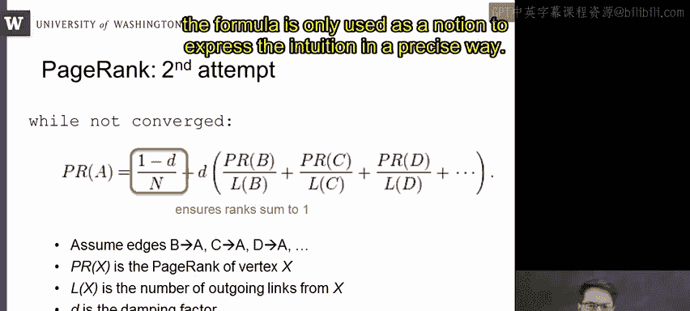

# 杜克大学《大规模数据科学（大数据操作，第1课／共3课有视频）｜Data Science at Scale》 - P114：113_PageRank详解.zh_en - GPT中英字幕课程资源 - BV12s421T7tJ

。

So you combine these two notions together and you get the definition of pay rank as it was published。

 and there's a couple of variations on this。This is the one to know。Okay， so while not converged。

The rank of。A vertex A is the sum of all the ranks of the vertices that link to A。

But each one is divided by the total number outgoing edges。

 so in this notation we assume that there are edges B linking to A， C linking to A D linking to A。

 and PR， the page rank of a vertex x is going to be the page rank of the vertex X L of x is the number of outgoing links from x and so for the page we take the page rank of B and divide by the number of outgoing links away from B。

Take the pay rank of a C divide by the number of a links away from C and so on， add all that up。

 and that's all the contribution to A， and then we multiply by a damping factor。

To make sure that what we pass on goes diminishes over time as we get further and further away and then this other term in this expression is just to ensure that all the ranks sum up to one so that we can sort of interpret them as probabilities and in fact you can directly interpret this as a probability。

Which is another way of looking at Page rank and deriving Page rank is to take random walks around around the Internet around the graph。

 right so you start on a random vertex and just start walking。

Make a choice at random among the edges， the outgoing edges and just traverse around well if you do this a bunch of times you can derive how likely it is that you'll spend time on some particular vertex versus some other particular vertex and that will exactly be the page rank and so this is sort of you know all roads lead back to Wikipedia or CNN or some other very you know important vertex in the web graph。

So that's page rank。 And what I want to point out before we move on is just the relative simplicity of this right it really comes out of an intuitive notion of trying to figure out how can we measure the importance of a vertex in the graph And so you know you start from very simple notions of well。

 maybe important means just the one with the highest number of edges the link to it well there's some problems with that。

 let's see we can fix it know maybe it's the one with the。

The most number of paths that go through it and maybe we don't care about all paths we care about shortest paths so that's gives you another notion of importance and you say well that's got some problems too you know what are the properties we really want here or maybe it kind of captures you know the importance of your friends needs to be added in there somehow and you can sort of。

Walk through this and come up with where pay drink。Came from。

 So the way it's presented just like a lot of these things are presented in terms of a finished formula。

 And then you kind have to work out back， you know， reverse engineer where it came from。

 But a lot of these things。Are developed very intuitively。

 and the formula is only used as an notion to express the intuition in a precise way。

