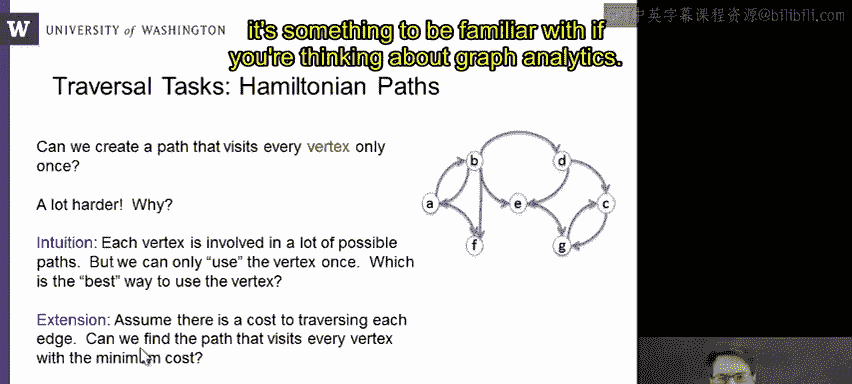
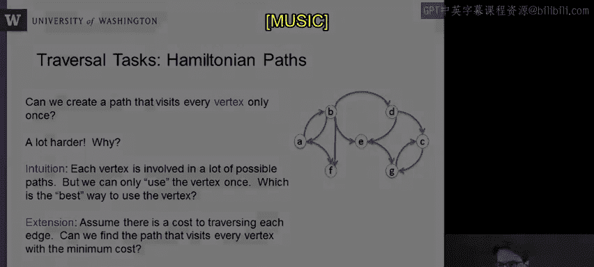

# 杜克大学《大规模数据科学（大数据操作，第1课／共3课有视频）｜Data Science at Scale》 - P115：114_遍历任务：生成树和回路.zh_en - GPT中英字幕课程资源 - BV12s421T7tJ

。

So we talked about structural analytics tasks， as broken down by this paper in 2012。

 what are some examples of traveral tasks。 So one is to find the minimum spanning tree of a graph。

 And so that is the smallest subset of edges that connect the graph by some notion notion of connectivity。

 So if we ignore directionality， we can talk about weekly connected graphs。

 So what is the minimum spanning tree of。This graph。

 so we're looking for the smallest set of edges a in with Spanish tree of this graph because there might be many that have the same number of edges in them。

A minimumt of this graph， Well， we can get from A to B。And again。

 we're going to ignore directionality。 So there's actually two edges from A to B。

 So we take one of those， and we get from B to F， and we get from B to E and we get them B to D。

 and then we get from D to C and E to G。 And so that's one edge，2 edge，3 edge，4 edge，5 edge，6 edge。

 And so the minimum spanning tree， the number of edges in the minimum spanning tree is。6， another。

Way to get6 is go from A to B and A to F。And then the same otherwise， B to D， B to E。

 D to C and E to G。Okay， so there's two different minimum span trees with the same number of reds in them。

And there are。Fast algorithms to compute this that we're not necessarily going to go into。

 This is sort of a guided tour of various tasks。 you might want compute。

 but we're not necessarily going to describe the algorithms in every case。

So another traversal oriented task is。Finding paths and circuits and so the you know classic example of this is Oulers Bridges of Consburg problem where the task is to find a path where we visit every vertex and yet cross every bridge in this graph here in the picture only。

Once and so the observation that was made here as well， if you enter by a bridge。

 you must also leave by a bridge。And you can't leave by the same one you came in on because that's the definition of the problem。

 so this suggests that there needs to be an even number of bridges to every vertex right you have to have one to come in on and one to go out on and then you can come come back to this vertex as many times as you want。

And so there's two sort of related results here。Going from the bottom one here first。

 if you actually want to start an end on the same。Vertex， well， the condition is。

That every vertex in the graph needs to have an even number of edges so that you can come in by one and you can leave by one。

 and this allows you to make an entire circuit。All the way around the graph if you don't care where you're starting end。

 you just start on one and end on another， then it's a little bit softer condition you can most of the vertices need to have an even number of edges。

But you can have at most two vertices that have an odd degree。

 the one you start on the one they end on because there you'll need to leave by one。

 you'll only to come in by one and I'm assuming undirected edges here。

 the definitions get slightly more complex if you talk about directed but not much。

 essentially you need to have a balance you know the same number of in degree edges and odd degree edges。

And so what's nice about this is a very， very。Great result because it's very easy to check this condition right。

 you can just add up the degrees of all the verrgies in the graph and you can tell whether one of these circuits or one of these paths。

Exist。But to sort of demonstrate them。Subttlety of some of these graph theoretic problems。

If you make a very slight change to the problem statement， the answer becomes a lot harder。

 so can we create a path that visits every vertex only once as opposed to every edge only once？Well。

 this is a hell of a lot harder and the reason is that intuitively， if you think about it， you know。

Every vertex has lots of edges， and so it's involved in lots of different paths。

 lots of different possible paths through the graph。

 and you're trying to find one of these such paths that touches every vertex only onces。 Well。

 given that this vertex is involved in lots of different paths。

You're only allowed to use that vertex one time。 and so you can imagine that it's difficult to figure out what is the best way to use this vertex。

 There's a whole lot of different conditions you have to consider。Okay。

A related problem is assume there's a cost to traversing each edge。

There's a distance you have to travel， for example。

 can we find a path that visits every vertex only once。

 but also has the minimum cost out of all these。And so there's no efficient algorithm that can exist for these problems and so heuristics and approximations are the best we can do and this extension here is the tribal and salesman problem。

Okay， so these might be some of the tasks you might want to do these actually come up。

 I would argue less often in a big data context。Especially this one。

 in part because it's such a difficult。Answer to compute。 And also。

 it's not clear that it's all that useful。 say in a social network context or in a web analytics context。

 You're not necessarily trying to find paths that touch every single vertex in the entire web。

 So this is， this tends to be。You knowThe only times when you're interested in touching every vertex in a graph。

 I'll claim is when the graph is in some sense， small。Okay。So this is less of a big data problem。

 but it's something to be familiar with if you're thinking about graph analytics。

