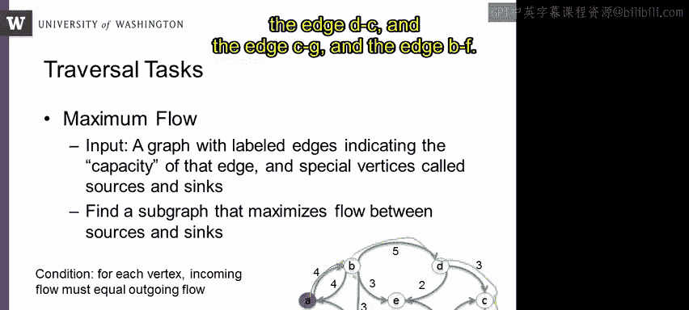

# 杜克大学《大规模数据科学（大数据操作，第1课／共3课有视频）｜Data Science at Scale》 - P116：115_遍历任务：最大流.zh_en - GPT中英字幕课程资源 - BV12s421T7tJ

。

And so one more traversal task。Just to be familiar with is maximum flow problems so here the input is a graph with labeled edges indicating the capacity at each edge and then special veres sources and sinks and the idea is to find a subgraph that maximizes flow between sources and sinks。

And so the observation here is that for each vertex， incoming flow must equal outgoing flow。

So in this example， if A is a source and F and G are the sinks。Then you can think about。

A subgraph where you just have a directly to f because it's only one hop away。

 And so the flow between them is two。 But if you look at a path A to B and then B to F。

 you get the flow of4 here and the flow from or the capacity of four here and the capacity of three here。

 which means the maximum flow along this is。3， right， there's some unused capacity on this edge。

 but three is still higher than two， and so that's we want to include that in the subgraph from A to F。

Okay， and then you get over to G， you can do sort of a similar walk。And say， well。

 one path is B to D through a capacity of5 and D to E through capacity of 2 and E to G through capacity of  two。

 and so the maximum flow here is two。While。A to B， B to D， D to C， and C to G。

 the maximum capacity is。Three， this edge is the weak link。Okay。

 so it looks like the max flow subgraph is ABF。DcG。Or rather。The A J B， the edge BD。The EDC。

In the edge C G。In the EBf。

