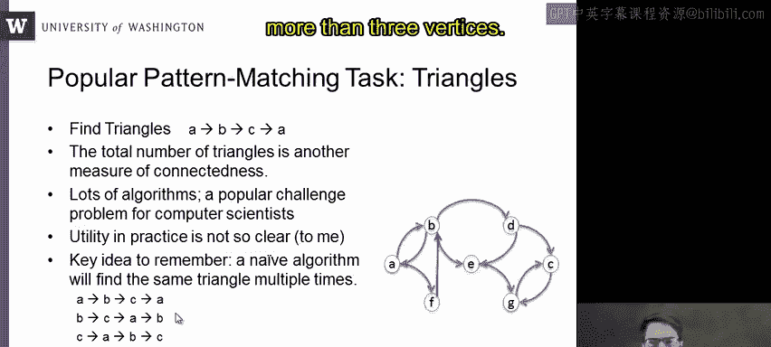
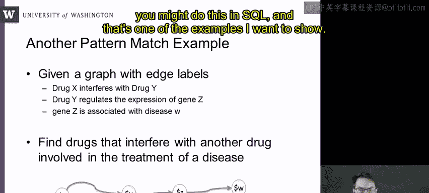

# 杜克大学《大规模数据科学（大数据操作，第1课／共3课有视频）｜Data Science at Scale》 - P117：116_模式匹配.zh_en - GPT中英字幕课程资源 - BV12s421T7tJ

。

So the final category of graph analytics tasks are these pattern matching tasks and this is where we want to maybe spend a little bit of time。

 especially because they are somewhat relevant in the news lately with this psism system and I'll try to touch on that in a bit Okay so here the idea is to find all instances of a particular subgraph pattern and so a very simple subgraph here is。

Two a vertices that both connect to each other。Okay and so here you may have conditions on the vertex labels or on the edge labels in order to more precisely specify the exact pattern you're looking for。

 but you're looking for all instances of this pattern across the graph。Okay。

 so how many times does this pattern appear in this graph or what are all the instances in this graph。

 how can you instantiate this pattern？There， well。Here's one from A to B。 You instant dollar x。

Equals a and dollar y equals B， and that seems to fit。And then。G to C seems to fit。

Dollar actually equal。C and dollar y equals G。And then actually， if we're not careful， you have。

Or price is what you want。 But generally you don't you have。Duplicates of this where dollar X can be。

B and dollar Y will be a。Oops。There will be a and dollar x will be G。And dollar Y， B。

So maybe four instances of this pattern。Only two of which are， in some sense， unique。

So a popular pattern matching problem is to find the triangles in a graph and so a triangle is a sequence of three vertices that are connected to each other。

 so A connects to B， B connects to C and C connects back to A and so the total number of triangles is a measure of connectedness There's lots of algorithms to compute this measure to count the number of triangles and it's a popular challenge problem kind of benchmark for computer scientists to compare different systems and compare different algorithms。

Its utility and practice as far as actually analyzing getting information out of a graph is not been made so clear to me when I talk to people who compute this。

 it seems to be more of a， again， a good benchmark problem for systems as opposed to a actually informative measure for social network analysis。

But that doesn't mean that's not to say that it's not used ever。

So I'm for that reason I'm not going to go into a lot of detail in the algorithms here。

 but a key idea to remember here is that a naive algorithm will actually find the same triangle three times right A connects to B。

 B connects to C and C connects back to A and then BC A B， and then CA A， BC。

are all logically the same triangle in that they involve the same nodes， but if you're not careful。

 you'll find to use all of these and so this gives an opportunity to come up with much faster algorithms。

I think the other reason why it' studied。In a lot of detail is that it's perhaps the simplest possible pattern。

You can find so it's a good starting point to do more complicated pattern analysis and in fact the pattern analysis problem in general is a very difficult problem。

 it's a very expensive problem which leads to a bunch of approximation techniques and in fact even for triangles there's a variety of algorithms that don't count the exact number of triangles to give you a good approximation with certain bounds okay so this is a very rich area of research。

But I think probably you'd be more interested in the pattern matching problem in general，And also。

 maybe I'll point out that you can extend this notion to cycles that involve。More than four vertices。

 more than three vertices。

And things change a little bit， but some of the techniques stay the same。

So let's look at another pattern match example， this one's a simplified version of a real example that comes from work with some of our collaborators。

Okay so here you know given a graph with edge labels is the extension we're going to make instead of just source node source vertex and target vertex。

 we're going to assume that there's going to be a label on that edge as well。

 so a third attribute in this table if you will。And we're going to be looking at what this label represents as relationships like an object。

 you know someone knows someone else。 and in this case， drug X interferes with drug Y。

 and so that label is interferes。 So you sort of know what the relationship is instead of it being a big anonymous relationship or say in the case of Twitter where you assume that all the relationship are the same it' just follows or in Facebook。

 every relationship is just friends or in the web， every relationship is just links to this one now they're。

Multiple different relationships being coded in the same graph。 Okay。

 And so this is a slightly more realistic case when you're trying to do real data analysis。系做。

Here we might say that drug X interferes with drug Y and drug Y regulates the expression of Gene Z and Gene Z is associated with disease W。

 and so now maybe one pattern that we want to look for is find all drugs that interfere with some other drug that is involved in the treatment of some disease。

Okay， and of course you could put other restrictions on here too。

 or maybe you're looking for a specific disease or you're looking for a specific。Drug。

 but now we're just looking for all patterns of this type。Okay， so。Pctorially。

 the query maybe looks like this where。YouWe want to find an edge linkings to vertices that's labeled with interferes with that's then connected to we're one of the outgoing edges of that vertex y。

He is connected to a vertex Z through an edge labeled with regulates。

And then that vertex Z is connected with a vertex W that through an edge labeled with associated with。

And we want to find all instants of this pattern。All right。So。

I'm not going to yet talk about algorithms to do this。

 I want to talk more about languages to express this。

Pattern and some of you with a database background may already be thinking about how you might do this in SQL。

 and that's one of the examples I want to show。

