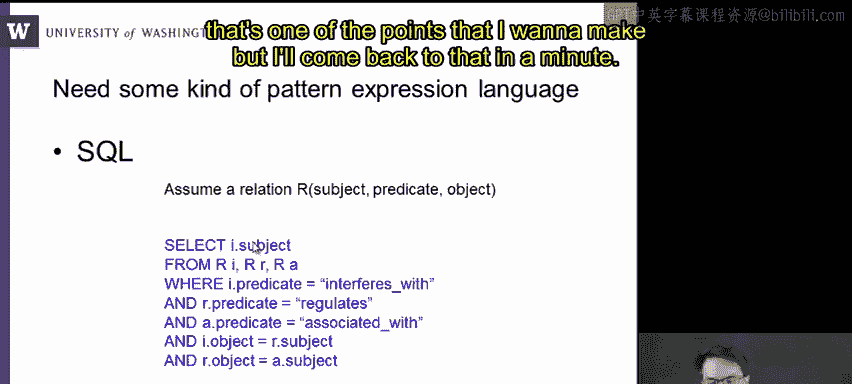

# 杜克大学《大规模数据科学（大数据操作，第1课／共3课有视频）｜Data Science at Scale》 - P118：117_查询边表.zh_en - GPT中英字幕课程资源 - BV12s421T7tJ

。

So the first pattern language I want to consider is Sple。

 which is a query language derived sort of SQL like derived in association with this resource description framework and you work with some of this data in the Elastic Mare assignment if you complete it is a resource description framework。

 RDF。Defins a formal data model around the idea of triples， which are really just edges in a graph。

 labeled edges in a graph。Logically， you can think about a table with three columns， subject。

 predicate and object。And the subject。Column refers to vertices in the graph。

 and the object column refers to vertices in the graph， and the predicate is the edge label。

And so there's。A lot of work that went into the formal model to define this。

 but I think it's most useful just to think of it as a labeled graph。

And so the query language ends up looking。Like this where you can say select。Variable names， where。

 and then define these triple patterns。And in this case， all the triple patterns look。

Similar in that they all instantiate the predicate with a actual literal。And all the。Vertices are。

Variables， but you don't have to do this。 You could have a variable in place of the predicate。

 and you could have literals in the place of the vertex。Representations as well。So this says。

 give me all the x's such that x interferes with y， Y regulates Z and z is associated with。W。

 and so if this was actually our data set。Then we might return this invented drug namedterazine because we can trace a path。

 Terrain interferes with。Btaminbatamin regulates this gene。

 and this gene is associated with this disease。And there might be billions of these triples。

Let me give you another example of a pattern expression language that comes up in database courses in computer science。

 but is less often seen in industry， although it's starting to make a comeback。

 which is one of the reasons why I want to mention to you make sure you're aware of it Okay so it's called data log and it's。

Based on a logic programming sort of paradigm， but simpler than it than。

General purpose logic programming languages such as prolo Okay。

 so here to express our query and data log， we assume a relation R。

 which is just the same structure as the triple table we saw for sparkle。

And I'll show you another formulation in the next slide， so here the pattern。

 the syntax here looks not all that different than sparkle for each。Predicate。

 we have an instance of R and we are looking for give me all the x's such that x interferes with y。

 y regulates z and z is associated with W， and we use three instances of this relation R。

And it's essentially can be interpreted as a join in that that's literally how it's going to be implemented in most Data log systems so you're going to join R on y equals y。

 join R again on z equals z。And then return the。Initations with the variable X。Now。

 so you've got a relation R with three attributes。 you know， why can't you query this in SQL。

 and there's no reason you can query an SQL。 you can imagine loading this table into a database and rewriting this query like this where you say。

A three way join on the relation R， and I've given them aliases here。

 I for interferes with R for regulates and A for associated with。

Then for each one of those relations， make sure you filter to the tus that correspond to the predicate you're interested in。

 so make sure the eye tus or only those tuples that have the predicate equal interferes with and so on for regulates and so on for associated with。

 and then you have to add a couple conditions for the join。

 make sure that the object of the eye relation is equal to the subject of the regulates relation and make sure the object of the regulates relation is equal to the subject of the associated with。

Relation， and then finally， just return the。Subject of the interferes。Relation。

So all these things are equivalent and。One of the points I want to make。

 but I'll come back to that in a minute。

