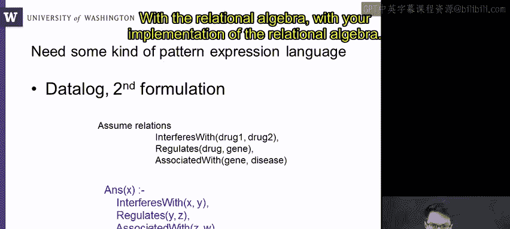

# 杜克大学《大规模数据科学（大数据操作，第1课／共3课有视频）｜Data Science at Scale》 - P119：118_图的关系代数和Datalog.zh_en - GPT中英字幕课程资源 - BV12s421T7tJ

。

So we implemented this query in three different pattern languages and the fact that we could do so suggests that there's something in common between them all and in fact there is what it is is the relational algebra and this is one reason why I've been trying to hit this throughout this quarter is that we you put your relational algebra goggles on the whole world starts to look like relational algebra and you can start to see that these languages are not really all that different and you can kind of look past the details of the syntax and see that what's actually going on as a relational algebra expression so in this particular case that expression might look like this and I say might because。

This is not necessarily a rigorous statement。Here on the slide， so there's two joints as we saw。

Three instances of the relation R and this。Symbol means a select condition where we're selecting for the predicate P equals regulates。

And here the predicate P equals associated with， and here the predicate P Eagles interferes with。

So now we have just the tuples that have the predicate with interferes with。

 just the tus that have the predicate equal to regulates and just the tus that have the predicate associated with。

 And then we just do the join where the object of this one equals the subject of this one and the object of this one equals。

The subject of this one。Right。And so this。You know， if you look back on the earlier lectures。

 we talked about relation algebra， hope you can convince yourself that this is。

Will produce as an equivalent result Now， as we said with the relational algebra。

 this is actually a specification of the order in which the operations should apply。

 while the other languages was more of a decative。Expression of what the result should be。

 but not necessarily how to get the result。 and that's generally the difference between。

The algebra and these languages， one of the benefits these languages give is they try to。

Put aside specific any specification of exactly how it should be implemented and just specify the conditions that must be true of the results。

 and that's what we mean by decorative languages。So， fine。Maybe they're all。

 maybe all three of these languages are equivalent， but I'd argue they're not。 They're actually。

 there's a benefit to the SQL implementation and the data log implementation。

 which I'll try to motivate by。Rewriting the query in a slightly different way。 So imagine now。

 instead of having one big table called triples or called R with all the edges in the graph。

 Imagine you had。Three different tables that came perhaps from different sources or different databases that you would combine together into one database。

 and each one of these tables represented different parts of the different parts of the original graph。

 so you had an。Drug interaction database。That had a relation interferes with and just to。

With two columns in it。You know， where the semantics of each tuple was drug the drug in the first column interferes with the drug in the second column and from a completely different database。

 you had a。Facts about。What drugs regulate which genes。

 perhaps this is mine from the scientific literature。

 perhaps this is derived from one of these public databases where some of this information is tracked。

And so on。 And then third， you might have a different database associated with。

Are recording what genes are associated with which diseases？And so this is a very likely scenario。

 I claim。 And in fact， again， this is derived from an actual example we have from working with our collaborators。

 and it's very much true that these。Different kinds of of relationships came from different sources。

 And so it's actually more likely for you to have them in this form than it is to for you to have them as one big graph。

 You actually have to do some pre processing to。Merge them in together as one graft。

But until you do that， until you do that merging， you can't use that sparkle language， and in fact。

 you can't use any graph language and you can't really use any graph database。

They only work on graphs。 And so while it's a very general data model for capturing。

Arbitrary relationships。It's not clear that the world is always represented。

As graphs in its source representation， it' represented a bunch of tables that happen to have graph edges encoded in them and so being able to work with them in the original format is a strength and you can do so in say data log so here the query actually gets a little bit simpler。

 you have a join between these three separate relations。

And you no longer have to sort of query on specify the predicate that defines each one。Okay。

 and that's perfectly fine。 If you have a mix of graphs and relations。

 you can handle both with data log and in fact， you can process them the same way as you would any other。

Query with the relational algebra， with your implementation of the relational algebra。

