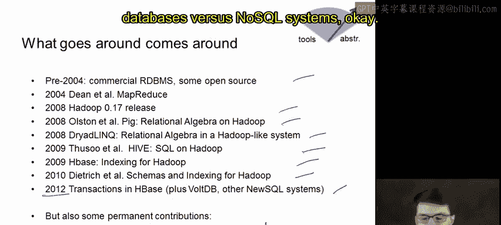
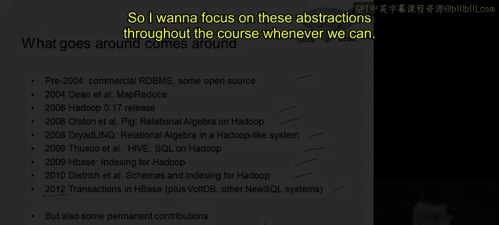

# 杜克大学《大规模数据科学（大数据操作，第1课／共3课有视频）｜Data Science at Scale》 - P11：10_工具与抽象.zh_en - GPT中英字幕课程资源 - BV12s421T7tJ

。

Welcome back to the Introuction to Data Science。So in this segment。

 I want to talk about these four dimensions that I introduced last time。

 and I want to justify the first three of them。And we'll talk about this one。Next time。Okay。

 and by justify what I mean is I want to explain why I've positioned the needles where at the locations I have for this course okay so the first。

Point here is this dimension of tools versus abstractions and this may seem sort of obvious that we want to focus on fundamental concepts as opposed to specific tools。

 but I can appreciate that people that are taking this course and many other courses really want sort of hands-on experience and we're definitely going to try to strike a balance but let me try to motivate why I think it's important to sort of focus on this angle and to do this let me tell one particular story that you see happens sort of time and time again so in this case we're talking about sort of databases and what is currently going on in the NosQL systems。

All right， so before 2004， you had you know the big three relational database vendors。

 plus some open source solutions like MySQL and PostgresQL then。

Arguably a big event in 2004 was when Jeff Dean and his colleagues published this paper on MapRduce at Google。

 and if you haven't heard of MaRduce， we'll talk about it at length and if you have bear with me。So。

This was great。 What this will allowed you to do was process very， very large data sets。

 and it sort of rebooted the database。Feature set。 so it really stuck on it really focused on just。

Sca out parallelism， and that's it。 none of the other features of databases。 and this was。

Exciting to a lot of people because they didn't have to sort of deal with the extra features that they didn't need in databases nor pay the exorbitant license fees associated with databases。

 So this seemed like， boy， this is the right solution。And you know， it took a few years。

 but a few years later， you had an open source implementation of the ideas in this paper called Hadyoop。

 led by some folks at。Yahoo。Now， even in the same year。

 one of the earliest and most successful projects within the Hadoop ecosystem。

Was this system called pig and what pig essentially was was。Hao。

A relational algebra programming environment for Hadoop。

 and if you haven't heard of relational algebra， don't worry， we'll talk about it。

Let me convince you that you notice the word relational there relational algebra is the secret sauce within relational databases and so a very early on project that was deemed necessary in the Hadop community and was wildly successful was to have relational style programming on top of this non-relational system Moreoverover。

 you had other competitive competing projects like dryad link which of dryyad and then dryad link which is an interface to dryyad。

 which also provided a relational Al oriented programming environment for large scale out。

Parallel data processing applications。Then you had people literally put the language SQL on top of Hadoops。

 so instead of just the underlying formalism， it literally had the programming language you needed。

Then。A bit later， you had。Indexing for Hadoop， which is another feature that databases have that we'll talk about。

 you had people talk about schemas and other more sophisticated types of indexing。

 which just two other things that databases have。 And then you now start to see transaction processing being a very host very。

Important topic in NoSQL systems is how to support concurrent access at very large scale transparently and this slide is perhaps a little old。

 it's now 2013 of course when at the time of this recording and the spanner system from Google is an important important system to look at that we'll talk a little bit about。

Later， okay， so now this isn't to say that map produceuce was useless。

 we're going to talk about that link and for a very good reason。

 it actually has some pretty important permanent contributions。

Three of which I mentioned here one is you know it was the first system to really emphasize fault tolerance and the idea here in a nutshell is that when you're working with a thousand0 computers at one time。

For any length of time at all， a few minutes， a few hours。

 the odds of one of them failing in some way is extremely high and so databases didn't typically have to worry about this because the assumption first of all they weren't running on thousands of computers at once and second of all they were sort of under the assumption that your queries would typically be pretty fast okay。

And so fault tolerance during query processing， so you don't lose all the work you started on when you're running a query。

Was something that the Hadop。And you know， the Mareuce paper really sort of emphasized and has now been sort of accepted by the larger community。

The other notion， which is a little more subtle is this idea of schema on read。

 And what I mean by that is。You know the way databases worked in the past and largely still work is you know we designed this thing called a schema。

 which is a particular structure for your data and then your job is to fit your data into that schema and until you do so we don't really want to talk to you know the database has nothing to offer you until you're able to sort of fit it into some sort of a schema。

OkayAnd the observation was that well， look a lot of data doesn't come preequipped with a schema。

 we don't have a schema just sort of lying around and we have to do something with it。

 you know and it's huge you know it's many hundreds of terabytes or something So what do we do Well you know one answer is you can use these map reduceuceases you know he doop for this but having to say that before you're allowed to touch your data you must load it into a database that was kind of a nonstarter for a lot of applications and then finally you know this idea of user defineded functions is something that all databases or most databases support and it's the idea that you might want to do things outside of what you can do in a normal SQL query you might want to write your own code and push it into the database but the experience of having to sort of write and maintain and manage and use these things is not great and that's why a lot of people put their logic inside the application as opposed to pushing it down into the database where arguably it could do more good。

For reasons people talk about。Okay， and so I think。You knowMaRuce sort of argued that look。

 you can actually have， you can give the Java programmers what they want。

 a Java programming environment and let them write scalable systems without forcing them to kind of use this crazy user defined function interface that databases offer。

 okay。So fine， so what's my point overall there as well？You know， if we focus too much on tools。

 what you would get is a snapshot in time of what tools are important as opposed to seeing that some of these features around databases are。

You know， they sort of ebb and flow in their popularity， butre they're sort of a permanent。

There are a permanent value in your reasoning about large scale systems， Similarlyly， you know。

 you might lose track of what's actually novel and what's actually new in the midst of。

The conversation about sort of you know relational databases versus versus No SQL systems， okay。

 so I want to focus on these abstractions throughout the course whenever we can。

