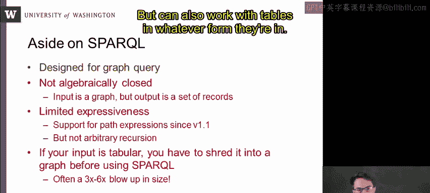

# 杜克大学《大规模数据科学（大数据操作，第1课／共3课有视频）｜Data Science at Scale》 - P120：119_查询混合图关系数据.zh_en - GPT中英字幕课程资源 - BV12s421T7tJ

。

Similarly， in SQL， SQL has no problem with expressing this query that if the data was represented in this form。

 you would do a join between these three tables and you just have the join conditions and the query actually gets a little bit simpler。

So I guess what I want to bring home is that graphs tend to not appear in the wild。

Isolated right they're not sort of free ions they tend to be applications tend to be hybrid。

 they have some tables， they have some relations and they have some graphs and being able to work with both of them uniformly is an important strength and so I think this emergence of graph specific systems。

While it does suggest that there's performance issues sometimes with modeling needs traditionally as relations。

 and that's one thing we'll talk about in a couple of segments。It's not clear to me that。

Capturing the entire world as a big flat graph。Is necessarily the right thing to do。

 It seems like you want a model that can do both relations and graphs and sort of interchange between them。

ok。Make one more point about Sple before we。Move on to some more complicated examples so summarizing what we sort of said while sparkle is designed for graph query。

 there's a few problems that I want to point out One is this notion of algebraic closure that we brought up when we talked about relational algebra so the input is a graph to sparkle you can query a graph but the output if if you go back to the slide on sparkle and you look at the results it's actually a list of records it's no longer a graph it doesn't have to be these triples anymore。

And so， therefore， I can't。Take the result of one sparkle query and then again query it with Sple。

 The only hack in query with Sple is a graph。And so the one way to say this that maybe he's a little bit pedantic。

 but is more technically correct is it's not algebraically closed。

 It returns a different type of thing than it than it takes as input。

 but this is a big disadvantage as we've。Seecene right。

 you want to be able to chain queries together。Whenever possible。

 this is what gives you the a foundation for。Features like logical data independence。

 which we argued back in the relational lectures as a really critical feature。Okay。Second。

 I'd argue that there's actually limited expressiveness。

 and we'll see some examples of this in a little bit。

You can't do graph these graph traveral tasks that we talked about。

 Most of these you can't express and sparkle Since version 1。1 in Sple。

 there is support for these path expressions that can that can express some forms of。Tversal。But。

It's not clear that all the general recursion is supported。And you need general recurion。

 you need general graph in order to implement these graph traersal tasks。

 you need some way of sort of walking over the entire graph as a whole and Sple doesn't necessarily provide that。

Okay， and then as we just pointed out in the last slide。

 if your input starts off as tables before you can even touch it， you have to shred it into triples。

And model the whole world as。A big pile of graph edges while what's nice about graphs is you can actually do that there's always a way to sort of shred it into a graph in some form。

 but the process of doing that might blow it up by a factor of three or a factor of six is what we see in practice depending on exactly how you model things and on what your table structures look like。

 but this is a tough hill to climb to try to recover that performance that you give up just by shredding it into a graph。

So again， I think what this tells me is that we want a system that can handle both graphs。

 can express graph traversal tasks。Which SQL is not great at， and we'll talk about that in a moment。

 but neither is sparkle， but can also。Work with tables in whatever form they're in。

