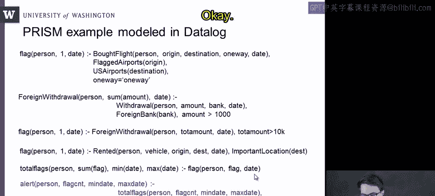

# 杜克大学《大规模数据科学（大数据操作，第1课／共3课有视频）｜Data Science at Scale》 - P121：120_图查询示例：NSA.zh_en - GPT中英字幕课程资源 - BV12s421T7tJ

。

So these graph pattern search problems were in the news in June 2013。

 pretty heavily associated with this PRism system being developed by the NSA。

 and so an article in Business Week，Describe the kinds of tasks that they're interested in doing。

 and by the way， the technologies that they're using this are things you've heard about or as far as we understand。

 So the system a cumulula I mentioned in the NoSQL lectures was actually developed by the NSA and then released open source and then commercialized after that and that's kind of the underlying platform and then the kinds of applications they want to do using this cumullo system and other systems。

Are of the type that we've been describing in terms of pattern search。

 And so let me give you an example of that。 So in this business week article， they talk about。

 you know in October， a foreign national named so and so purchased a one-way plane ticket from Cairo to Miami where he rented a condo Then over the previous few weeks he had made a number of large withdrawals from a Russian bank account and place repeated calls to a few people in Syria and more recently he rented a truck drove to Orlando and visited Walt Disney World by himself。

 And the point they wanted to make in the article is that individually none of these activities would raise any flags but collectively they might they might be worthy of closer inspection。

 And whether you agree with this or not maybe you'd that this does not warrant for their inspection but just trying to state the facts of what。

Of what they're doing with the system without putting in judgment on whether it's the right or wrong thing to do。

So you can encode this you can encode these factss in this language say data log。

 although you could also do it as a graph as an RDf graph and in fact that's actually a little closer to what they're actually doing。

 but you know you start off with a database of flights that the government has access to so you know that they bought a flight from Cairo to Miami and the last name was this and that it was one way and that it was on this date and you also know that they made some withdrawals。

 there's multiple records here for various amounts from some bank and Russia on various dates and what I didn't include here was the calls to people in Syria although probably should because that's perhaps the。

The biggest flag， which you could write that down to， you could say call from。

This person to some other person where location of the other person is。嗯。Syria。

 so these are a representation of all the facts that they have access to。

 and the point I want to make is that。D。Aggregation of these facts into a alert of some kind into a is this is worthy of further inspection can be expressed as a query in these various languages and in particular。

 I'm going to talk about data log here so maybe one。

You might flag a person and this number one is just a token to say that this is one flag。

And this is a date associated with the time that applied in case you want to do further analysis。

 this might become clear in a moment。You raised this flag if a person bought a flight from some origin to a destination where the origin was one of the flagged airports。

 I'm making this up。And the destination was a US airport and the ticket type was one way， you know。

 obviously this alone is not necessarily suspicious， but it's。Perhaps a first step is that from a。

You know airportport that we sometimes monitor more closely to a US。 destination and it was one way。

Then， you know， you might express a query producing foreign withdrawals that are these sum total。

Amount withdrawn from a foreign bank。Where individual amounts were greater than1。

00 because maybe you're trying to cut out small withdrawals okay and so this says assuming we're building off this withdrawal table。

 we add up the total for each person coming from a foreign bank。

 this could maybe be called big foreign withdrawals instead of just foreign withdrawals。

And then the flags are perhaps associated well when the total amount across all these withdrawals are greater than some fixed threshold here I've said 10。

000。Maybe that represents a flag and notice that these flags are the same relation as these flags in data log it's okay to have multiple rules like that and the semantics of them is you're going to union all these results together so you can imagine expressing this andSQL as well where I query for a bunch of records and query for another bunch of records and then union the results together that's what's going on here and then we ski the conditions on the calls to Syria although again those would be easy to do and probably。

Good examples to include but maybe we have this database of all the vehicle rentals with attributes。

 you know， the person who rented the vehicle， the origin。

 the destination and some kind of a date until we write a query producing yet another flag when someone。

Rented a vehicle that where the destination with some important location and this one's probably not the greatest。

Example of something that would generate a flag， but it's something you could look for。

 and you can imagine making this a little bit more complicated。ok。And so all these flags together。

 you could write another query in data log。 And again。

 I haven't told you too much about the details of data log。

 But one thing you'll notice here is that'm I'm using aggregations in the。Head of the rule。

 just like you can in SQL so。Select person， some flag Min date， max date group by person。

I the same semantics as what I'm showing you here？So we add up all the total flags。

 now we have a relation with people， their total flags and the。

Date range for which those flags occurred。This won't get you exactly the right results because we didn't really filter much on dates。

 but you can see。The argument I want to make is that it's not too much code。

 it's not too much work to try to express these。English questions you have over this massive graph in terms of a logical language like this。

Okay and so maybe finally the alerts， things that are warrant more human attention by some analyst are things where the max state minus you know。

 within the span of just 10 days， the total flag ground is greater than say three。And again。

 one problem I'm sort of pointing out with this is this is giving you the total across the entire range of time for that person。

 and so you may want to bucket this by weeks or months， and I haven't expressed that here。

 So what I'm hoping to do is wet your appetite that these kind of rule-based logical languages can work with a big graph。

 can work with a lot of relations and can express fairly complicated conditions and they're in some sense they're all you need if you have a way of implementing this at scale efficiently this is kind of all you need to do fairly advanced analytics。

