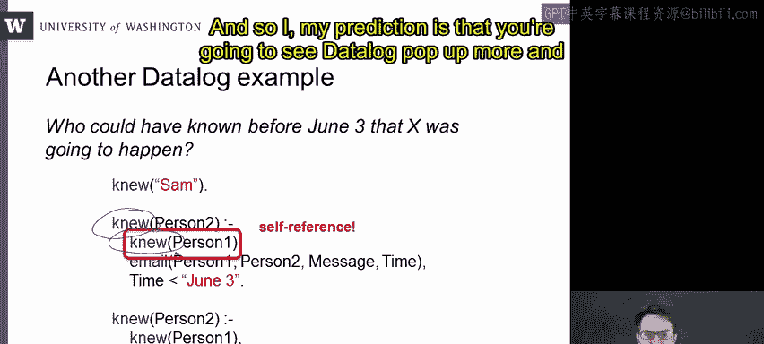

# 杜克大学《大规模数据科学（大数据操作，第1课／共3课有视频）｜Data Science at Scale》 - P122：121_图查询示例：递归.zh_en - GPT中英字幕课程资源 - BV12s421T7tJ

。

So let me give you one more example of a data log。Query so。

We want to know who contacted who and when they contacted them。

 but we don't really care how they did， and this is a simplification of something we saw in the previous example。

So we say person one contacted person two at time at some time if。

Person one sent an email to person two at some time。

We also say person one contacted person two at some time if person one called person two at some time。

And then finally， we say。Person one person contacted person two if they send a text message at some time。

And so the point here is these would most likely come from three very different sources。

 right as the government is doing whatever they're doing to get， you know， again。

 whether you agree with this or not。啊。That's one company or one source。

 another source is who called who and a third source is who。I send a text message to who。

 and so combining all these together。Doesn't necessarily take a lot of work。

 You can express these in these high level languages。 And this is。

I would argue the right way to approach these problems as opposed to a lot of low level code。

So let me give you one more example， who could have known before June 3rd that some event was going to happen。

Maybe you know for a fact that。Someone named Sam New。 So you're starting from that point。 Well。

 who else could have known。 Well using this same trick we used in the to build up a contacted relation。

 you can do this again。 Well， we know person 2 new if person one knew and person one emailed person2。

Before June 3r， and we can also argue that person two knew potentially new if person one new and。

Person 2 met with person 1 before June 3。And so the point I want to make here is that we've referenced。

The head。The relation that we're creating new， we referenced it in the body of this rule as well。

 so there's a recursive relationship now。It starts with Sam and then basically find all the people that Sam emailed before June 3rd and they're in the final result and then all the people that those people emailed before June 3rd and they're in the final result and so on。

 and you can do this with Met and you can do this with called and so on。So this recursive。

There's recursive relationship。This self reference is the difference between Data log and SQL。

You actually can express this kind of thing in SQL。

 There's Microsoft calls them common table expressions。

 and you can use the width clause to do this recursive stuff。

 but you'll find if you try to do this in practice that the implementation of those features is a little bit poor in many of the commercial databases and it's。

There's various limitations。 for example， you can only have a depth of 100 recursive steps。

 which is sort of arbitrary and much too small for many of these applications。

 You also find that the performance of these varies widely and is not particularly good。

 So' it's not clear that the customers of relational databases have been demanding these features。

 but I'd argue that increasingly this is what。People are interested in and my evidence is。

Examples like we just saw from the news， the fact that graph specific database systems are emerging。

 you know， Neo 4J is getting very， very popular。There's various systems for processing graphs on top of map reduce and we'll talk about a couple of those。

 and so on RDF systems。You know， these so called triple stores。

So the fact that graphs are becoming more and more important。A。

Suggest that this ability to traverse the graph recursively is becoming more and more important。

 which motivates perhaps a move from SQL relational algebra languages to this data log。

 relational algebra language， and so my prediction is that you're going to see data log pop up more and more often in industry。

。