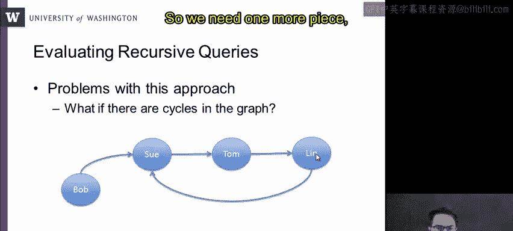

# 杜克大学《大规模数据科学（大数据操作，第1课／共3课有视频）｜Data Science at Scale》 - P123：122_递归程序评估.zh_en - GPT中英字幕课程资源 - BV12s421T7tJ

。

So let's take a step back and see where we are we talked about graph tasks in general。

 gave an example of constructing these histograms， talked about structural traversal and pattern tasks。

 gave payD as an example of of both a structural and a traversal task。

 and then talked about pattern languages in Sple and SQL and data log。

 gave a few more detailed examples of data log motivated by。

What's been going on in the news in June 2013 related to the pism system。

 but what we haven't talked about is how to implement much of this， especially at scale。

So that's what I want to do next， we're going to stick with Data log for a moment and think about how to actually implement those kinds of queries in mappreuce。

And then talk about how to implement paid rank and Mareuce。

So way back towards the beginning of the course， we talked about how to implement relational algebra operations in mapre at scale and we showed this sort of connection between languages like PG and the relational algebra。

 what databases do is obviously the relational algebra and what you can implement directly a map or do so there seems to be this kind of relational algebra DNA and a lot of these large scale。

啊啊。Programming platforms， however， all of those cases。

 we never had anything that had to loop that had to do recursion。

 that had to do iteration and now that we're talking about graphs。As we sort of pointed out。

 that traversal of these graphs。Is。Really the salient feature of working with them and so it came up in traversal tasks and it came up in pattern languages in data log we saw examples of recursive data log programs without talking much about how they would be implemented so I want to cover that a little bit now。

So given if you have a recursive data log program that looks like this。

 so you can say this is an edge relation that's just linking an arbitrary vertex x with an arbitrary vertex Y。

 every pair of edges is stored in a relation called edgedge。And I write this program。

 this program says。Find me all the edges connected to the vertex labeled W。

 and here we have a vertex labeled W。And put those in a new relation called A。

Then also finding the additional values of a。In this manner。For every vertex that's already in A。

 go find me an edge that leads out from that vertex and give me a new generation of vertices。

So this is now a recursive data log program， but what you can。Think about it intuitively。

 what it's doing is traversing this graph in kind of a breath first way right So first we fire this rule。

Which just says out of all the vertices， select the one with W， and we know how to do this。

 We could write this in SQL， I would hope。We can write this in Mareduce， we can write this in Python。

Find all edges where the first position has a lay legal to W。

And call that a0 or finding everything that's connected to W。

 call all those collectively a0 next we go to this rule and now we have to join all the ones we've already found with the edge relation to produce a new generation of vertices for each node in a0 find all of its neighbors。

And then just step two， we fire this rule again。For each node in a1， find the neighbors and so on。

 so we keep finding more and more。Vertices in this graph as we go one generation away and that's。

Niveively how we would how we might evaluate this recursive program's what that's what the meaning of this program is。

 But there's a problem here。 What if there's a cycle in the graph Well at Gene one we'd find Sue and Gene two。

 we'd find Tom at Gene three， we'd find Lyn。And then in Gene five， we find Sue again。

 and so we would just keep going。So we need one more piece。

 which is to remove all the ones we've already found previously。

