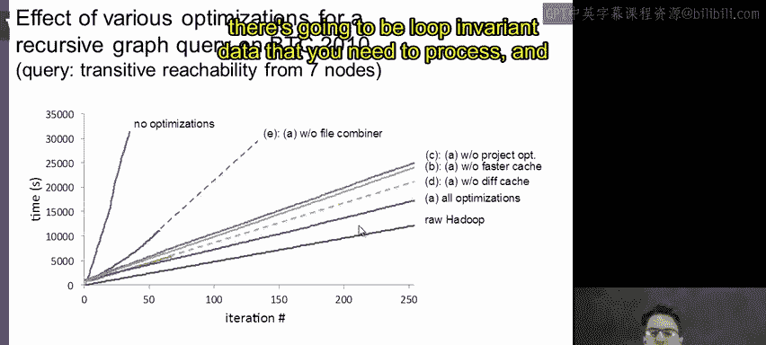
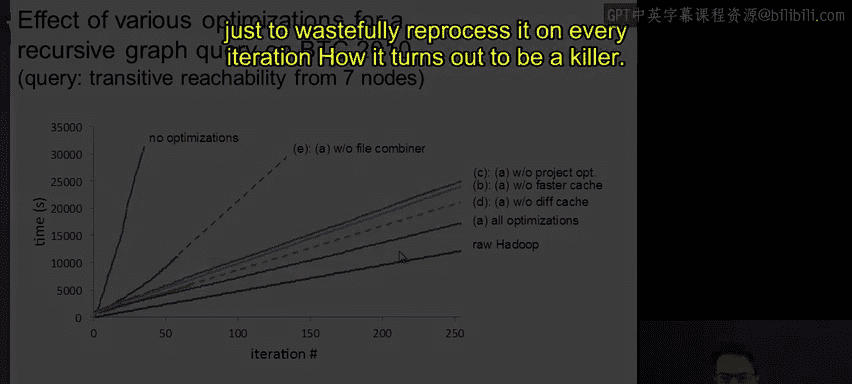

# 杜克大学《大规模数据科学（大数据操作，第1课／共3课有视频）｜Data Science at Scale》 - P124：123_MapReduce中的递归查询.zh_en - GPT中英字幕课程资源 - BV12s421T7tJ

。

All right so this is the basic idiom for implementing recursive programs in MapR。Maybe we're done。

Well， there's a couple of problems here and here they are。First。

On every iteration we're going to do this over and over and over again as we traverse the graph。

 and the number of times we're going to traverse the graph is actually the diameter of the graph。

 which we talked about。Well， on every iteration， we're going to。Process。

All billion edges in the graph in the map phase and shuffled them across the network to the reduce phase in order to compute this join。

This wasn't so bad if you're only going to do this once。

 but if you're going to do it every time there's no useful work happening in this map phase you're just。

Reading the edges off disk， identifying the join key。

 emitting the appropriate tuples and sending across the network to throughdue phase。

 implementing a standard join in MaRuce， which we did as part of the homework。So， this is。

Extremely wasteful。 The second point， which is a little bit more subtle， is that。The answer set。

 AI is growing at every iteration， right you find more and more answers and as soon as you stop finding answers。

 you're done。Well， this is getting bigger and bigger and bigger over time。

 so it's not completely static。But all the old values that you've already seen before are read off of disk and shuffled across the network in the same way in order to try to remove duplicates。

And if you've already done that once， you shouldn't have to do it again。So the solution here。Is to。

Fill in some sort of a cache on the reducer side of the Mareuce program。

 So instead of shuffling this across the network。We're going to shuffle it once in the first iteration and then read it off of disk in the second iteration。

And with a variant of this trick， you can do the same thing here where。You'll read it off of disk。

And then append more new tus back to the same cache right as you're done。And。

With some careful thought， you can arrange for this to happen。By extending the map reviews framework。

And still keep a mapre programming interface and this is what we did as part of our research for this system called Hadloop which is to add intereric capabilities to the Hadoop。

Maappper system and one of the applications that we did with this was to implement data log。

All right， and so this makes a pretty big difference。

So this is a plot of runtime and this is iteration number。

 so this is just the time it takes to do each iteration and without the cache。That we just described。

Every iteration takes about the same amount of time in this particular data set， which was。

A variant of the same one you process in the elastic map reduced assignment。With the cash。

 the first iteration actually takes a little longer because they have a little bit more work to do。

 we have to actually to prepare this cash， but subsequent iterations take far， far less time。

Because you don't have to map and shuffle that huge relation。

 that huge edge relation across a network anymore。So this is a being。Well。

 really arbitrarily faster because the more durations it takes the better and better。

 the more and more difference it gets in the overall runtime。

With the variant of that trick to also optimize the。Duplicant elimination step。Plus。

 another set of optimizations that had to do with using the map reduced framework in sort of an intelligent way。

 we're able to sort of get。Yes。Pretty horrible performance for raw vanilla Mareuce。

On iterative programs and get it way down to something that is actually kind of approaching the raw overhead of just running a Hadoop job。

 meaning you know you don't do no useful work with the Hadoop job you just launch。

A task on every machine in the cluster and do no useful work and then shut down。

And that's what this bottom line is。So what I think the takeaway here is one is I just want you to internalize that trick。

 but the other thing is if you're using raw Hadoop， if you're using I shouldn't say raw。

 if you're using mapre right out of the box， it's not great for iteration， mainly for this reason。

 there's actually a few other optimizations we explored in a couple of papers。

 but this is the one that makes the most difference is the fact that there's invari。Quite frequently。

 there's going to be loop invariant data that you need to process and just to wastefully reprocess it on every iteration。

It turns out to be a killer。

