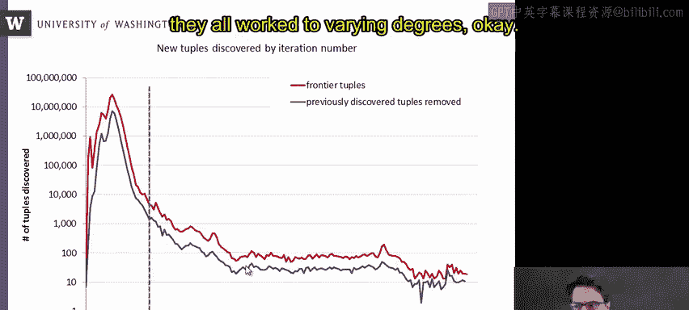

# 杜克大学《大规模数据科学（大数据操作，第1课／共3课有视频）｜Data Science at Scale》 - P125：124_终局问题.zh_en - GPT中英字幕课程资源 - BV12s421T7tJ

。I mean， one more point I want to make about this before we move on is that。

The number of new tuples discovered， the new results discovered on every iteration。

Tends to have a pretty standard pattern， which is a result of the degree distribution of common graphs found in practice。

 which we talked about in the histogram segment a little while ago。

 so this plot is on the Y axis is the number of new results discovered and the X axis is the iteration number and what you can see here is that in the first few iterations you quickly start to find an enormous number of new results。

Right notice that this is a log scale。 So this difference is really， really huge。

 But then pretty soon it tapers off and you're just。Kind of piddling along。

 finding smaller and smaller。Stets of new results， but you're not done yet either。

 you're still finding new stuff， but you're not finding much new stuff。So this is really。

 really rough for Mapper。Because every one of these iterations way out here in this long tail。

 this end game asman Friday and Oleman called it in a paper。

You start have to pay the overhead of launching Hadoop on a huge cluster and sort of processing and checking for things。

Even though you don't actually find that many more results， right。

 most of the results you already discovered。Fine， that's one point。

 The other point here is that this does make sense because what you're doing is you quickly get to this within a few iterations。

 you're going to get to this middle part of the graph。That's connected to everything and you've。

The fan out is huge and you discovered everything， you're going to hit one of these really popular。

Vertices that's connected to everything。And then once you're past that。

 you've pretty much seen everything you're going to see and you quickly taper off。

Thing to think about is。What to do about these two different regimes you're in。

 one regime where you're doing a lot of useful work and one regime in this end game where you're not doing very much useful work and there's a couple things you can think about here one is。

You know， it may not be unreasonable to just stop processing when you are no longer producing that many results。

This would produce the wrong answer according to the program。

 but it might be reasonable a lot of cases if you're mostly looking for an approximation。

 you can get a pretty good approximation after the first several iterations。

 this extra work is not doing you that much good。Another approach would be to scrap map reduce and try to find something that had less overhead on a pro iteration basis。

And so there's a system that， for example， we're working on now that doesn't have this property。

 right？The runtime is sort of proportional to the number of tus discovered as opposed to having this very large fixed cost just to launch a job at all。

 which is a problem with Hado。Still another way is perhaps to。Change strategies in this regime。

You process it as we've described in this later regime， you actually might try to do more work。

Piteeration， for example， don't bother checking for duplicates because you're only finding100 new tus anyway。

 why bother even checking for duplicates， just keep going and going and going and going for a while to save the number of map produced jobs you have to do and so we've explored these various options and they all work to varying degrees。

Okay。

