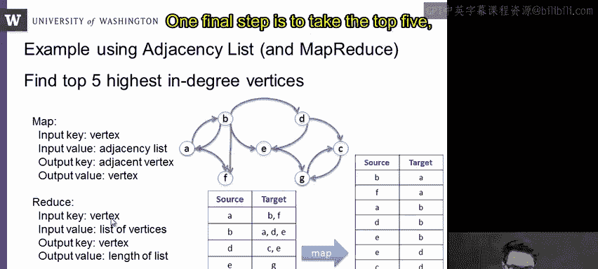

# 杜克大学《大规模数据科学（大数据操作，第1课／共3课有视频）｜Data Science at Scale》 - P126：125_表示：边表、邻接表.zh_en - GPT中英字幕课程资源 - BV12s421T7tJ

。

All right， I want to give a quick aside on representing graphs。

 we've sort of been assuming implicitly that we're representing graphs in this way with a table with two columns。

 one source and one target， maybe some other columns representing for example， an edge label。

But every edge will be explicitly represented。 Okay。

 And so this makes sense because it's easy to manipulate with a relational language。

 which is what we've been sort of talking about in terms of。Pattern matching。Tasks。

 and so this is the edge table。 we'll call this the edge table representation of this graph。

Here where A and B is there and B back to A is there and so on。And you can process this。

 as we've seen， we can do pattern matching， but we can also do the structural tasks pretty simply。

 we can say find the top five highest in degreeeg vertices。Using a group byque。from this edge table。

For each target， count up the number of sources group by target。

And then select the top five from that， and this is using the syntax for。Top five from。

The SQL standard as well as Microsoft SQL Server， other commercial databases used。

Can express this in a slightly different way。And you have to order by the end count here。

 which is why we do this as a nested query。So fine。

 so this table gives us a lot of flexibility in how to process it。

 but there's some cost that we bear。To do this。 and so what you actually see more often in programming language libraries for working with graphs is an adjacency list representation。

 and so for here for each source。Each source is associated with a list of all the adjacent vertices。

 so here with A you'd be associated with a list of the vertices B and F。

And B would be associated with the list， A， D， E and F， everything that's one hop away。

 and so this the overall space required for this representation is less。

 which can make a pretty big difference。In performance。 So as an example。

Of how to use this representation， you can think about a map reduced program。

It's a little bit harder to think about how to do this in a relational。Database， for example。

 because you can't。Without directly and naturally， you can't express this。List construct。

 there's various extensions and proposals and so on to do this。

 but this essentially it breaks first normal form， which I won't go into， but it's。

No longer really a conventional relation if you have this nested collection structure as one of the values。

 but in mapreuce this is perfectly fine。 we saw this before。

 right there's a key in a value and the value can be anything。 It can be a bag of words。

 in this case， it's a list of neighboring vertices。And in fact。

 in the libraries for produced that work with graphs。This is。

The most common representation you'll see。 and in fact， even in the。

It was some of the original work with MaR to express page rank， which we'll talk about in the bids。

They assume indjacency with representation there， as well。

So for this same task of finding the top five highest in degree vertices。

 you can imagine a map program that takes in a vertex and adjacency list。And produces。

A key of the adjacent vertex， along with。The key tag， so you just reverse the direction。

So for you for B and F， the output would be。B， mapping back to a， F mapping back to A and so on。

 just reverse the edges。 And then the reduce side， it'll receive a。

List of vertex along with a list of incoming edges。

 you can count them up and produce that as your result。One final step is to take the top five。

 which would actually be a second map reduced job。

