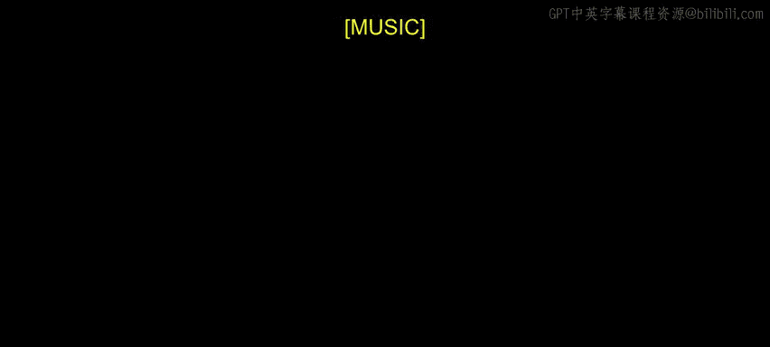
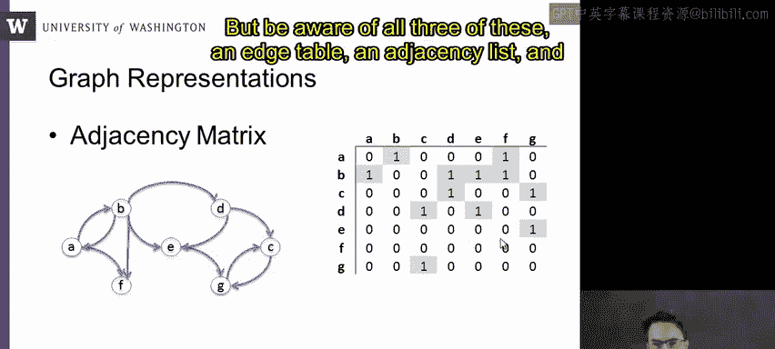

# 杜克大学《大规模数据科学（大数据操作，第1课／共3课有视频）｜Data Science at Scale》 - P127：126_表示：邻接矩阵.zh_en - GPT中英字幕课程资源 - BV12s421T7tJ

。

So the last representation you'll typically see。Is an adjacency matrix。

And this is really only useful if you have a。Fast efficient。

Representation of matrices and you're trying to manipulate the graph as a matrix。

But these things exist and the other nice thing about this is it sort of exposes the equivalence。

Of a graph and a square matrix right so a square matrix has。All same number of rows and columns。

 And so how to represent a graph as a square matrix is for each row。

Each row corresponds to one vertex and each column corresponds to one vertex。

And you put a one in that cell， if。Vertex row is adjacent to vertex column。

And if you have an underwrrated graph then you'll have， then this will be symmetric。

And if it's a directed graph， then it may not be， so a is adjacent to B。

 which is why there's a one here， and B is adjacent to A， which is why there's one here。

 but B is adjacent to D and D is not adjacent to B。And you also see that this is。

Always going to be pretty much always going to be a sparse scrap， right。

 lots and lots and lots of zeroes， not everything。 it's rare for a vertex to be for all vertices to be connected to almost everything。

So you have sparse， and if you remember back to some of the work we did with relational databases。

 and we showed how to represent matrices in databases。That。Once you have a matrix。

 you get access to processing things with linear algebra and you might get access to fast libraries that already know how to work with。

Marices and linear algebra operations。But what a lot of those libraries do under the sheets is take a sparse matrix and represent it。

In a way that doesn't require you to actually materialize all these zeros。

 and those sparse representations are going to look a lot like。

The previous two representations we just saw， an adjacency list or an edge relation。So。

 in some sense， it's。You're moving things into matrices in order to get the access to fast libraries for working in matrices。

 But what the matrices are doing underneath the sheets is to represent things in a sparse way that looks back that looks more like。

A relational representation。But be aware of all three of these， an edge table， an adjacency list。

 and an adjacency major。

