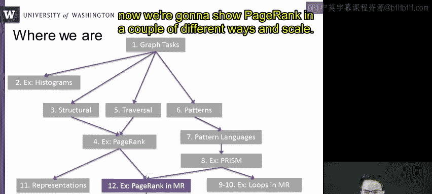
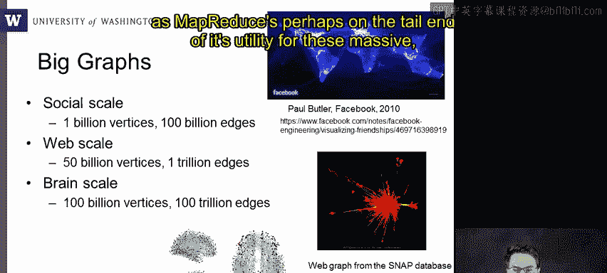
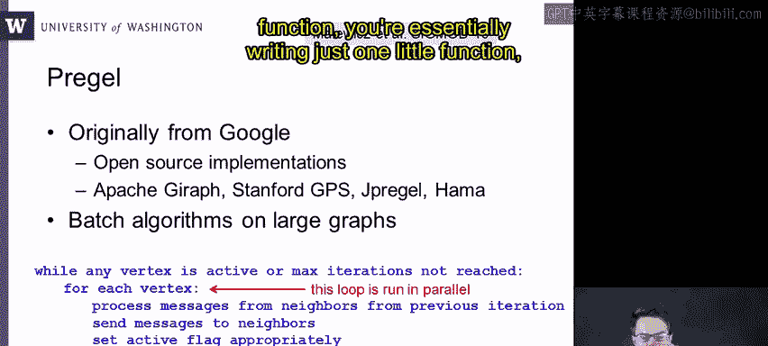

# 杜克大学《大规模数据科学（大数据操作，第1课／共3课有视频）｜Data Science at Scale》 - P128：127_MapReduce中的PageRank.zh_en - GPT中英字幕课程资源 - BV12s421T7tJ

。

So we showed how to implement。Loops and map produceuce and optimize them and use that to implement。

The data log pattern language and recursive programs in that language。

 and we showed different representations of graphs。

 and now we're going to show pay rank in a couple of different ways。At scale。

 So remember the context here is that graphs are getting bigger and bigger and bigger so you can imagine a social scale graph having about a billion vertices one per person with maybe 100 billion edges web scale graph is bigger because there's more web pages than people so maybe 50 billion vertices and a trillion edges。

 but there's you know the human connectome the neural network in your brain has maybe 100 billion edges and 100 excuse me100 billion vertices and 100 trillion edges so。

We need large scale systems to process this and map reduces one。Such system。

 there is more coming down the pipe， though， map produces。

Perhaps on the tail end of its utility for these massive massive scale。

 but we're going to stick with it for now。

So here's an implementation of pay rank in map reduce in the map。Function。

 we have a node ID and a vertex object that verage object has a couple of methods that we use。

You can get its current pay rank， in dot pay rank， and you can get its adjacency list。

 in dot adjacency list。So in dot page rank divided by the length of the adjacency list gives us the fraction of the rank that we're going to distribute to each of our neighbors across each of our out edges。

Then we're going to emitm a special key value pair with the node ID and the vertex object and I'll come back to that in a bit。

And then for each of my outgoing neighbors， send the appropriate fraction of my page rank。

 which is the value P that we just constructed。Okay， so now on the reduce side。

 we've got a node IDM and a list of things。AndWe initialized a couple of values。

 this M object to know。New rank to zero。 and then for every P in this list of P's。

 we're going to check to see if it's a vertex。Now why that's there is that' if it is a vertex。

 that means it corresponds to this key value pair that we emitted up there and all this was was a way to pass that complex vertex object through to the reducer because remember the key here is just a node ID。

So we need some way of passing this more。Complex object with some internal structure over to the reduced side。

And so now we have it， and we sign it to him。If it's not a vertex， then it's one of these other。

Paage rank values that we computed， and therefore we just added up。And then finally。

 the new pay rank for that vertex M。Is going to be this。Formula that we saw。Well， sorry， sorry。

 I guess about being a little glib there。 This is the damp factor that we。Mentioned。

And this is a equivalent expression to what we showed before and finally now that we've constructed the new page rank。

 we emit a key value pair， the node ID and the vertex object itself。

 which is the same key value types as we need on the map side to repeat this。

 So we're going to run this over and over and over again with different。Across multiple iterations。

So there's some problems with this implementation， the main one is that the entire state of the graph is shuffled on every iteration。

 right that little complex vertex object that includes within it the adjacency list。

Associated with that vertex is sent across the network over to the reduce side and handled by the reducer。

When all that really needs to be sinned is just the new rank contributions if the vertex state could sort of stay in place。

if you could address。The neighboring emergegies directly and just say， hey。

 here's your new rank contribution。That would be useful。 That would save some communication traffic。

And then also we have to control the iteration outside of mapRds。

 including the termination conditions and just the logic itself。

So for these reasons and just to explore another protoome model， Pragel was suggested。Also at Google。

Or in 2010。So there's been since then there's been open source implementations。

 just like there was for MapRduce and Apache giraffe， Stanford， there's system called GPS。

 system called J Pragel HamA。And this is really designed for batch algorithms on large graphs in particular。

 so focused on graphs。 And so the basic logic looks something like this。

 It says while any vertex is still active。Or the max iterations have not been reached。

For each vertex。Process all the messages you get from your neighbors。

Update your own internal state and then send messages back out to your neighbors。

And then maybe set the active flag appropriately， you know， if you don't get any messages。

 then you're not active。Or if your internal state doesn't change enough。

 you're not active and you can control this logic and so the point is now you're writing instead of writing a map function a reduced function。

 you're essentially writing just one little function。

 which is the function that I should run on each vertex at every time step。

