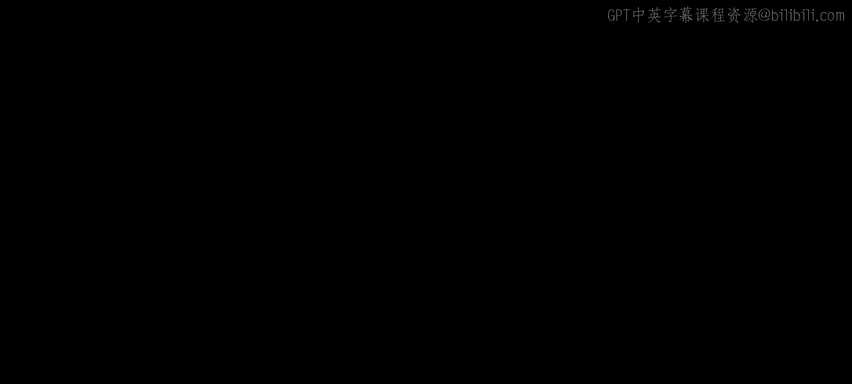
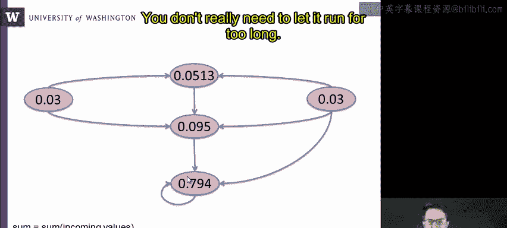

# 杜克大学《大规模数据科学（大数据操作，第1课／共3课有视频）｜Data Science at Scale》 - P129：128_Pregel中的PageRank.zh_en - GPT中英字幕课程资源 - BV12s421T7tJ

。

So let's see an example。Which is paid drink。Okay， so there's just one method here。

 compute and this is。This code is a little awkward。

 This is straight from the Prale paper it's a little awkward here because it's。In sea。

 so bear with me if you're not used to looking at sea。

But this says if basically the iteration number is greater than or equal to  one is super step。Then。

Add up all the messages I get from my neighbors。And then assign my own internal state to this new calculation to the new rank。

Then as long as the super step is less than。30， which is our， you know， if we go over 30。

 we're just going to assume that we converge and just quit。Vin。Sin。

The contribution of my rank to all my neighbors， which is my current value divided by n and in is just the number of。

Number of neighbors。Otherwise set myself to inactive， which is this vote to halt。

 so you sort of say I've got no more work to do， I'm done until somebody wakes me up with a new value。

Okay， and what's not in here in this implementation。

 but is often added in a pre implementation is some kind of condition that says， well。

 if the internal value hasn't changed by a large enough amount， then vote to halt。

 then set myself to inactive。All right， so let's see how this works because the code may or may not be very clear。

So imagine we have a graph like this。 We initialized the rank to the total number of vertices divided by the number of excuse me the number one divided by the number of vertices。

 so there's five vertices so we just divide one by 5 which is 0。2 okay so that's the initial。Rannk。

Then we。Be。The program， the compute program， runs on every vertex simultaneously in parallel。And。

It sends。It's rank contribution to all of its neighbors， so this rank contribution is 0。

2 divided by two outgoing edges so that each one gives 0。1。And here there's three ein edges。

 so each one gets 0。066。And so on。Then on the next super step。All those contributions are added up。

And so here we add 0。1 and 0。066。Multiply by 0。85 and add in 0。

03 because that's our formula and we get 0。172。And we do the same for all the other nodes now this one's a little funny why did 0。

0 why did this node and this node get 0。03 Well that's because they have zero they have no incoming edges at all in which case this term in the formula provided nothing some was 0 and so they just get 0。

15 divided by 50。03。And so that's our new value。After that iteration。Then it repeats。This。

Rank is divided in half 0。015 and 0。015 this rank is divided in thirds， 0。01，0。01，0。01 and so on。

And we see what。Changes so we add this up this plus this times 0。085。Plus 0。03 gives us 0。

 0513 and so on， and then I've marked these vertices as red because their value didn't change from one iteration to the next。

 and so they' marked as inactive and that condition actually wasn't in the code that I showed you。

But it's typically a condition you add。And so then the process continues。

 here's the new values for the next iteration。We start over again。

One optimization here is that these messages aren't actually resent again， they can be。

Retained on the receiving side。You know， all the incoming edges have a value and it doesn't necessarily need to be rescined across the network。

 you can just sit there。Until it's updated so if this vertex were active。

 it would be resent with a new value， but since it's not active。

 you just use the old value from the previous iteration and nothing needs to be sent。

So we recompute these， but we find out that this top vertex。

Didn't change from one duration to the other。So it goes red。

And then these two values are updated appropriately。And that's our new values for the next iteration。

And then finally， every， remember all the red nose don't actually all the red verncies don't actually get executed。

At all， and so they don't send any messages and they don't send any messages， nobody needs them。

But this vertex still needs to be updated。And we apply it again and then finally the。

Execution halts when all the vertices are inactive。 Now。

 it's it might take quite a while to to converge， in which case， remember。

 there's that super step less than 30 condition as well。 So you don't really need to let in general。

 page rank。Starts to get pretty close to converging after some number of iterations。

 you don't really need to let it run。

For too long。