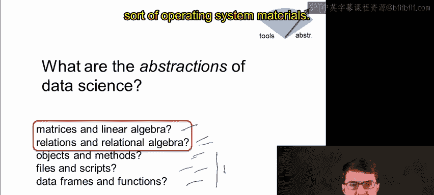

# 杜克大学《大规模数据科学（大数据操作，第1课／共3课有视频）｜Data Science at Scale》 - P12：11_桌面规模与云端规模.zh_en - GPT中英字幕课程资源 - BV12s421T7tJ

。

Okay， so fine we're going to focus on the abstractions。 What are the abstractions of data science？

It's not clear that people really know yet， and I'll give my case for this in the next slide。

 but the reason why I don't think we really know yet is you see these words being used like data jujitsu and data wrangling and data muing and this is the real skill of data scientists is they have to be able to wrangle data well what does that mean？

So my translation of this is we don't really know what we're talking about yet。

Now if I had to choose what are the abstractions of data science there's maybe these candidates and there might be others so one is it's all about the math and so everything is a matrix and everything you do with the matrix and some sort of linear algebra expression and then I think this is a valid viewpoint another view is that everything's a relation and most of what you're doing is some variation on relational algebra perhaps equipped with these user defined functions and if this seems very foreign。

 this may seem very foreign to you， certainly if you've never heard of databases never really use databases too much well hopefully you've heard of them because that was a prerequiite of the course but even if you don't use them that much this may seem form or rather even if you do use databases a lot you may not be too familiar with relational algebra but we'll talk about it。

But the point is it's a candidate as a sort of universal abstraction for working with data I think and i'll try to motivate that more Another view is if you're more familiar with sort of object or a programming languages is that you know well everything's an object and we manipulate objects by passing messages back and forth and calling methods on each other and that really can model the world and that's probably。

Thu。啊。F， so that's a candidate Another one is well everything's a file and we're all going to sort of write scripts over files and if you're familiar with the language。

 say pearl or even to some extent R， although the next bullet here is more about R。

This is the the lay of the land， right， Everything stored in a file and you manipulate these files by。

Writing scripts over them。I guess assists admins also probably like this view。

 it's all just sort of text files and scripts and batchsh scripts that process them。

Another view of the world is that there's this notion of data frames and then functions that you can call on them。

 and this is really ours。Data model， but of all these candidates。

 I would argue that the first two are really the only ones that we ought to be thinking about and the reason。

Is that they're the ones that are most focused on the kinds of tasks that we're going to be doing with data and especially large scale data。

 These other ones are more for organizing code or in this case， you know， sort operating system。

Materials。So now I want to motivate。Desktop scale versus cloud scale。

You know the argument here for desktop scale is that well you know data science is really about the functions and the statistics and the manipulation。

 the techniques， so therefore we can sort of push large scale data into a separate course or a separate category and really just focus on the math and the functions and I think this is a bit of a mistake for a data science course and the reason is is that。

You knowThis is a fundamental limitation of a whole category of technologies and R itself is included in that。

 although there's a lot of great work on how to sort of scale our up。But as it added。

In its basic usage， what you do with R is you read a file。

 load the whole thing into main memory on one machine， and then call functions on that。

 and so if your data doesn't fit in main memory on one machine， you're kind of out of luck。Now。

You can be clever and start to use。Indices to kind of limit the data that you need to access and you can start to try to be parallel to take advantage of the fact that there's now you know four and six and eight and 12 cores in your machine in your computers you'll buy nowadays but。

Trying to be clever in doing that yourself。Overlooks the fact that a lot of these techniques are pretty well understood and already implemented in other systems。

Okay， so being able to be cognizant of what other systems can do and take advantage of those flexibly and you know write your application in terms of these other systems that already do scale out is a critical skill in data science and so the point being made in this slide that is somewhat out of date although you can get the idea is that。

Simple simpleple tools that are available in every machine such as GP。

 which if you haven't heard of rep if you're a Windows user and don't use GP too often。

 this is essentially search a file for a particular pattern。

 but it searches it linearly right it looks at every single。Line of。

The file and checks for the pattern and so you can do a linear scan of a megayte in maybe a second and a gigabyte in a minute and so on。

 and so at very large scale data sets， you can't do this linear scan anymore you have to search in more in a smarter way。

Okay， and he sort of has some costs over here that are probably horribly out of date now。All right。嗯。

反周。The point is large scale data is not just bigger， it's different。

 it requires a different way of thinking about techniques and it requires a different stack of technologies and to ignore it's mistake to ignore that in a data science course。

