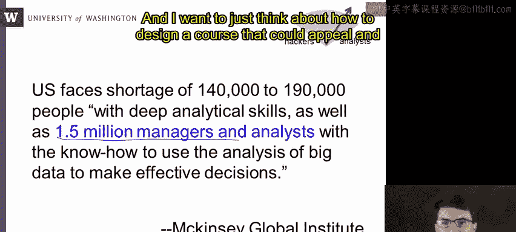

# 杜克大学《大规模数据科学（大数据操作，第1课／共3课有视频）｜Data Science at Scale》 - P13：12_黑客与分析师.zh_en - GPT中英字幕课程资源 - BV12s421T7tJ

。

And then this final dimension of sort of hackers versus analysts and again what I mean here is you know am I going to require sort of deep programming proficiency in order to participate in this data science class and in general in the data science kind of activities and the answer is I don't think so I think we need at least two types of people and really sort of a broad spectrum of people and this isn't really my idea this often quoted report from the McKinsey Global Institute。

You'll see this quote time and again， but the people that use this quote tend to focus on this first part that talks about 140。

000 to 190，000 people with deep analytical skills， but the second part of the quote is。

 well you also need 1。5 million managers and analysts。

Who know how to use the analysis of big data to make effective decisions。 Okay。

 so this means that it won't be just the。Programmers who are working in this space。

 and I wanted to sort of think about how to design a course that could。

Appeal and inform both categories of people right。

And this is my last side of this segment。The other reason why I think hackers versus analysts is that the line between them is kind of blurring nowadays and technology can actually help here right it doesn't require a PhD in computer science or a bachelor's degree in computer science even in some cases to manipulate large data sets and in order to back up this claim giving an example from some of my work where we have done some work to try to make databases easier to use for say biologists and this really nasty looking SQL query that if you squint closely you can see that it's actually doing interval arithmetic over genetic sequences this。

Is a pretty tough query to understand for even experts this was written by somebody that doesn't do any programming whatsoever。

 she doesn't write a line of Pythons， she doesn't write a line of pearls。

 she doesn't write a line of R and she's able to write these SQL queries that process very large data sets。

So the fact that if you understand what's going on and if you can think in terms of some of these abstractions。

And you understand your problem well enough？You can participate in the activity of manipulating large data sets and doing data science even without a deep background in software engineering and that's why I want to push this needle somewhere over this way。

I probably put this in the middle， I suppose I'm not so much trying to focus on only the analyst。

 I just want to make sure that they're included。O。Next time we'll pick up with the last dimension。

