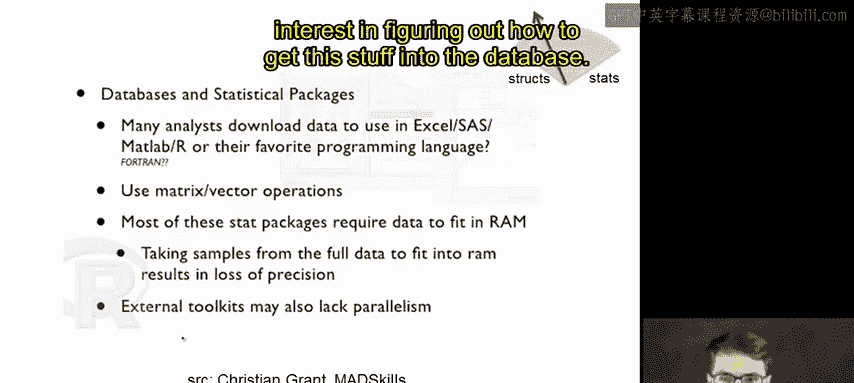

# 杜克大学《大规模数据科学（大数据操作，第1课／共3课有视频）｜Data Science at Scale》 - P14：13_结构与统计.zh_en - GPT中英字幕课程资源 - BV12s421T7tJ

。

Welcome back last time we talked about three out of four of these dimensions in describing how we designed this course in data science and so in this segment I want to talk about this。

Last dimension of what I what I callstructs versus stats。

 And so this is the relative importance of data manipulation versus deeper mathematics。

 And you can see that I've sort of put the。The dial here a little bit to the left。

 and I'll try to motivate that in the next few minutes， all right。

So we already saw one example of this in the first segment where I gave some examples of data science from you know recent history and one of these was Nate Silver's prediction of the Electoral College。

Votes for the 2012 U。S。 presidential election and if you recall you know。

This prediction was accomplished by essentially taking the average of the state polls for each state。

So it didn't really require a sophisticated statistical model， and yet it had massive impact。

So a quote that I think sums this up a little bit comes from Aaron Kimball at a company called Weebi data where he says know 80% of analytics is really just sums and averages and so if you can get these what he means by this is if you get these sums and averages right。

 if you can do it at any scale on any data that you might see。

 then you can always sort of build up and more advanced techniques。

 everything sort of boils down to just sums and averages。

 so I think this is a motivation for why focusing on data manipulation which typically is associated with being able to express sums and averages。

 for example， what you can do in a database query which we'll talk about in the next couple of lectures。

That gets you a pretty long way， it gets you 80% of the problem。

So another way of looking at this is that there's three main tasks involved with。啊。

You know a data science project there's you know preparing to run the model running the actual statistical model and then interpreting the results and communicating it I got the animation out of order here so you can ignore that red but the point here is you know again Aaron Kimball from a conversation with him is where I got this was know 80% of the work is really in this first step where you're gathering data and cleaning it and integrating it and restructuring it。

 transforming it loading it and so on right so verifying all these verbs you see here this is the hard part right and so actually running the model even or even choosing the model and then running it doesn't tend to keep people up at night in practice okay。

So and then the joke here is perhaps that the other 80% of the work， you know。

 implying that there's sort of 180% of a normal task is in data science is in this interpreting the results。

 so this is the visualization and the communication and the explanation of the results okay。

So there's another reason why I want to focus in this course on。

Data manipulation tasks that are associated with this first number one task。

You know another way of looking at this is a quote that's now really old right so this is 12 years old or so at the time of this recording from Doug Laney and this is the document that first coined this notion of big data being the threeVs of volume velocity and variety and we'll talk about that in a couple of segments but he has this quote you know no greater barrier to effective data management will exist in the variety of incompatible data formats not alignedign data structures an inconsistent data semantics so what the database community know my community calls the data integration problem。

 this is the hard part and so he was saying this and back in 2001 and I would argue that it's still true today。

 this is the greatest barrier and in the context of this he was talking about this notion of variety being harder than volume or velocity and I'll explain more about what those Vs mean in a couple of segments。

All right， so another vignette here is something that we like to ask the scientists we work with。

 so these are astronomers， oceanographers and biologists。

Ask them sort of informally how much time they spend quote handling data as opposed to quote。

 doing science Now， you know， we let them interpret these quotes however they want。

 But what we mean by doing science， you know。Choosing a statistical method or designing a statistical model。

 they absolutely consider part of their science。 And so we mean by handling data is all the other crap。

 you know， the format conversions and so on。 And so what do you think the most common answer is here。

You can guess yourself for a second， but they don't even blink it they say things like 90%。

 and so this number should you know give pause， right。Taxpayer money that goes to federal。

Funding agencies to come back to pay some postdoctoral fellow to spend 90% of her time doing something that she doesn't even consider science。

 And so this is why I think it's really important as a data scientist to focus on this problem。 Now。

 you might say， well， that's just science。 What about business。 but as I。

We'll try to make the point throughout the course， there's an increasing alignment between what's going on in business and what's going in science。

Okay， and we'll talk about that more in a couple of segments。All right。

 so if 90% of the problem is handling data， you know， boy。

 we ought to spend a lot of attention on that。All right。

 so you know another argument that sort of follows on the first slide that I gave is thatstructs。

 you know the data manipulation platforms and databases in particular actually go a pretty long way to being able to express more advanced things and this isn't just a matter of oh well you can express anything if you have sums and averages。

 it's also even。Fairly advanced techniques。 you can。 there's an increasing amount of interest in。

Figure out how to get this stuff into the database。

