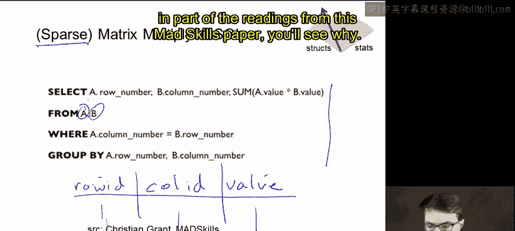

# 杜克大学《大规模数据科学（大数据操作，第1课／共3课有视频）｜Data Science at Scale》 - P15：14_结构与统计（续）.zh_en - GPT中英字幕课程资源 - BV12s421T7tJ

。

So this is a slide I'm taking from Christian Gr where he argues that look， know。

If you consider databases versus statistical packages such as。SAS or MA LaB or R or SPSS。啊。

This is what they're doing now they're taking they're downloading data to use in their favorite statistical package frequently under the assumption that well of course I have to right。

 of course that's the only thing that can possibly express this well。Look， you know。

 most of these sta packages， the first thing that you'll do is read the date off of disk and load it into memory and then start calling functions on it well。

If increasingly data sets simply don't fit in memory on a single machine certainly not on your laptop。

 and so you have a couple of choices here， either you shift into some kind of fancy cluster version of the tools for which they exist for things like SPPSS and MATLAb。

 although they're quite expensive。Or you sample the data so that you only have only can work with a subset that actually does fit in memory and you'll see this to be。

Very， very common is that it's just par of the course to take a sample of the data。

In order to be able to work with it efficiently but the point here is that this isn't really required if you use different packages in this case。

 the argument here is that if you can use databases。

 if you can figure out how how to perform your task in the database。

 you'll get the scalability for free more， you know these toolkits don't don't necessarily have any kind of notion of parallelism right so even if it does fit in memory。

 every machine you buy nowadays has at least four cores in it probably more like8 and soon to be 12 and 16。

 so to take advantage of all those cores on your problem is something you're going to be looking for in a package and this is something the databases can do automatically most databases not all。

 in fact the ones you may be familiar with MySQL and Postgres typically do not but。

Other databases will， and we'll talk more about this。Okay。

 so you get parallelism for free if you can use a database and you get scalability beyond the size of main memory for free。

 if you can use a database and that's perhaps a big if and we'll talk about it okay。

Let' me give you an example here and you'll actually do this as part of a homework assignment but you know can you express matrix multiplication in SQL and if you can then I'd argue well hey now any formula that you can express using matrix multiplication。

 you can perhaps express an SQL by doing this over and over again and the answer is yes and in fact the simplest version of this is pretty straightforward so if you haven't ever seen SQL before don't worry we're talk a little bit more about this but if you have you know bear with me imagine you have two matrices A and B oops。

 I'm using the wrong device here two matrices A and B。

And what you want to do is find all the you know and the。

The representation of each matrix here is as a。诶。R。😔，Excuse me。R I D。Kowen。😔，Haidi。In value。

So that's your relation now。This is a very inefficient relation if your matrix is dense。

And I'll let you think about what， well， I'll tell you why。

 and you can think about a little bit more as well， is that， you know。

An implicit representation of this only has the， let's say you have in row。

 let's say you have five rows and5 and  six columns。 Then you only need the 30 values，5 times 6。

 But here you're doing， you have to do。30 row Is。Plus 30 column Is， plus 30 values。

 So you sort of tripled the size of your data relative to you know efficient main memory representations。

 So why would you do that， Well， it turns out that a lot of matrices in practice are sparse。

 And I put that word right up here at the top。 in a sparse matrix。

 not all the cells actually have a value。 And so you don't actually need to store them。

 And so this representation in terms of know explicitly having a row idea。

 a column I in a value turns out to be pretty efficient。Okay。And in fact， sparse matrix solvers。

 this is exactly the kind of representation they use internally。All right。

 so if you have a sparse matrix and if you encode it in if you represent it in a database。

 then expressing matrix multiply is not too bad， what you want to do is find。All the columns。

For each column number in the matrix A， find the corresponding row number。In column B。

And then add up all the all the contributions to the new value。

 and I'll show a diagram of this after it。 In fact， in fact。

 you know what let let me skip going into too much detail about this right now because I'm going to talk about this in detail in preparation for the homework where you'll do this。

 So right now I guess to take away what I want you to take away is that。

Do you know representing matrices inside of a database sounds very unusual。

 it's actually not the world's worst idea and in part of the readings from this Mad skillss paper you'll try to you'll see why so right now I just want you take away that it can be done and it's not necessarily a terrible idea。

