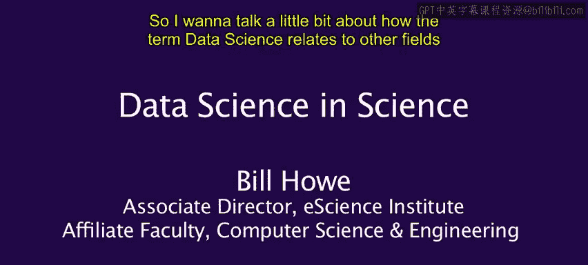
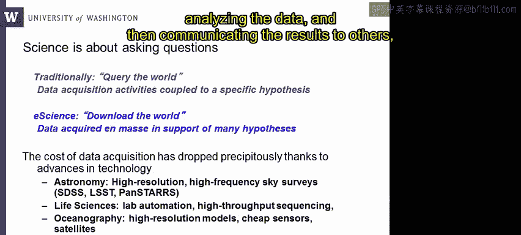

# 杜克大学《大规模数据科学（大数据操作，第1课／共3课有视频）｜Data Science at Scale》 - P16：15_科学的第四范式.zh_en - GPT中英字幕课程资源 - BV12s421T7tJ

。

Welcome back So I want to talk a little bit about how the term data science relates to other fields of science。

 and in particular， I want to introduce this term E science。

 which to a first approximation you can think of as equivalent to data science so while the term E science associated with astronomy and oceanography and biology。

 data science has been adopted more in business but they involve a lot of the same concepts So let me tell you about what's going on in science so for thousands of years know scientific inquiry has been empirical right you observe the natural world or in some cases maybe replicate the natural world in a controlled environment in the laboratory and make observations about that in the last you know few hundreds of years。

 science has accepted theoretical models as a valid method of inquiry。

 one that is reinforcing empirical methods so you know new theories suggest new experiments and the theories help explain the observed data you get from the experiments。

In the last 50 years or so， highpe computation has emit an entirely new method of scientific inquiry you can simulate in the computer phenomenon that otherwise couldn't be you instead you can't observe directly and you can't reproduce in the lab and even the theoretical models become too complex to solve analytically using essentially paper and pencil but you can actually start from initial conditions and run the simulation to get a result。

 so this is maybe what goes on in the interior stars or the shift of tectonic plates or the evolution of the universe or the effects on the ecology from some species dying out and so on。

So that's fine， so that's three methods of inquiry， but in the last 10 years or so。

 there's been arguably a fourth method of scientific inquiry。

 which is to acquire massive data sets from instruments or from simulations and then explore these data sets using new algorithms and new infrastructure and so eScience is really about massive and complex data data large enough to require automated or city automated analysis。

 you can't look at it， you can't inspect it directly。

And so the relevant tools here are the same as those for data science， you know， databases。

 visualization， scale out computing， maybe even no SQL systems， machine learning techniques。

Web services and so on。So the way this， this。Id of the fourth paradigm。

 There's a book that's in the reading list that you can refer to here。

 and there's a lot of there's some other articles in the reading list that you can also refer to the story's been told lots of ways。

 The way I like to talk about this story is that science has always been about asking questions。

 but conventionally， it was really about querying the world， right You would sort of。

Have data acquisition activities， experiments or field studies。

That were coupled to very specific hypotheses right you had the question in mind first and you went out to collected data。

 but eScience has really sort of shifted a bit where now you're kind of downloading data on mass。

 you're downloading the world first putting into some sort of a representation in the computer and then querying that database to test your hypotheses。

 and so the data can be acquired independent of any specific hypotheses in some cases。

And this is due in part to the cost of data acquisition be dropping precipitously things to advanced technology right so the telescopes you can build now that we'll talk about in the next couple of slides can acquire enormous amounts of data at very high resolution and in the life sciences you have sort laboratory automation and you have high throughput sequencing and oceanography the sensors are getting cheaper the models things to advances in things to Moore's law and advances in computing the simulations you can run are getting bigger and higher resolution and therefore producing large and large amounts of data and so on and so the rate at which data can be produced has far outpaced the rate that we can analyze it or come up with the questions we need to ask about it the cost of finding integrate and analyzing the data and then communicating the results to others of the new bottleneck and this story should sound very similar to what we've been saying data science is all about。

