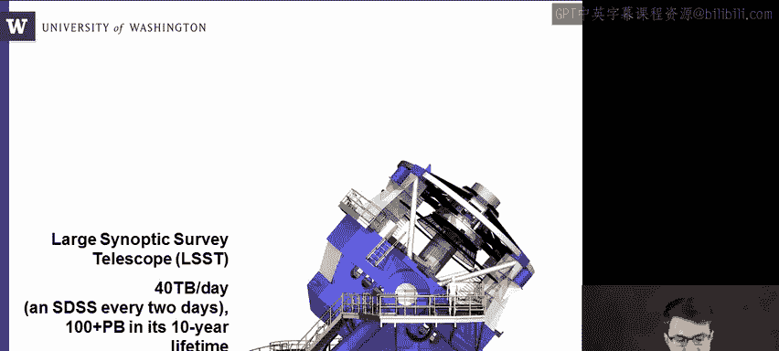
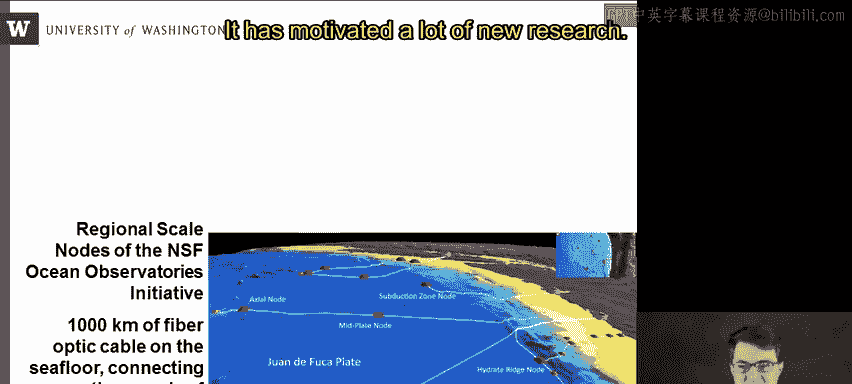
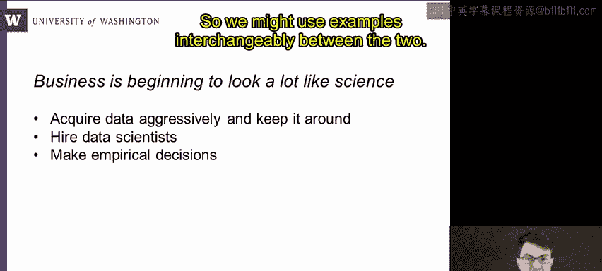

# 杜克大学《大规模数据科学（大数据操作，第1课／共3课有视频）｜Data Science at Scale》 - P17：16_数据密集型科学实例.zh_en - GPT中英字幕课程资源 - BV12s421T7tJ

。

Now the problem is is that the same technology stack and to some extent even the same approach is difficult to apply in this case of the large synoptic surveyvey telescope。

 the reason why this guy is producing so much more data is not just that it's much higher resolution and can perceive a much deeper field in the sky but also because it's returning to the same point in the sky frequently every three days and so this allows you to look at things that change over time so asteroids commons you might a supernova and so forth and by comparing these images in the time series。

啊。There's all sorts of new questions you can ask okay。So。

Both because of the science they're going to do and because of the sheer scale and because of of the complexity of the details of how the data is acquired the existing。

The previous solution won't work and so this is motivating a whole new area of research to study data management techniques and data analysis techniques to support this project。

So in life sciences， these high throughput sequencers are capable of producing terabytes per day when run continuously and major labs that do this work such as the Joint Genome Institute have 25 to 100 of these machines running all the time right so this is spiing out an enormous amount of data。

Forces。I was going to say a variety of samples， so it may be individual organisms or it could even be samples from the environment where there's no one particular organism in there。

 but there's entire population so for a variety of uses these guys are able to spit out the data。

In Oceanography， the regional scale nodes of the NSF Ocean Observatories Initiative is a project led here at UW。

 Ocean Observatory initiative is a multi institutional partnership。

 the regional scale nodes part is run at the University of Washington。

This project has all laying1 thousand kilometers of fiber optic cable on the sea floorloor。

 connecting thousands of instruments in chemical， physical， and biological。啊。

Thousands of chemical biological and physical sensors。

 including live video from the sea floor to measure to monitor volcanic activity okay so again the database。

if not a relational database， the data sets and data infrastructure required to support this effort is significant as motivated a lot of new research。

In the information space there's a lot of science to be done directly on the web itself and so just the web you know a single computer can read 30 to 35 megabytes per second from one disk and so it would take about four months just to read the entire web so summing up a little bit E scienceence about the analysis of data so the automated or semi automated extraction of knowledge from massive volumes of data and so your main instrument for looking for answers is are the algorithms in the technology as opposed to direct inspection there's just too much of it to look at yourself。

But it's not just a matter of volume as we'll talk about in the next segment。

 this is another link back to what's going on in business right there's this concept of big data and there's the three vs of big data that we'll talk about a little bit more next time。

 but let me just mention them here where volume sort of the three vs or volume variety and velocity that you'll read about and I'll give you where the terms came from in the next segment the volume refers to just simply the number of rows of the number of bytes the sheer scale variety is perhaps the number of columns or dimensions。

 but in science， for example， a lot of。In the life sciences in particular， you'll have。

Experiments that involve accessing multiple public databases as well as multiple sensors。

 your own data that you've collected and that of your colleagues and the integration task and putting all this data together is。

A significant bottleneck， even the even when the actual scale of the data is not necessarily all that bad。

 Okay， so this is the complexity of the data。 And then the velocity， you know。

 we saw with the large large optic survey telescope that。You know。

 although the scale itself was enormous， the fact that。

40  TBabytes are being collected every two days means that the infrastructure needs to keep up with that pace and just transferring that data from the telescope facility to the data analysis facility is an engineering challenge okay and you'll also see other Vs here where things like veracity。

 you know can we actually trust this data？So a bit more of that next time。So to summarize here。

 science is in the midst of a generational shift from a data poor enterprise where you can never know there's never enough data to a data rich enterprise where there's so much of it you don't know what to do with it and as a result data analysis has replaced data acquisition as the new bottleneck to discovery so it's not that the cost of going out and getting the data it's the cost of actually analyzing the data you might already have。

So this is fine， but what does it have to do with business， which is probably where a lot of you are。

Coming from and where your interests lie Well， what we see is。

That business is beginning to look a lot like what's always been happening in science。

 so though you know businesses are requiring data aggressively and keeping it around indefinitely in case it becomes useful。

 they're beginning to hire people that have training and skill sets that look a lot like what's。

Been important in science for a long time， especially mathematical depth and there beginning to make decisions with this data that are very empirical。

 So we're always want to sort of back up every decision with a a clear case based on。

Data and so for these reasons， I think that you can take the lessons learned in science and apply them in business and actually vice versa as well。

 because one thing where science is's lagging behind business is in the adoption of technology。

 there's been there's been proportionly a lot less spent on IT infrastructure in science than there has in business and so there's it's a great time for this。

 there's this cross pollination of ideas between both fields。 Okay and so。

Going back to this first slide that I gave， Eci and data science have essentially everything in common。

 so we might use examples interchangeably between the two。

