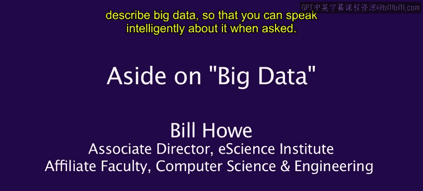
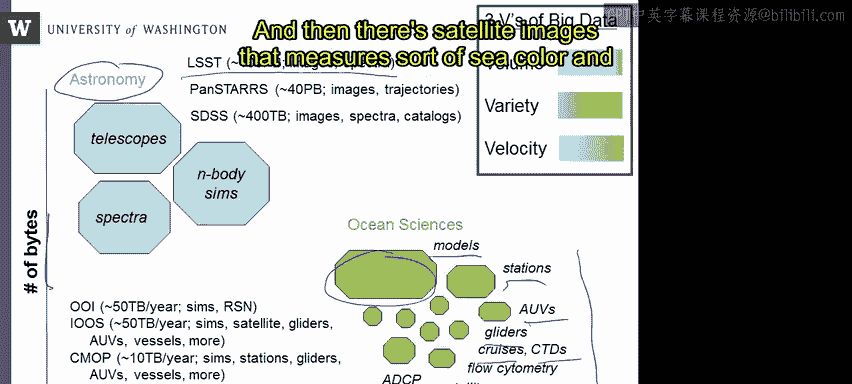

# 杜克大学《大规模数据科学（大数据操作，第1课／共3课有视频）｜Data Science at Scale》 - P18：17_大数据与3V.zh_en - GPT中英字幕课程资源 - BV12s421T7tJ

。

So I want to spend a little time on the term big data。

 and I'm not too concerned with any sort of technical definition of the term because it probably doesn't exist。

 but I want to arm you with some of the language that people use when they describe big data so that you can speak intelligently about it when asked。

Probably the main thing to recognize is this。Notion of the three Vs of big data。

 which are volume velocity and variety。 And we talked a little about this in a previous segment。

 So just to repeat， know a volume is the size of the data。

And you measured in bytes or number of rows or number of objects or what have you sort。Vertical。

diimenssion of the data。 The velocity is you know what I'll say here is the latency of the data processing relative to the demand for inactivity。

 and that's maybe a mouthful。 but what I mean by that is you know how fast is it coming based on how fast it needs to be consumed and so there's a lot of applications for which interactive response times is increasingly important if not if not directly important and so when this becomes the bottleneck when this becomes the challenge then this velocity term starts to become pretty relevant and the one that I think is really pretty interesting to me and is near and dear to my hardwi by research is this notion of variety and so here the problem is you know an increasing number of different data sources are being applied for any particular task and so you need to pull out you know ASI files as well as download data from the web as well as pull data out of some database as well as use some nosQL system。

And so on， and the integration of all these different data sources。

I a pretty significant problem and can end up occupying a lot of your time and so I may just point a couple of segments ago about researchers who spend 90% of their time quote handling data。

 this is where a lot of that time is going， this notion of variety okay。

So all three of these are relevant in performing sort of data science tasks。

let me give you another notion and I'm going to go back to use science examples and you've seen some of these before。

 but if you sort of make a plot of number of bytes on the Y axis versus number of data sources。

 maybe columns of data in a single table or columns data across multiple tables or a number of distinct data sources on the X axis。

 you can sort of map out。Different fields of study or different problems and sort of see where they lie。

 and so typically astronomy has been。Challenged by the sheer volume of data and so they're sort of up here we're high on the Y axis but know but the number of actual sources in astronomy is not too high。

 there's telescopes， there's these spectral images and then there simulations of the galaxy and so that's relatively few in say the ocean sciences and certainly in the life sciences although I only show one example here the variety is really more of a challenge the actual sheer scale is not as high as hundreds of petabytes that can be generated by these telecope infrastructures like the large synoptic survey telescope。

But the number of different types of instruments you can use to acquire data is large and ever growing right so you have these glider systems that will go out for months of their time and kind of ppoise through the water you have autonomous underwater vehicles that are more for short term missions that are sort of driven around flown by wire or well they're sorry they're not flown by wire。

They do run autonomously， but they sort of powered it。

You knowWe'll look at much more finer scale phenomenon， you know。

 there's oceanographic cruises where they deploy these conductivity， temperature and depth。

Instruments that can take profiles of the water right， So this is， you know， at a fixed X。

 Y and a varying Z and a varying T， varying depth and a varying time while the gliders are sort of varying all in all four dimensions。

 you have these simulations that are probably one of the largest sources of information。

 So the size the of the glyph here tends to be you know how much of space it can occupy in this。

In this XY space， and so models range from large to small and have a lot of variances and that's why that circle is kind of big。

Right， so these can be mesoscale sort of at the order of you know entire the northern hemisphere or the old Eastern Pacific。

 or they could be models of a particular bay or inlet or estuary。

Connected to a river and connected to the open ocean， so a much smaller scale thing。

 so there's a lot of diversity there。And I say stations to mean these sort of fixed stations where there's a particular sensor deployed at one location and just measuring across time。

 ADCP is an acoustic doppler or something profiler where they're using sound waves to to record the time that the sound waves take to bounce off particulate matter in the ocean and they can therefore measure velocity and so this gives you an entire profile of the velocities in the ocean you can mount these on the seafloor pointing upwards where you can mount them on the bottom of a bow point downwards and so on。

 and then there's satellite images that measure sort of sea color and wave breaking as well。

