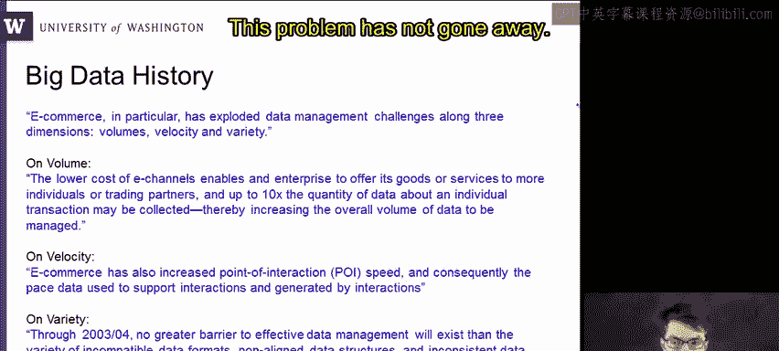

# 杜克大学《大规模数据科学（大数据操作，第1课／共3课有视频）｜Data Science at Scale》 - P19：18_大数据定义.zh_en - GPT中英字幕课程资源 - BV12s421T7tJ

。

You know here the blue is perhaps high volume but relatively low variety and the variety is the green and so on so this is from science examples but you can do the same thing with I claim you can do the same thing with enterprise problems where a lot of times you know it might be pulling together hundreds of spreadsheets and that can take three weeks even though the size of the data is you know less than sort of 10。

000 rows or something。Versus a data warehouse that's many hundreds of terabytes and these。

Infrastructure required to manage it is the real challenge。So fine。

 so just a little more on the term big data。The notion that Mike Franklin at the University of Berkeley uses which I like is that you big data is really relative right it's any data that is expensive to manage and hard to extract value from so it's not so much about a particular cutoff know what makes it big is it a petabyte scale is big versus a terabyte scale is small or a gigabyte scale is very small since it fits in memory on your machine know not necessarily it depends on what you're trying to do with it and it depends on what sort of resources and infrastructure you have to bring to bear on the problem and so in some sense difficult data is perhaps what big data really means right it's not so much about big it's about it's about being challenging and so this is really important to remember that big is relative。

You actually let me make one more point about this what you'll see on a lot of times in talks from people who are working in big data areas。

 there's a temptation to throw up the biggest numbers you can right so we have 60 petabytes in a database or we have an instrument that's collecting 40 terabytes a night or something and so this alone doesn't convey much about what the actual challenges are。

 this could be actually not that big of a challenge if you immediately reduce that the size of data with simple methods to something much more smaller and more manageable so again big relative so there maybe be a little bit of history of the term big data there's the earliest notion I could find was from Eric Larson in 1989 where he says the keepers from Harper's magazine eventually went into a book the keepers of big data say they do it for consumers's benefit but data have a way of being used for purposes other than originally intended so his point was not really about technology at all。

 it was just a notion that data is being collected for one purpose and being reused for another which is a theme that I mentioned in the very first segment in this course and will come back to over and over again。

So I think he had it right in that sense， so his real point was that about consumer private data starting to be commoditized。

 which was absolutely true and fairly prescient at the time since it's become a big issue now。

 but and it's been perhaps especially impressive that given that this predates the rise of the internet and it already sort of foreshadows。

Very topical issues in big data， such as ethics and privacy and sensitivity and so forth。

 that we'll talk a little bit about。 But this isn't quite what we mean by big data nowadays。

 typically because it didn't have that technology aspect to it。

 It didn't talk about the challenge of， actually。Managing these data sets。Okay， so another。

Point of reference is that。More recent reports from some of these consulting firms get credit for these notion of 3 theses。

 but really the original source of this was a report from Gartner in 2001 written by a guy named Doug Laney and so we talked about volume velocitying variety which we've said but let me just give you a chance to look at these quotes you know so in volume it's。

He's really talking about sort of business to business。 If you think about 2001。

 this is around the dot co boom。 And so we're going trying to figure out what。

This new era of technology was going to get what the internet was really going to give to them beyond just sort of putting up a web page and serving it out to your customers what how are you going to be able to interact with your supply chain or your。

Your vendors and so on okay and so this is what you needs by this notion of echan but you know up to 10x the quantity of data about an individual transaction may be collected know absolutely true that this data exhaust this point we've made a couple of times is giving rise to a larger scale of data being collected and on velocity well is increase the point of interaction speed so this is that need for interactionivity that didn't used to be so required but there's the velocity of all business and all transactions sort of increase so do the constraints on the infrastructure used to process it and then a variety know I like this one a lot so through 2003 through 2004 right so he was being sort of fairly conservative about how far out you wanted to predict。

No greater barrier to effective data management will exist than the variety of incompatible data formats。

 non alignedign data structures and inconsistent data semantics。 And so this is great。 This is。

 this is， you know， he could have said this for the through 2015 and been arguably correct。

 This problem is。Not gone away。

