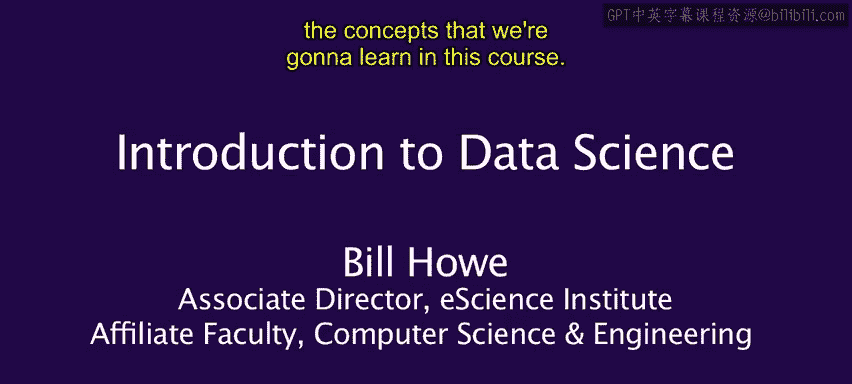
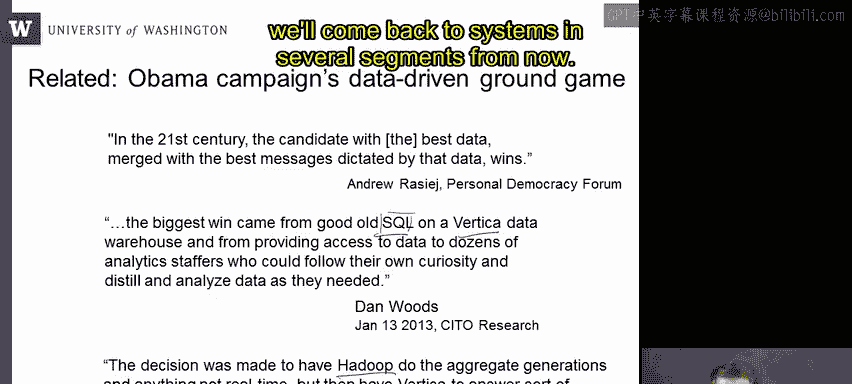

# 杜克大学《大规模数据科学（大数据操作，第1课／共3课有视频）｜Data Science at Scale》 - P1：0_激发胃口：政治.zh_en - GPT中英字幕课程资源 - BV12s421T7tJ

。

Welcome to Inuction to data Science my name is Bill How and I'm the director of Research for scalable Data Anatic at the University of Washington E Science Institute。

And an affiliate assistant professor in computer science and engineering also at the University of Washington so in this first segment what I want to do is go through some examples of data science activities and projects from the recent past that I found interesting and use them to sort of wet your appetite for the concepts that we're going to learn in this course。

Okay。So the first one I want to。Mention here。Is the presidential election from 2012 and I know you're probably sick of hearing about this' if you live in the United States and even if you don't you may be sick of hearing about a but bear with me so this is a map of the Electoral College and each state is colored by the for the candidate that took the electoral votes and the numbers represent how many electoral votes each state has and so if you recall what was interesting about。

This map at the time was that it was or that it led to a pretty significant discussion in the media about data science because Nate Silver of the 538 blog was able to predict this map perfectly before the election。

All right。And you know that discussion in the media had talked a lot about you know what a geniusnateate Silver was and mentioned the sophisticated mathematics he was using and how you know he's sort of a whiz with these things。

 but what I thought was interesting about this was thatnateate Silver would be the first one to tell you that the methods he was employing to make this prediction were actually pretty simple and so he says here in a series of quotes from blog posts around that time。

 this first one from October 26 was the in behind this ought to be very simple， Mr。

 Obama is maintaining leads in the polls in Ohio and other states that are sufficient form to win。

270 electoral votes and then all was funny was you know a few days later he becomes sort of more blunt。

 the argument we're making is exceedingly simple here it is。

 Obama's ahead in Ohio right it's not a magic trick。And so then after the election on November 10th。

When he was shown to be right and got this sort of flawless prediction。

The blog post that this last quote was taken from，op excuse me。

 that this last quote was taken from was。Describing why he started the 538 blog in the first place and he says。

 look， you know the bar set by the competition was invitingly low。

 someone could look like a genius simply by doing some fairly basic research into what really has predictive power in a political campaign and so what really had predictive power in this case was the state polls。

themselves aggregated right so historically the state polls aggregated did a pretty good job of predicting the outcome of the general election and so that's what he did now there was some sophisticated work in quantifying the uncertainty and certainly in presenting these results there's a lot of beautiful interactive visualizations that he created in order to sort to convey these ideas to the public and that's one of the points I want to make about this is that getting the answer in some cases is the easy part it's in。

interpreting the results and in convincing others of the results by presenting them usually through visualization that can be the hard part and this is one of the themes that we'll come back to throughout this course。

Okay。So just to summarize that， though I'm not sure I said this。

That simple methods plus enough good data。You know， wins。

 that trumps more sophisticated methods in many cases。

 and that's another theme that we'll come back to。All right。

 so something else related to the campaign before moved on to other topics。

Was the system that the Obama campaign used for their data driven ground Green， so to speak。

ability to sort of target direct you know target specific categories of users and so what they did was they built and maintained a really significantly saw a massive voter database and used it to design these highly tailored messages to very very specific groups so you know the mother of two in a small town in Ohio who tweeted about the environment and mentioned organic vegetables on our Facebook page and you know who had voted in 2008。

And had registered on Obama's website， but had never donated， okay， you know。

 she would get a message from Michelle Obama that highlighted Barack Obama's environmental policies。

Okay and so in order to design these messages what you had to do is kind of do ad hoc hypothesis testing about what might work and what didn't you have to kind of slice and dice this data at kind of interactive speeds and this another theme that we'll return to is the need for these kind of ad hoc interactive analysis and the systems that used for this are pretty interesting too you know this was a SQL database。

 a very fast one called Vertica and we'll talk a little bit about what makes Vertica special I hope toward the end of the course but it is a SQL database and so SQL sometimes gets a bad name in data science context as sort of the old guard that can't be possibly used for analytics and doesn't really make sense in todays era but。

You know don't believe it right it has a role to play in many cases。

 and so here you know they did use Hadoop。To do the aggregate generations of anything， not real time。

 he says here， but for the speed of thought queries about the data， they used this vertica database。

And so we'll come back to systems。

Its says several segments from now。