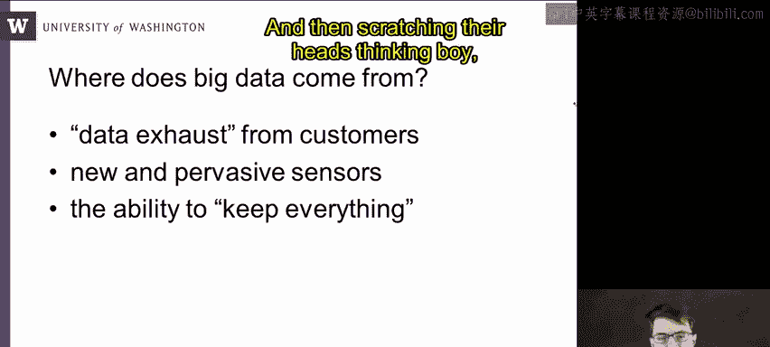
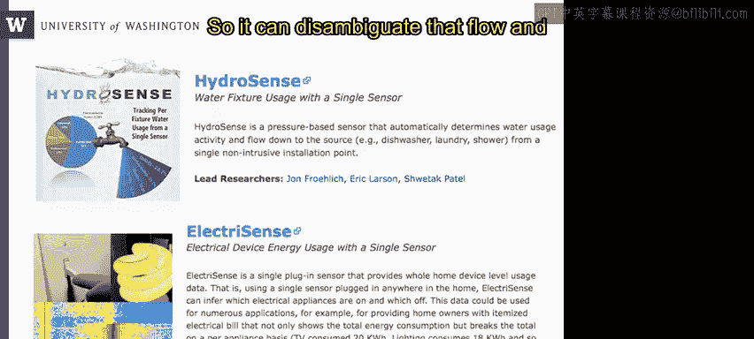

# 杜克大学《大规模数据科学（大数据操作，第1课／共3课有视频）｜Data Science at Scale》 - P20：19_大数据来源.zh_en - GPT中英字幕课程资源 - BV12s421T7tJ

。

All right， so another point in the history of this term Big data， there was a series of talks。

 a lot of work by John Masey，' who was formerly the chief scientist at SGI who would talk about big data being the next wave of infrastructure stress and so what do you mean by in was what's going to really drive the technology forward。

Where are we going to feel the pain and his point was that the IO interfaces was where it was tough so in particular discapacities were growing incredibly fast and still are and that the latencies are not keeping pace right so you can go down to a local store and buy a 3terabyte drive for probably $200。

But the rate at which you can pull data off that is essentially the same as it's been for many。

 many years， and so now it takes you hours to actually read every bite of data on that disk that you've stored。

 and so this is a problem。Because the actual analysis you can do over all this data you know we can keep it and that's fairly cheap but we can't actually do anything with it because the pipe is sort the small okay and so this is one of the argument he made several sort of very cogen arguments about where the bottlenecks are in the infrastructure。

 but they all sort of revolved around this idea that large know big data and big data processing we're going to be the stress point and so this is probably a pretty。

Appropriate use of big data， although John actually has said you know that he doesn't he's not sure that he deserves any credit for。

Coining this term since it's a fairly generic term。

And he was using it in one way and we use it now in a related way。

 but it's not necessarily that it captures everything we need today， and I probably agree with him。

All right， so just another quote about big data sort of today where we're。

Trying to capture exactly how it is being used you know the necessity of grappling with big data and the desirability of unlocking the information hidden within it is now a key theme in all the sciences and you I like this arguably the key to scientific theme of our times and so we've talked about science we talked about the fact that I think what's going on in sciences more or less equivalent to what's going on in business and so I think this is。

This is nice right it's really maybe the key problem across all fields is unlocking what's going on inside big data right getting some extracting value out of big data right。

So the final point I want to make is you know where does all this big data come from and we said this a little bit before but one is data exhaust from customers right so we're actually tracking a lot more information about interactions with customers than we used to right it's not just about taking their order it's about monitoring their click stream when that they' used in order to get to that order it's about not just about sending advertisements to them but it's about watching how many clicks are on each advertisement。

And whether the number of clicks goes up or down depending on where that ad is placed on the web page and so on。

啊。Fine as their orders are。Sent to them， you know the log of the exact time points at which it arrived at different stages and the system is now kept as well。

 Okay， and so you have。In some sense， the similar interactions with customers that you've always had。

 but you're tracking just every last little detail of it and so that gives our rise to an enormous data set to study All right another point that know especially true in science but I think is also true in business and I'll give a couple examples of this is that the availability of new and pervasive sensors we're actually able to get visibility on data sources that we previously couldn't and I'll give a couple examples that in a second。

And then I think you I mentioned this already， but the technology of data storage。

 just this capacities of disks has gone up， the cost of per storing a byte has gone down。

 and so we sort of have this ability to keep everything whether or not we need it。

 or at least there's a perceived ability to keep everything。

Whetherther or not we need it and so people are doing so right the other things that they would have otherwise thrown away。

 they're starting to keep and then scratching their heads thinking， boyy。

 how might I use this to make predictions and make better business decisions？

Okay， so just a couple of examples of sensors that may or may not lead to massive data。

 but just examples of where we're getting visibility on data sources that we didn't previously have。

 so one is the fact that all new cars are going to be equipped with these black boxes that are a lot like what's going on inside what airliners have。

And you know， the reason is for forensics in the event of a crash。

 but they also record a lot of other information and so insurance companies have similar devices that you can opt in。

 you can voluntarily plug in to reduce your insurance rates that track your speed。

 track other kinds of aspects of your driving habits。

So this technology simply would have been hard to imagine。

You know2030 years ago but now that we have a technology why not actually start collecting the data from it okay and so while the purpose here is pretty clear at least for the insurance companies and for these black boxes for crash forensics。

 you can imagine repurposing that data for other purposes and in fact that's what this article was about as well boy you is there a privacy risk here given that there's one you know they're being deployed for crash forensics but they might be used for other purposes and for insurance companies you can imagine how they would。

Collected with a particular actuarial risk model in mind。

 but may develop other models in the future given that now they have this data okay and so I think this is really a theme of big data is that we're collecting new sources of information independent of whether we know how we're going to use them or not in the future。

It's another couple of projects from here at University of Washington from a Schwedtic Patel in the computer science engineering engineering department。

 a faculty member。Let start over。So let me give you another couple of examples。

From research here by Schwetic Patel in the computer science and engineering department。

 and there are several。Related devices and here I just mentioned two of them hydrosense and electrosense and so both of these devices are intended for consumers to use to monitor their own resource consumption and so instead of having to kind of rewire your house to monitor the consumption of every device in your house。

 every faucet in and every shower and so on you can just clamp this device on the main water line coming into your house and it will monitor the pressure changes associated with every individual device so it can disambiguate that flow and recognize the signature that every device puts on the pressure changes and so every time you turn on the shower in the upstairs bathroom or flush the toilet in the downstairs bathroom。

 this thing tell can identify when that happens and give you a log of the events and by analyzing that log you can tell。

You know which device where most of your water is going， is it mostly going for showers。

 Is it mostly going for dishwasher and so on and Esense is a very similar device in that every。

Electrical device in your house puts a recognizable load on the signal。

on the power signal that can be read and disambiguated to tell you where your energy is going okay and so these are just examples of new sensors that are coming on the market where data is being derived that otherwise wouldn't be able to be derived at all。

