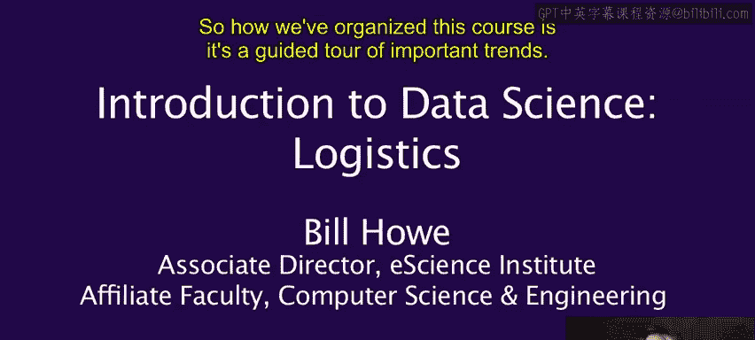
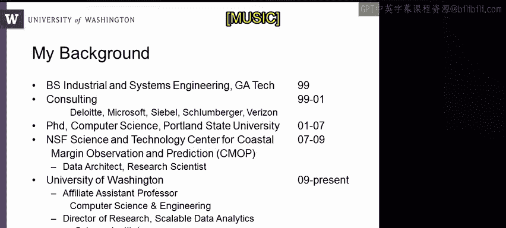

# 杜克大学《大规模数据科学（大数据操作，第1课／共3课有视频）｜Data Science at Scale》 - P21：20_课程后勤.zh_en - GPT中英字幕课程资源 - BV12s421T7tJ

。

Okay， in this segment I want to talk about logistics of the course。

 so how we've organize this course is a guided tour of important trends along with a deep dive into specific topics。

And then there's a set of handson assignments that are intended to deliver specific skills and experiences and that's perhaps the most important part okay and so overall the course is not you know the challenge here was to design a course that would be broad enough to cover the topics that we want and also inclusive enough that we didn't sort of have to dial it in for a very specific cohort but the challenge then is that it's going to be。

Very difficult for some people and others may may find it some aspects of it certainly routine I'd be surprised if anybody finds it the whole thing routine if so then I'd be surprised that you took this course。

Okay， so the prerequiites here are pretty light because we are trying to cast such a wide net。

 but they're really important， so some prior programming experience in some language is going to be really critical。

Then you know we're going to use terminology from basic college statistics or advanced high school statistics so when I talk about linear regressiong。

 you should know what that means you should also be able to sort of。Look at。

Some visualization of data and be able to understand what it's telling you。 Okay。

 and then perhaps the toughest one is that statistics。

 Perhaps the toughest one is to have some exposure to databases and databases concepts。 And。

 you know， if you're just starting out in college， that's not always an easy。

Proficiency to have gained or experience to have gained。

 but you know it's not the we're going to couch a lot of the discussion in terms of databases and in relationships to databases and so some idea of what that means what they are is going to be helpful okay。

So to that end one assignment will involve writing SQL and if you've never written SQL before。

 but you understand databases a little bit， you will probably be able to power through the assignment if you're an expert in SQL。

 there's some parts of it that might still be interesting to you。

Then two assignments will be will involve writing Python one optional。

One optional assignment will involve sort of processing big data using Amazon web services and here you know one of the reasons it's optional is that。

Because of the varying skill sets， but another reason is that you'll have to pay out of pocket for the cloud resources and the reason for that is there's you know 60。

000 students whove signed up for the course and we can't sort of pay for。All of them。

 the good news is it will cost sort of less than $10 or so okay and it's optional so if you don't feel comfortable that you don't want to do it and you'll still get full credit for the course。

All right。Then another assignment will involve。Competing in a Caagle。

com project or participating in a Caagle。com competition using whatever you want。

 and so this may or may not involve any programming。

 a lot of valid assignment you can certainly compete by using Excel and other kinds of GoI tools。

This last bullet probably isn't true， so let's just ignore that actually。Okay。

 so the learning objectives here is I really want people to come out of this course being able to talk intelligently about the landscape of data science concepts。

 tools， algorithms and technologies， and this will be sort of a springboard for you to dive deeper into。

Particular areas， so for example， machine learning this is not a machine learning course。

 but you can dive deeper into machine learning。By taking this course。This is not a database course。

 but you can dive deeper by taking a database course and so on okay then I just want to deliver some handson experience manipulating data in order to level set people that don't have any programming experience and provide some specific experiences for those of you who do have programming experiences for example。

 the first Python assignment will involve computing some sentiment analysis using Twitter data and so if you already know Python the learning Python won't be much of a contribution of that assignment but。

Perhaps it's the first time you've been able to work with the live Twitter stream， okay？

And so the end result of this is we hope that you'll be sort of an advanced beginner in a variety of data science topics and as I said know the tough part here is sort of how to do something more than just superficial access given that data science encompasses such a broad area as we've discussed。

 and so we think we put together a pretty good program but you'll have to be the judge of that。

All right， so。The risk of belaboring this， the course of the philosophy here has been that the skills needed by the data scientists span a variety of different areas。

 statistics， programming databases， distributed systems， visualization。

 but the traditional organization of these topics is sort of vertical and is not ideal for becoming sort of introductory in data science right so in order to get introductory level knowledge in all these areas which you end up having to do is take an introductory course in seven different areas or something so a lot of different courses。

Okay。And so our goal is to try to expose and simplify the。Links between these different areas。

 okay as opposed to sort of。Narrowing our attention on what makes them unique， okay？はい。All right， so。

You know， after taking this course， you will not be an expert in。Statistics。

You will not be an expert in machine learning certainly you will not emerge an expert in databases or even no SQL nor will you sort of have programming prociency in all these language however you will use all these tools。

 you will understand the basic concepts of all these tools and you will have applied many of these tools。

Okay。The assignments will。We'll have online。Short quizzes during the lectures。

 of which you've already seen some。These finger exercise quizzes。

 they will be just set of the full length allline assignments， as I mentioned。

 and some of the assignments will be graded。Some of the programming assignments will be graded automatically。

Assignments that don't lend themselves to auto grading will be assessed using the peer assessment。

Tools so an example of that is you're going to write up a description of your kggle solution。

In addition to submitting your score for the CAggo Comp and other students are going to sort of grade whether it's comprehensible or not。

 okay。All right， so whom my background is here on the slide。

Bachelor's degree in industrial systems engineering。

 and I spent a couple of years doing some consulting with various。Software shops and。

They went back to grad school and got a PhD in computer science working a lot with oceanographers and other researchers。

 and then spent a couple of years working more directly with oceanographers as kind of a data architect。

For their systems and what they did was。Combiner。Large scale ocean models， along with。

On observational network。And then I came here to the University of Washington。

 where I have an affiliate assistant professor position at。

The computeruter Science and engineering department。

 and I lead a group in scalable data analytics and these sciences Institute。

