# 杜克大学《大规模数据科学（大数据操作，第1课／共3课有视频）｜Data Science at Scale》 - P22：21_Twitter作业入门.zh_en - GPT中英字幕课程资源 - BV12s421T7tJ

This tutorial is going to walk through the first couple of steps of the first assignment where you will be accessing the Twitter programmatic API to collect some data and perform a sentiment analysis and analyze the results。

 so I've got the page open here with the instructions for the assignment and I'm going to scroll past the background in front at it here although I of course encourage you to read it。

And the first step here is going to be to set up an environment with Python and Git so you can get the starter code you can do this in any environment you have access to if you're on Mac or Linux or Windows or anything you want to set up your own environment or if you like you can use the virtual machine that we've provided as part of the class and so that's what I'm going to do for the purposes of this tutorial so I'm going to click this link here。

And it'll start downloading this OVA file， it takes a little while because it's quite a big file， 2。

3 gigs， I've already downloaded this， so I'm going to hit cancel。

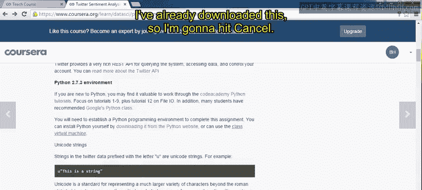

Okay， now that we've got the OVA file downloaded， we're going to。

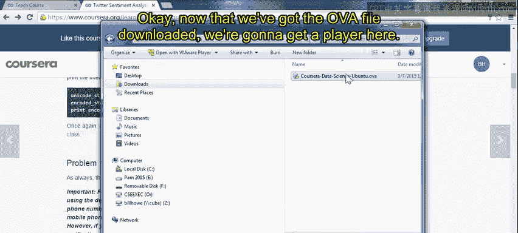

Get a player here。 VMware player is actually installed on this machine， but I'm going to。

Go get virtual box， which is a free player that may be a little bit more accessible to others。

 So here I am on a Windows host， the first link that comes up。

To install this doesn't take too long to get going。And I'm going to run it。It's going to install。

I'm going to quickly click through these things。う。Maybe a bold statement， but let's do it anyway。

Okay， now it's installed。Open this up。And。Open in Virbox manager。So I right clicked on it。

And it's select a virtual box manager， and right now， presumably it's thinking。Okay。

 so here's the import window。This all looks fine。Click import。Yes。T a couple minutes。

And should be finishing up now。All right， and there it is。Maowu。

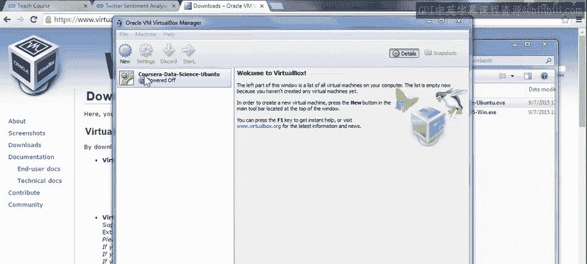

Start this virtual machine。And there it is。Okay， so we've got our virtual machine open。

 most of the work we're going to do is inside the terminal。

And the first thing we want to do is clone the repository I've already it will already be cloned inside the virtual machine。

 but if you did want to clone it， you would say get clone and then pass in the URL of the Gitthub repository。

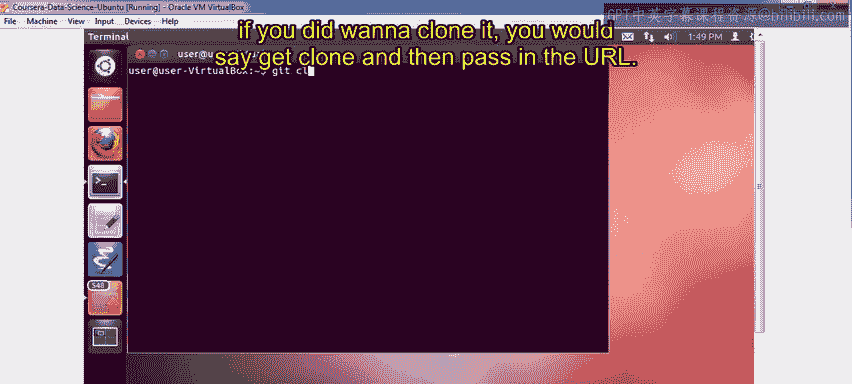

Which you can find by following this link here in the assignment。

 so get Twitter data the first step is to make sure assignment details are up to date。

 this takes you to the instructions page in the course about how to access the GitHub repository。

 and then if you access the repository itself。

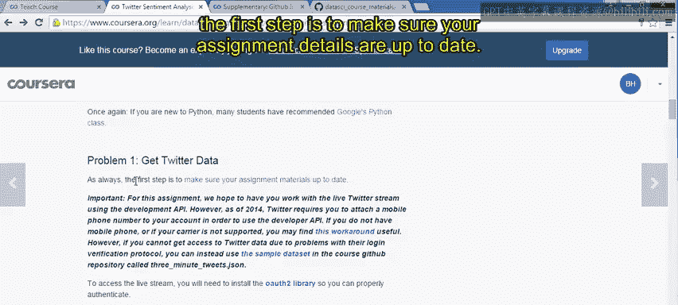

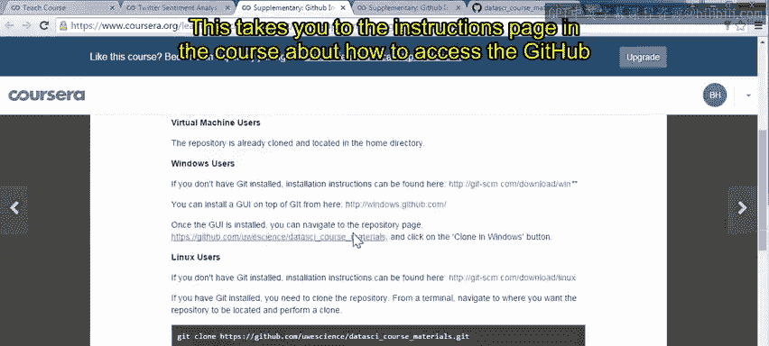

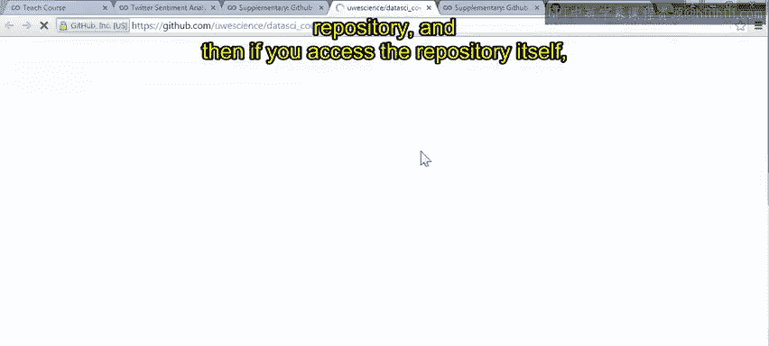

The clone URL is down here on the lower right。So if we were to clone that。

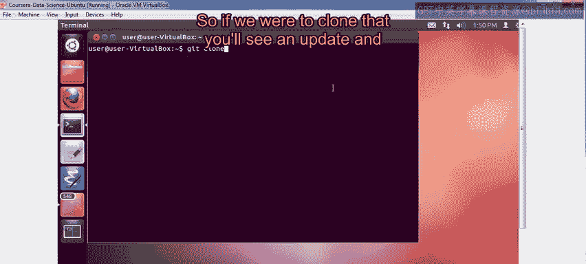

啊。You'll see it update and you'll get this directory here， data side course materials。Oops。

 tried to copy that， but I shouldn't。And then you'll want to do a git pull。

 if you start off at this time and you won't actually see these directories， you'll see nothing。

 but if you do a git pull。You'll see several things download and it'll take a few seconds Min says is already up to date because I just did this a few minutes ago。

 I'm going to go inside assignment one。I'm going look at the material I have here and I'll flip back to the assignment itself。

Next thing you want to do is check to see that you have。啊。Python and Git。

 which again you will if you're using a virtual machine。

 we just check to see if we have Git Python is here。And if I says 2。7。3， that's fine。

We're in pretty good shape woods。あこちら。Other requirement for this assignment is just O off to library and the easiest way to get this is to just。

Use Pip， which is a Python package manager。 So Pip install O off2。And mines。Oops。

 so I need to install P itself have to get。Install Python Pip， just like the instructions say。

This is。Listed on the website， the password。Per is now installed， I can。Install O off2。

 and it looks like that the requirement is already satisfied O2 is already installed from in the in the virtual machine。

 so you can skip that actually a PP step， but it is sort of useful to get in the habit of installing things from PP。

Okay， so now we're going to connect to Twitter and make sure that we have access to the API。

 The process here is to set up an account and then create a what's called an application。

And then we'll move our secret keys from the application into the Python program so that we can access the API。

Programmatically。

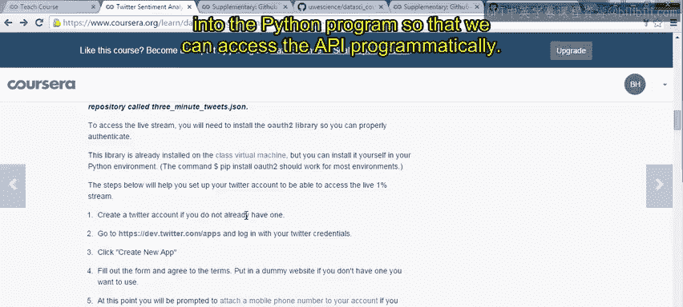

We're going to do this from within the virtual machine so that we can make sure to copy and paste things easily。

 You can get your virtual machine set up where you can copy and paste between the guest and the host。

 but that's not always。Possible， depending on your platform and how you have your environment set up。

 so we're just going to assume that we don't have access to that。

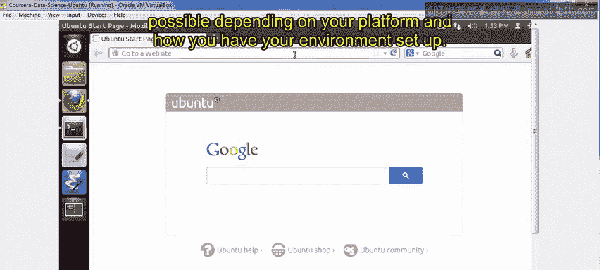

Capability， so the URL we're going to go to here is Htps， dev dot Twitter dot com dot apps。

 And I'll see if I can remember that when I type here。

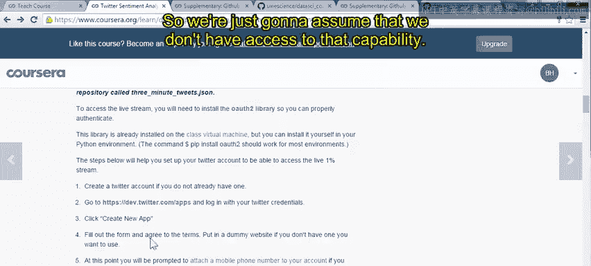

Okay you'll need to sign in with a Twitter account。

You don't have to tweet or follow anybody or do anything else。

 but you do need a Twitter account just to access the application so you can create a fake one if you prefer。

All right， so here are the list of application， your list should be empty and you're going to create this create a new app by clicking this button。

 The name here should be globally unique。So I'm going to say bills， data science， Twitter。

 application。Any saying Twitter。Sement。我 about that。First assignment。Moreor than Ds。Specialization。

And you can give it a URL， usually these。Application are associated with。

Some sort of a company or consumer end user facing website here。 we're just using it for Texas。

 the API for practice， so to speak。 so it doesn't actually matter what you put in here。

 So I'm going to put in。Just a home page。

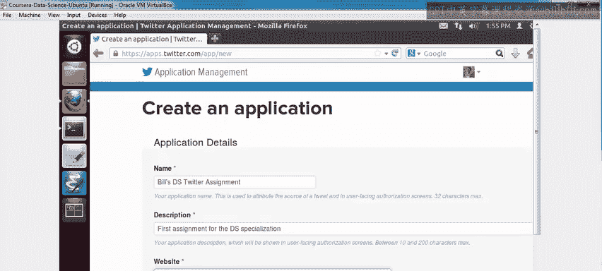

There we go， I had to scroll down a bit to get to the edge of the virtual machine boundary there。

So agree to the。Terms， and then create the application。Okay。

 I just switched to a different assignment there because I had a rate limit exceeded error from Twitter。

 which shouldn't actually happen when you're creating applications。

 but has something to do with the fact that I was testing。Various calls earlier。

 so they they limit you to a certain number of calls per hour that you won't usually hit。

 but apparently I did， So I'm just using an existing assignment that I already had。

 but this should still be the screen that you get when you click create application。

 So the next thing to do is to go to keys and access tokens， which is。

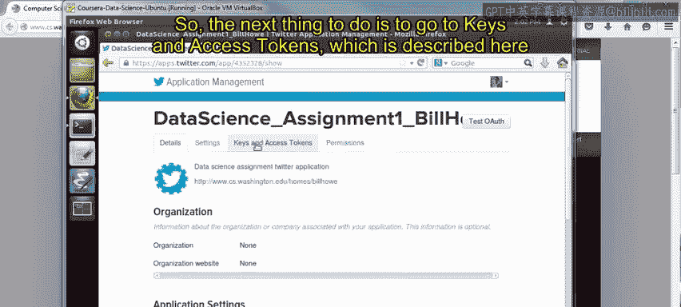

Which is described here。In the instructions， click the keys and Access tokens tab along the top。

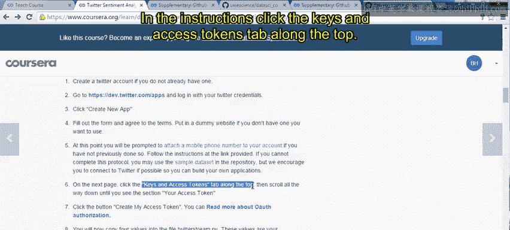

And then you'll want to scroll down and you'll see。You won't have these access token。A。Aly generated。

 and she will click a button that says create the generate the access token for the first time。

 Min says regenerate my access token and token secret， which I'll go ahead and click。

And it has successfully regenerated。But now you have two sets of keys that you'll need in the next part of the assignment。

 you'll have this consumer API access key that's just part of the application you just created。

 and then you have the token access that you've just generated with the last operation。Okay， so now。

You're going copy these values into the。Python files。

That you downloaded through from the Gitthub repository in particular， it's Twitter stream。PY。

 I'm going to use VI to edit this。And the API key， there's these four variables right at the top of the file and you're going to fill in these keys from the Twitter application。

 the API key is the same as the consumer access key consumer API key， excuse me。

And I'll paste that in。API secret， consumer secret or API secret。Heres the next one。

And scrolling down to get the access tokens。

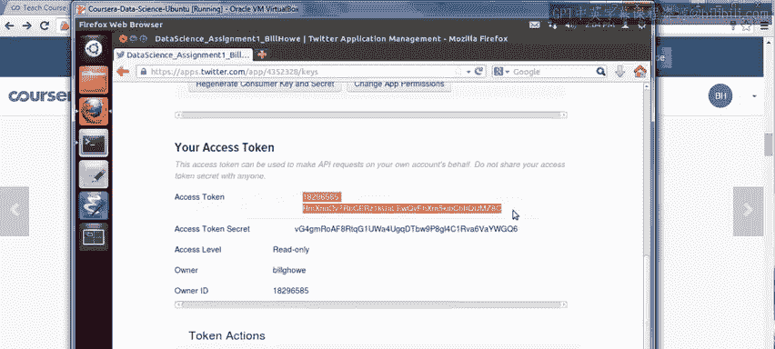

Excuse me。😔。

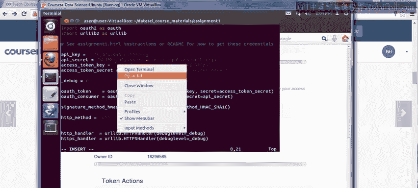

And in。Access token secret。And now with the credentials in the file and with OO installed。

 you can just run this。Python file， and you'll start seeing seeing data flow。

 So these are tweets coming from the。1% stream。And it'll just go forever。If you let it。

 so I'm going to hit C C and cancel it， and now for the first part of the assignment here。

We're going to。

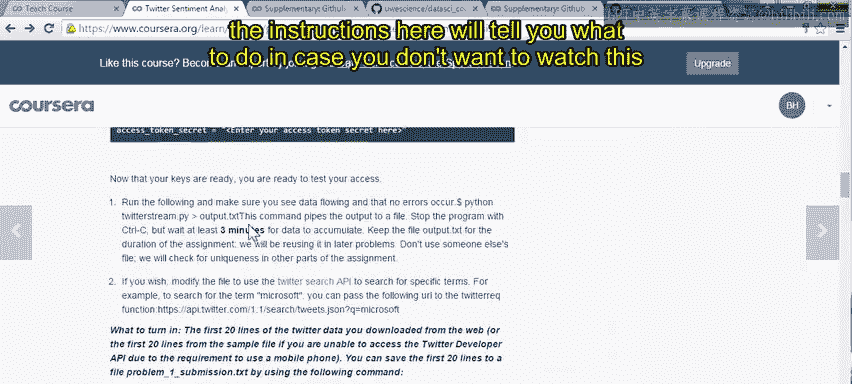

So the instructions here you tell you what to do in case you don't want to watch this。

Video again or keep hitting rewind。 You can just read these instructions。

 and they should be pretty clear。 But the next step here is you're going to actually。

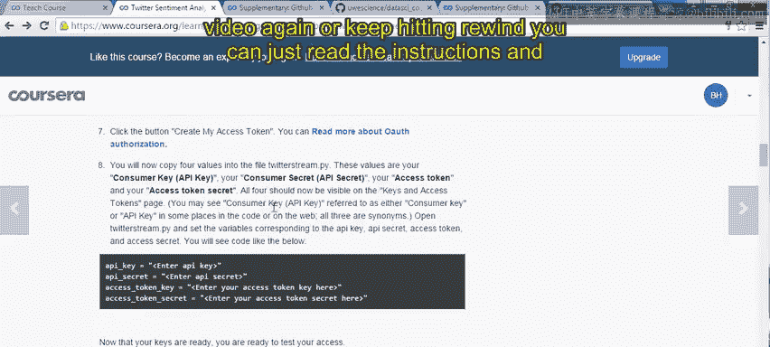

Create a。File of sample tweets that you'll use in the later part of the assignment。

 So we're going to let it run for about three minutes and pipe the results。

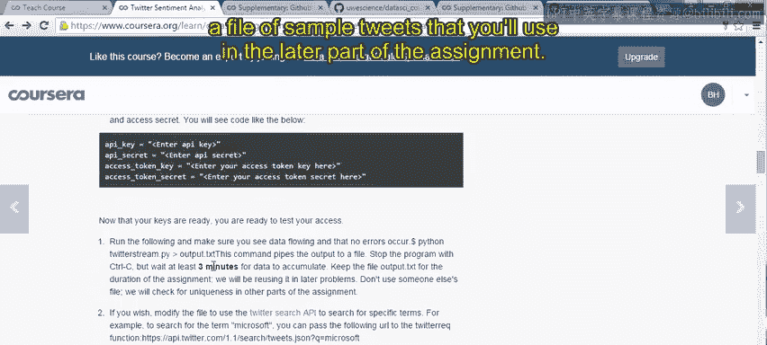

Into a。File。So I'll give it output。I'm going to say dot Jason instead of dot TxT since it's J data。

And you can sit here and just let this run。Once your time is up。

 you can hit control C and you'll have。This output do J file there。

 and we can take a look at that as well。And there we have some tweets。

 and I' will have a lot fewer than you will because you will let it run for a long time。

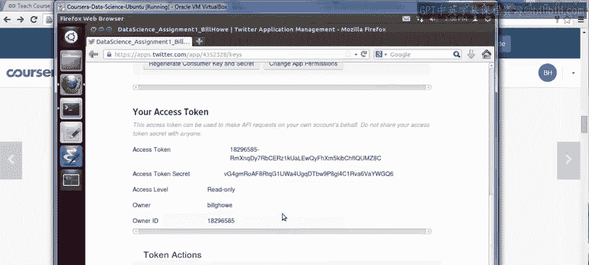

Now， this is an optional step。 you can actually tweak this file to。

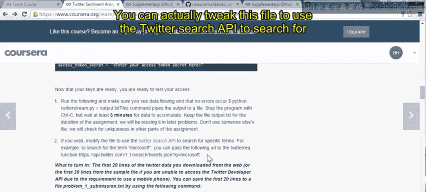

Use the Twitter search API to switch search for specific terms。And here the bottom。

But I'm not going to do that right now。 So this is just generating sample data directly from the stream itself as opposed to applying a search。

 But if you want to practice with the search API， you can do so。

 but the file you should generate should just be the data the sample data itself。

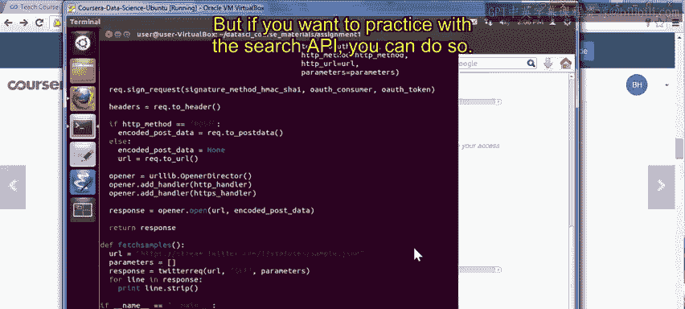

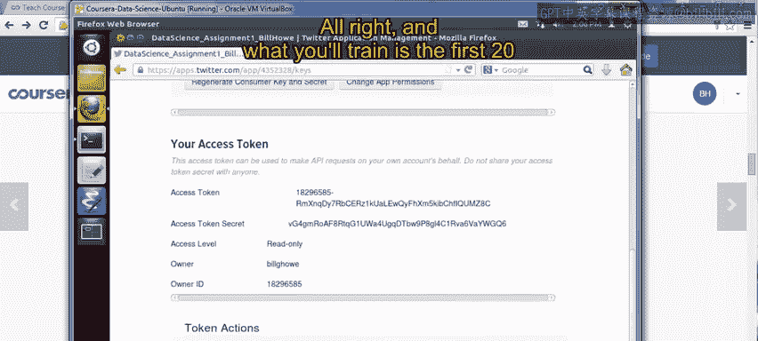

All right， and what you'll turn in is the first 20 lines of the Twitter data file that you generated from this call and you can do that with this command here。

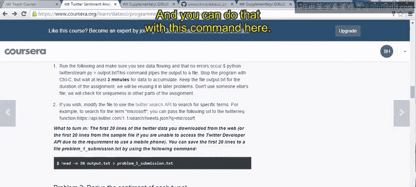

So， we'll do。Haad dash in。20 output Jason and pipe that into。Another file。

 which we'll just say problem one submission。Do。对是。And we can open up that guy。

And there's all the data。Okay， so now you just need to turn in that assignment using the Coursera interface you can do that from within the virtual machine if you get rendering problems because of the resolution of within the virtual machine。

 you can email the files to yourself or otherwise transfer them through Dropbox or if you know how to configure your virtual machine environment you can set up a shared folder and move data back and forth that way。

 I'm not going to show those methods it's a little bit outside the scope of this tutorial and really in this course but you have a variety of methods available to you and if you need help you can ask questions on the form and there'll be somebody else that'll be able to answer those questions。

Okay， so that's the problem one of the first assignment I mainly just wanted to show you show clicking through the steps on the Twitter API and application setup procedure in case you hadn't quite seen that before and to make sure you were familiar with the idea of using command line and moving things around and getting set up to get started at this point forward。

 you'll just be modifying these Python files。

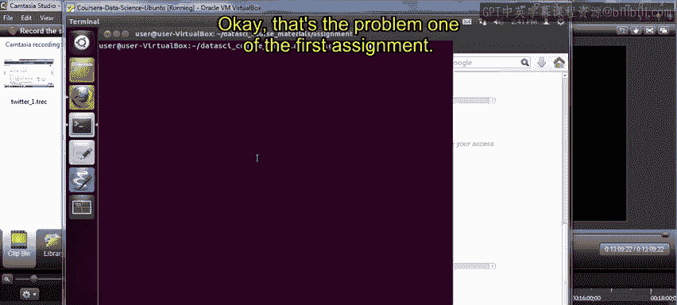

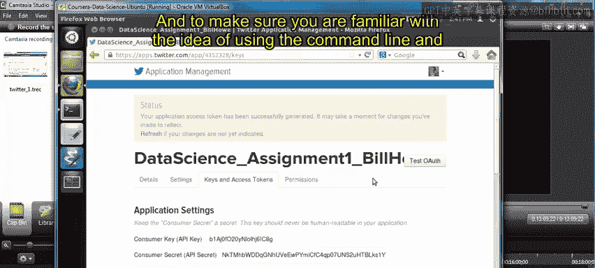

In order to。Write the program to satisfy the requirements。 Now。

 for those of you who aren't too familiar with Python。

 this is first time it can be a bit of a challenge It's pretty open ended， and you'll need to。

You know create a program and test it more or less from scratch so don't get frustrated hang in there and ask questions on the form if you do need help if you are familiar with Python。

 I don't think it'll be too much of a struggle if it does seem like a struggle make sure you're not overthinking the problem a little bit。

 that' a simple solution for most of these parts。Will be perfectly acceptable while a more sophisticated solution will also be acceptable。

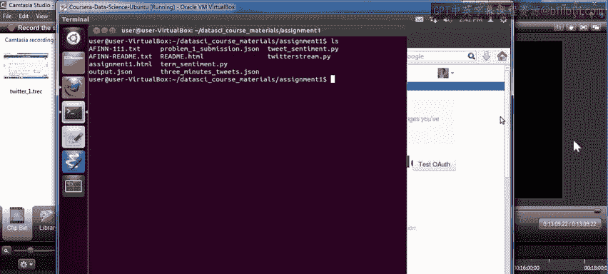