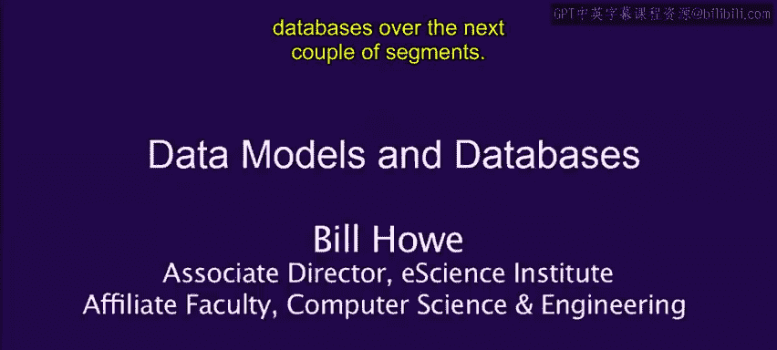
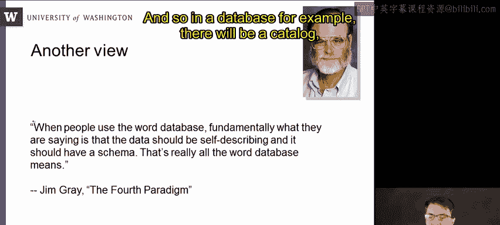

# 杜克大学《大规模数据科学（大数据操作，第1课／共3课有视频）｜Data Science at Scale》 - P23：22_数据模型术语.zh_en - GPT中英字幕课程资源 - BV12s421T7tJ

。

Welcome back。 I want to talk a little bit about data models as a run up to talking about databases over the next couple of segments。

So this is a data science course。 So we know we have data。 So the first question to ask you is just。

 where is this stored， How do we store data。And so one way of interpreting this question is just to talk about technology。

 right， to what technology do we use Well we use magnetic media。

And we might use solidlitate drive more recently right and so both of these have the property that they're not they persist even when the power goes out the data is safe even when the power is not on okay。

 so non volatileatile storage， but another way of interpreting the question is。A little different。

 a little more of the logical way we saw， the organization of the data。And so， we might ask。

One way of interpreting this question is what is the data model we're using？

So it's not just bits on a disk or bits in a file， what do we do？You know， in your。

Personal computer or maybe you your computer you might store data sort of hierarchically a in these kind of nested folders right that's one organization of data and so the data model here is kind of tree like。

Another way is rows and columns。 And this is what we'll talk。

A lot about in this course right so in this case it's a nasty file and these are。

Hits from a biological database， matches in a biological database for a particular sequence。

And of course you might have spreadsheets that are a little funny right。

 maybe they look a little bit like rows and columns but maybe they don't。

 so you're sort of an embedded table within a spreadsheet and so on。So you need to start it。

The idea is to think about what data model is being applied whenever you think about data so it could be a tree。

 it could be a table， it could be something a grid like this unstructured or it could be a graph and we'll talk a little bit about that in the future。

All right， so in general， what is a data model？Well。

 there's going to be three components that you should remember。

 one is that there's going to be some notion of a structure。Right， so I。

In the case of tables it's rows and columns there's give some notion of constraints what are the legal structures you're allowed to create so for example。

 typically with if you think about a tabular data model you won't have row all the rows will have the exact same number of columns right this is sort of a constraint you might also have more constraints on the values themselves such as you know this field must be this column every value in this column is an integer。

And you could even have other kinds of more semantic constraints such as every value in this column must be within a certain range of numbers because it represents say days of the year。

 And then the third one is the operations and so this is sometimes thought of as independent of these three but I really like to call the data model all three of these things the structures。

 the constraints to define valid structures， valid instantiations of these structures and then the operations you can actually that these structures support So let's see some examples So your structures might be。

 as we've mentioned your rows and columns， nodes and edges if it's a graph model。

 key value pairs has been popular with the nosQL movement just a sequence of bytes that might be the structures you have if you're just working with bare files and then the constraints you might imagine are all rows have the same number columns as I mentioned all values in one columns of the same type。

For a hierarchical view， you might have a child cannot have two parents right so this would。

For example， one file cannot be in two folders at the same time in your data model of your file system。

ok。And then the operations that are supported， well。

 maybe you can look up the value given a key X in these key value pair data models。

 that's one of the primary operations is if I give you the key， you give me back the value。

For a tabular data model， you might say， well， find me all the rows where a particular column has a particular value。

 in this case you know a column last name is equal to the value of Jordan。Okay， and with a file。

 there's not too many operations you can think about it' essentially get the next invitetes move to another position within the file。

 and then you can open and close the file and that's about all the operations that are supported。

So I think in any case you see data， especially in a nonvolat storage。

 you can think about what operations are supported， what constraints there are over the structure。

 and so on， and this gives you an idea of the data model。So what is a database well。

 one definition that I think is。Pretty adequate is this one。

 which is a collection of information organized to afford efficient retrieval。

So this is a very pretty general definition， doesn't say anything about tables。

 it doesn't say anything about relations， so when you think about database。

 don't necessarily assume relational database， it' perfectly adequate to talk about a database that has nothing to do with relations。

Allright， but it is not just a pile of data。 either。 It's organized to afford efficient retrieval。

So another view of a database is。This idea of a schema and so Jim G in this fourth paradigm book've that we talked about in the e science segment a little bit ago。

Has this quote when people use the word database fundamentally what they are saying is the data should be self-decrib and it should have a schema that's really all the word database means and so this goes back to this notion of a data model right there's a structure there and in fact and some constraints and that the and some operations and all three of these are things you can intuit by looking at the data itself it needs to be self-decrib right so if I have。

You know， if I have a table if I have a。A file of data that's organized the rows and columns somewhere I'm able to inspect which columns it has and how many rows there are and so on right I need to be able to understand how to read this data just by looking at the data itself and so in a database。

 for example， therell be a catalog there will be an explicit schema。

