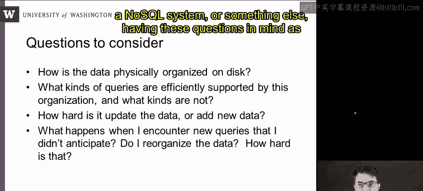

# 杜克大学《大规模数据科学（大数据操作，第1课／共3课有视频）｜Data Science at Scale》 - P24：23_从数据模型到数据库.zh_en - GPT中英字幕课程资源 - BV12s421T7tJ

。

So having this idea that the word database is synonymous with self-deib data。

 data equipped with a schema， that's a pretty common view and it's important one to keep in mind as we hear through this course So let me give you another view of the database。

Motivated by this question， why would I want one in the first place， Why would I want a database。

 What problem do they solve， Well there's maybe four。啊。

Issues you might run into that that putting your data into some kind of a database broadly defined can help you solve and these are the ones that I like to talk about so one is sharing data right so once you have multiple users trying to access the same pile of data some sort of infrastructure or interface to manage concurrent access starts to become required I would argue all real databases afford okay another is you know the enforcement of a data model you might say well look I use aros and columns data model or I use a hierarchical data model。

But there's some sort of software that needs to enforce that。

And so this is something the database is。Can do now， remember。

 the data model is not just the the raw structure of。You know。

 parents and children stay with trees or rows and columns。

 it's also higher level constraints such as。You know， this must be a number from one to five。

 or this must be a day of the week。Or it must be one of the customers that already exists in another table。

 Okay， so these kind of constraints are。Difficult to enforce in the application layer。

 and I'll argue this more in a little bit。Okay so the third reason might be scale right。

 so we know we have a pile of data and we know we have sort of a data model floating around here。

 but once it gets over a certain size or we get a certain number of instances of this data model。诶。

We're going to want to use specialized algorithms to be able to work with it and writing all these specialized algorithms ourselves to traverse larger and larger data sets becomes the bottleneck and so a database can organize these algorithms and expose them through convenient mechanisms we talk a lot about complexity hiding interfaces right databases provide a complexity hidden interface for large scale data。

And I think the fourth one is flexibility， which is you might have written some software to access your set of files in a particular way。

 but as soon as you have to access it in some way， you didn't anticipate。

RightYou have to rewrite a bunch of code。 and so what databases try to do is anticipate a broad。

Set of different ways of accessing the data and working with the data and support all of them。 Okay。

 and so I'm talking pretty abstractly here of。fairly deliberately because all these things are certainly true of relational databases which we'll talk about。

 but I think they ought to be true of anything that sort of earns the term database and they're certainly true of other systems as well and so we want to try to think about keep these things in mind when we think about No SQL systems and key value stores。

And graph databases and so on， so it's not just relational databases。

 this is broader than just relational databases。And so I think in general。

 when you're looking at these different systems and thinking about the data storage layer。

 which is sort of where we're starting here in this conversation about data science and this course about data science。

 is how is the data physically organized on disk， what kinds of queries。

 what kinds of operations are going to be efficiently supported by some particular organization and what kinds are not right so one immediate question。

 well and this third bullet at least media question is it hard to update the data or add new data？

That's。One quick way to split all all the different operations you can do on the data。

 one quick one is the reads versus the rights and in many cases you'll find that what's convenient you know where the organization that makes sense to read the data efficiently is not the same one that makes it efficient to write the data and that tradeoff is at the heart of a lot of the system design challenges in databases and other largescale systems but there's other kind of operations as well as we discuss do you want to look up by key do you want to look up by some other field and so on and we'll talk about this in future segments。

O k。And then what happens if I encounter new queries that I didn't anticipate。

 What do I need to completely reorganize the data， Do I need to write a bunch of new code， You know。

 how hard is this。 And so this。These are the evaluation criteria you're going to use when you're thinking about choosing a platform for your data science task。

Okay， these are some of the questions， and perhaps not all of them。Right， so。

If broadly your choices are a pile of files， an off the shelf database。

 No SQL system or something else。

Having these questions in mind as you're evaluating the pros and cons is going to be really important okay？

