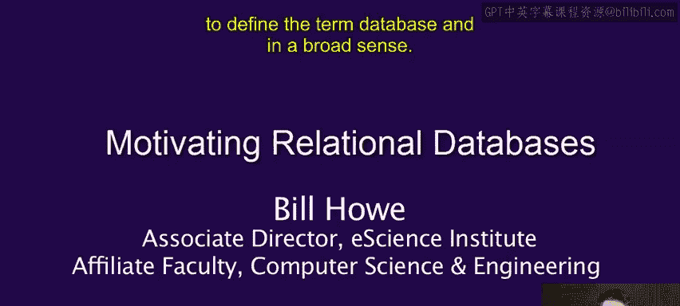
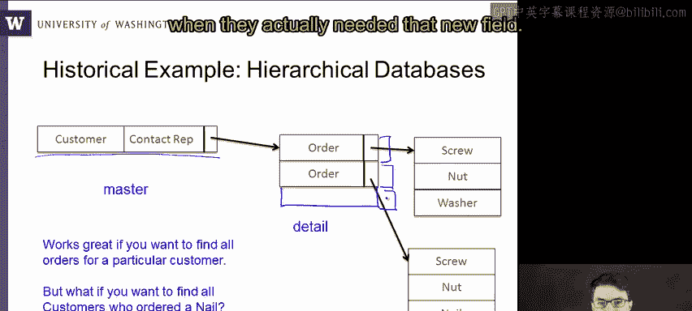

# 杜克大学《大规模数据科学（大数据操作，第1课／共3课有视频）｜Data Science at Scale》 - P25：24_前关系型数据库.zh_en - GPT中英字幕课程资源 - BV12s421T7tJ

。

So last time we talked about data models and used them to motivate databases and define the term database in a broad sense。

 and now I want to build on that to talk specifically about relational databases so the last time we talked about these questions you could use to reason about different ways of organizing data and evaluate them with respect to your requirements and I want to talk about these questions and apply them to examples of different kinds of databases you saw in the past。

That end up motivating the relational model and in particular the reason I want to go through this sort of historical view of things is that you see some of these same designs being proposed in terms of no SQL systems and some of the same issues come up both both benefits and you know both pros and cons are still there so it gives it's good to have a historical perspective on them when youre evaluating these modern systems that are becoming popular okay so the questions we talked about where you know how is data physically organized on disk you can ask this about a system。

What kind of queries are efficiently supported？How do you update things and so on？All right。

 so one example is what I'll call a network database。

 although arguably this is just sort of pre databases where you just had files and if you go back to our questions。

 you might ask， well， how is it physically organized on disk？Well。

 if you you're using sort of a parts and orders model here， you would have a。Order record。

 and it would have an address associated with this order record that would physically point to。

The first part。Associated with that order， and that part would point to the next one and so on。

Another field in the record would point to。The customer that made that order。Going back， you know。

 what kind of queries are efficiently supported， Well if I want to find。

All the parts associated with an order， I can do that pretty efficiently。

 I have an access to I have a given order and I just walk down this。Chain to gather of all the parts。

What kind of queries are not supported efficiently is you know， I want to find all the orders。That。

Involve a particular part， although all the orders that involve this washer。Well。

 now I have to scan every order to look for them， okay。

There are some ways around that by putting back pointers and so on another problem with this。

File oriented， you know a sort of proto database model is that whenever I want to make a change to the data。

 right if I want to have an extra field added to support the billing customer as opposed to the shipping customer。

Well， I've just added a new。Field I've extended the length of this record。

 that means that everything else below that record。Needs to be moved more importantly。

 all the programs that that navigate this structure now need to be aware of this other field。

 they all need to be rewritten to accommodate this extra。Pce of data。Moreover。

 if you want to support different access methods， as we talked about。

 if I want to look say by part and find all the orders。

 I end up having to make a complete second copy。Of。The database。And now。When I update。

 when I make a change to a one copy， I need to make a change to all copies。

 and you can imagine how the space of possible copies might grow might get pretty big。Okay， so。

A partial solution to this problem was this notion of hierarchical databases characterized by perhaps IBM's IMS system。

 which actually still exists in Shouse。Customers， and so here。

And idea was to order organize data in terms of segments。

But still the logical model was had this hierarchical flavor that we saw in the network bottle as well。

 so here I've switched， I've made the top level access the customer instead of order and so logically what you have is that an order is only located underneath the customer and a part is only located underneath an order。

However。Given that they're in separate segments， I can make a change to one segment without having to break all the code that accesses other segments。

The downside that still exists here， though， is that。The programmer。

 the application developer still needs to understand this hierarchy in order to find anything。

They have to actually know exactly how things are organized， for example。

 that orders appear under customers。So you still have to anticipate what kind of access methods your customers are going to want and design for those updates here are a little bit easier given that I can add an order to one segment stored elsewhere。

Without affecting all the other structures and I can even add a field and I can only only make changes to the orders as opposed to changing everything moreover the software layers on top of this we're able to sort of insulate from those kind of changes with us。

With some reliability。This new field would only be passed back to the client when they actually needed that new field。

 Okay， so there was some measure of。

What I'll call data independence and we'll talk about that a little bit more in a few minutes。

