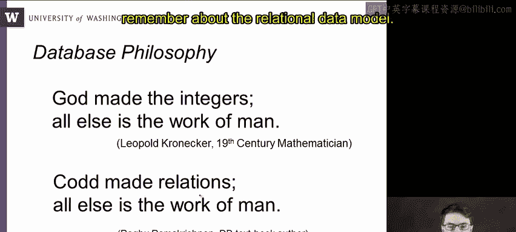

# 杜克大学《大规模数据科学（大数据操作，第1课／共3课有视频）｜Data Science at Scale》 - P26：25_关系型数据库的动机.zh_en - GPT中英字幕课程资源 - BV12s421T7tJ

。

Moving towards relational databases， the one view of what a relational database really is is here I'm quoting Kurt Moashs an analyst for the database industry。

And he says， you know， relational database management systems were invented to let you use one set of data in multiple ways。

 including ways that were unforeseen at the time the database was built and at the time the first applications were written and so I want to。

Imphasize here is that this is the key idea of relational databases， not， you know。

 SQl and not some of the other things you may associate with with particular implementations。

 It's really just about。Organizing the data in such a way as to support unforeseen access methods。

 querying in ways that you didn't anticipate when you organized it。

 insulating applications from changes。 So what is a relational database， Well， at the simplest level。

 everything is a relation which is synonymous with a table everything's rows in columns and this probably doesn't need to be made explicitly。

 but let me do so every row in the table has exactly the same columns has the same number of columns。

 but they also have the same types so if a column is an integer in one row there needs to be an integer in all the rows and then。

A consequence of this。Model of everything being a table means that you don't have pointers anymore。

 right， you don't have physical addresses。 All you have is tables。 and so relationships between。

Different data items are implicit， so here we switch to the domain to one of courses and students。

 So this table is a student takes。We'll say takes。A student takes course。

And this is a student record。Well， instead of having a physical pointer from。

Course record back to the student。We just have a shared ID。

The the only relationship between these these two data items is the fact that they both have the same value in a particular column and so this is。

You know intuitively， this sounds really bad for performance right off the bat right if I want to go look up all the students associated all the students names associated with a particular course。

Once I have my course， I need to go。Look up in this table all the values that match as opposed to just navigating directly to them。

 which you could do with the hierarchical method。But if I want to go the other direction。

 it's the exact same process， I look up the name I want to find all the courses that a student has taken。

I can do so the same way， I do have to do the lookups， which may be is a cost in performance。

 but the mechanism by which I look things up is the same in both cases。Moreover。

 everything is stored only once。hich is a feature of the hierarchical databases we're able to achieve as well in most cases。

But the network databases were not， we don't have multiple copies of things。Line around。All right。

So the philosophy here is you know。Being cute about this。

 you know the quote from the 19th century is that you know God made the integers and all else is the work as man。

 well， you know， Codd made the relations， which is a reference to Edgar Cod。

 who wrote the first Relational database paper and went on to win the Turing Award for his work。

 which is sort of the Nobel Prize in Comp science。Cd made relations and all of uss work as man。

 so everything is a table is the number one thing to remember about the relational data model。

 everything's a relation。

