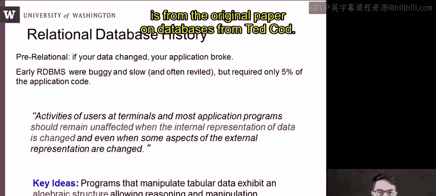
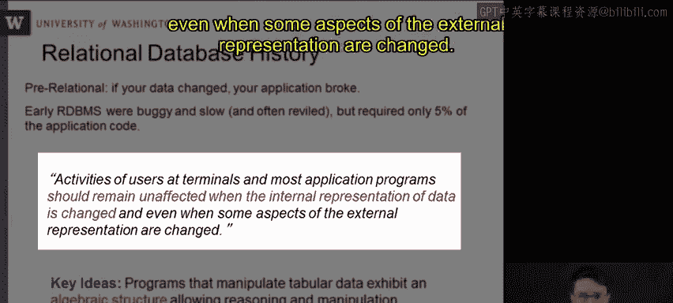
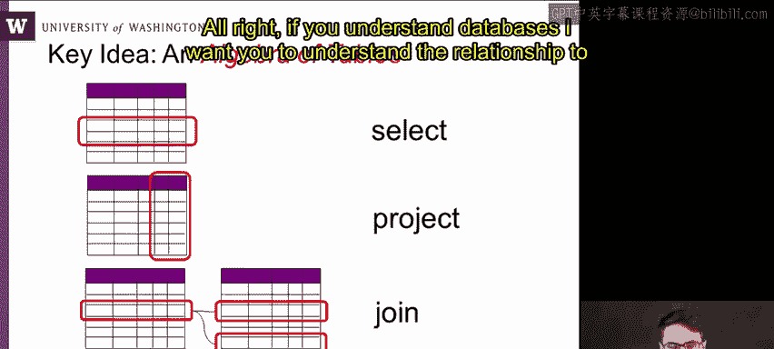
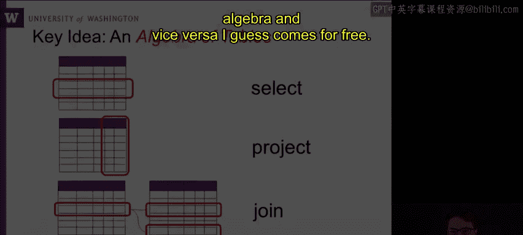

# 杜克大学《大规模数据科学（大数据操作，第1课／共3课有视频）｜Data Science at Scale》 - P27：26_关系型数据库的关键思想.zh_en - GPT中英字幕课程资源 - BV12s421T7tJ

。

Okay， so let's talk about relational databases。 So the history here is that。

Which I motivated last time， I hope is that prereal， if your data changed in some significant way。

 you need to reorganize things in some way， your application broke。Okay。

 so if you changed the parent child relationships in the hierarchical model。

 or if you pretty much did anything with the network or file oriented model。

 your applications had to be rewritten to support that。

And so early relational databases addressed this issue。

 and even though they were buggy and sort of slow。They required only about 5% of the code you had to write previously。

 And so this was an enormous win。Okay， and so this quote sort of motiv sort of following on what the quote I used from Kurt Monash in the previous segment is from the original。

Paper on databases from Ted Cod， so activities of users at terminals and most application programs should remain unaffected when the internal representation of data has changed and even excuse when even when some aspects of the external representation。

A change。 and so the reason I want to emphasize this is that again。

 this is the key idea of relational databases not。SQL and not some of the other features that you associate with with particular implementations。

 It's really this notion of data independence。 Okay。

 and this was the right there in the abstract in the original paper。 This is the key idea。

And then the reason I'm hitting this so hard is that this idea。

It's still just as important now as it was then。All right so I want to go through some of the other key ideas that are associated with relational databases whether or not they were in the original paper so one key idea is that programs that manipulate tabular the manipulate tabular data exhibit this algebraic structure that we can use to reason about them and manipulate the logical model independent of any physical data representation so what I mean here is that if you think in terms of tables and you think about the operations of the tables support。

 you can think about what your program means and even how to optimize it which we'll show。

Regardless of how the bits are actually organized on disk and this is。You know， incredibly powerful。

就。The key idea here again is physical data independence。

 And we'll talk about what logical data independence means to in， in the next segment。It's a。

The programs that you write to manipulate things no longer have to sort of manipulate files and sort of chase pointers around。

 you can in this case access it through a high level language sQL。

 although again it doesn't have to be SQL， the point is that you're manipulating logical structures called tables so just know the term physical data independence and know that it means that your'。

Programs you write to manipulate data are more robust than they would be without this relational model。

So another key idea is that there's this algebra of tables that I mentioned。

 and we'll talk more about these specific operators in a bit。But at a high level， you know。

 one operation on a table is to select out rows that satisfy some condition。

 Another is to ignore columns that you're not interested in。 Another one is to for two tables。

 for every record in in。The first table， find corresponding records in another table。

Select project and join and there's other operations you can define us to aggregation。

 all sorts of set operations derived from set theory， union and difference in crosspro and so on。

 and so these operations， if you write your expression out in terms of these operations。

 it's very clear what it means， and it's for software engineering purposes it allows the database designers to focus on just implementing these operations。

Efficiently。ok。Nowao。if I could， if I had you on a classroom。

 what I'd ask is how many people have heard of the relational algebra and also ask how many people have worked with databases and typically the number of people have worked with databases is。

Very high。 And the number of people who have heard of the relation algebra is somewhat lower。

 And that's one of the things I hope to。Fix in this course is to equate the two right if you understand databases。

 I want you to understand relational algebra and vice versa， I guess， comes for free。

