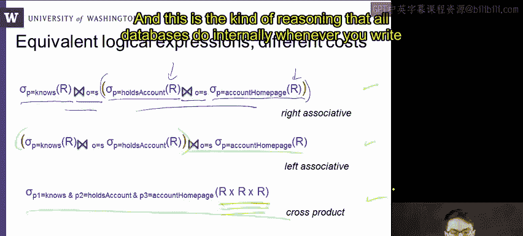

# 杜克大学《大规模数据科学（大数据操作，第1课／共3课有视频）｜Data Science at Scale》 - P28：27_代数优化概述.zh_en - GPT中英字幕课程资源 - BV12s421T7tJ

你们可。When I'm giving a talk and describe using this slide。

 what I'll also ask is how many people have heard of algebraic optimization and typically very few have。

 even if they're computer scientists。Unless it's a room of database people。

 but the thing is that you already understand what this is right you don't have to know databases to know what this is this is just something you learned in high school in algebra class Okay so forget tables for a second just think about integers。

Well。I've got this expression here， and I want you to evaluate this expression when I tell you z is equal to four。

Okay， so one thing you might do is just well say， well， you know。

 four times two is eight and four times three is 12 and so that's。20。

 and I have zero and that doesn't change anything， and then I divide by one。Fine。

 but if you're clever， you might notice that， well， adding0 to any number doesn't change it at all。

 So I'll just ignore that altogether， Similarlyly， dividing。

Any number by one or any integer by one is the same number。So I'll ignore that as well。

And then if you're really clever， you might notice that there's a distributivity law here that says when I see this pattern。

 I can。Pull out the multiplication and by applying these rules in turn。

 including community wall that allows things to be reordered。

 I can simplify this expression down to this。 And this just says well now two plus three is 5。

 just multiply five times 4 and I get 20 and I've done few operations。

 I've only done two operations instead of5 and I didn't have to do division vision。

 which is potentially an expensive operator if you're thinking about a computer evaluating this Now do。

Do computers use this kind of symbolic reasoning when they evaluate expressions？Over integers， no。

 the answer is no， and the reason is is that this kind of symbolic reason is much much more expensive than just from evaluating the damn thing。

 right so。Fine， but if if the objects that you're manipulating are not small integers， but rather。

You know terabyte size tables then this kind of symbolic reason is not only。

Valuable but it's absolutely critical if you do things in the wrong order。

 if you do wasted work or you do more operations than you need to over massive tables。

 you're dead in the water and you'll get nothing done and so all databases。

 all relational databases rather do this kind of algebraic optimization when you write a query right and so if you think in terms of SQL if you're familiar with SQL。

Your query gets translated into a relational algebra expression in terms of selection and projection joins and then is manipulated according to algebra and rewrite rules。

 just like you learned in algebra class， and that's why the term algebra is there。啊。

And they attempt to simplify the expression。I the reason I pause is it simplifies perhaps not the right work because it's not always true that the shorter the expression。

 the faster it is， we actually use this notion of costbased optimization。

 which means we'll try lots of different kinds of equivalent expressions。

 assign each one of them an estimated cost and choose the one with the lowest cost and this is something that all relational databases are doing in one form or another okay。

So fine， so is this is the magic trick of query processing and relational databases。

 and this is a really， really great idea。 and the reason why this。

Works is because we understand very。Formerally， what these operations are and what they mean。

OkayAnd so when you relax this formal model and start allowing anybody to write any kind of code they want over the data。

 you lose the ability to do this kind of algebraic optimization and you leave it up to the programmer to write the best possible algorithm and what I'm hinting at here is we'll talk about it more later but when you think about writing large scale data processing pipelines in something like mapreduce and if you haven't heard a mapRduce don't worry we'll talk about it。

You're leaving all the work up to the programmer to not only write the logic。

 but also to do the optimization and this can impose a penalty。Okay。

 one final comment about this is the term algebra is not just kind of trying to connote。You know。

 algebra from high school it literally is the same thing。 and so what when you hear the word algebra。

 we you should be thinking of is this notion of algebra at closure and what I mean by that is every operation that。

Applies to a table， also returns a table， and so I can chain these operations together。To。

Always get tables。Right now。That's the exact same idea that's going on when you talk about operations over integers or real numbers and you might sort of quibble and say。

 well， if I divide an integer by some other integer I may get a real number and that's true。

 but there's notions of multisorted algebras with different types involved but the point is that this notion of closure you can't escape the system by applying operations is。

Always true when you hear the term algebra。So we're not making things up。Fine。

 so here's some relational algebra expressions that if you squint hard enough。

 you can see kind of look like similar expressions over integers。

 except instead of addition and multiplication， we have things like joins and selects。

 And so what this says， select certain values from a relation R。

And here I'm going to select other values from the same relation R， that's okay。

 I can have two different the relation R can appear in two different places in the same expression。

 no problem。And。Then join them together。Then select still other values from the relation R and join this one。

And。One way of evaluating this plan is to perform this join first and then this join second and indicated by these parentheses。

Another way to evaluate this expression is to perform this join first。

And then form this joint second， indicated by the parentheses。Still another。

Expression is to take the full cross product of all three relations which I haven't told you what cross product is。

 this is actually a pretty bad one to do if you do know what a cross product is。

 it generates an enormous amount of data and you would never actually want to evaluate this plan。

 but you could and it's provably equivalent to these other plans so you know that it returns the same answer。

And now all we have to do is figure out which one of these is likely to be the cheapest one。

And we'll choose that one to run， and this is the kind of reasoning that all databases do internally whenever you write a query。

ok。

