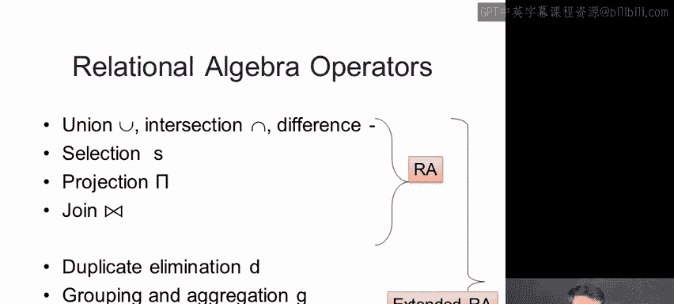

# 杜克大学《大规模数据科学（大数据操作，第1课／共3课有视频）｜Data Science at Scale》 - P29：28_关系代数概述.zh_en - GPT中英字幕课程资源 - BV12s421T7tJ

。

So where are we now？Given an overview of data science itself。

 and one of the things we talked about was that there's this important aspect of you know data muing or manipulation。

 cleaning， restructuring and so on that is perhaps。You know， ill defined。

 but is kind of what keeps people up at night when they're working on。Data science problems。 Okay。

 then we also gave an overview of relational databases。

 kind of a history of relational databases and why they came into being in the first place。 And。

 you know， we found that the original problem being addressed was this one of physical data independence that。

 you know， when。Aspects of the data changed all the applications broke and so you wanted to insulate application from certain kinds of changes okay and one of the tricks here。

 the secret sauce or relational databases is this algebra of tables that allows you to reason about manipulation tasks。

 reason about data manipulation tasks independently of the grubby details of the physical representation okay。

So this idea will come up over and over and over again， even outside of the context of， say。

 you know， Oracle and Microsoft SQL Ser and IBM DB2 and so on。 You know。

 you don't have to be talking about a commercial。Flagship relational database system to make use of this relational algebra。

 okay。And we'll see that and so I want to spend some time in this segment and the probably the next few segments。

On understanding the relational algebra。You know， at times this may look like more of a theoretical exercise。

 but I promise you it's not right these there's there's an entire database course offered say here at the University of Washington and everywhere else that I think is a great idea to take we're taking out segments of that that are。

Demonstrably practical in a data science setting。So。

I'll also mention that many of the slides in the next segment or two came from the Inuction to Data management course developed by Dan Su Mag Valinska and is taught here at the University of Washington。

Okay。走。The relational algebra operators that we hinted at。

 but maybe not listed out explicitly are these。Include the set operations that are lifted to support relations and we'll see examples of that and then the big three are selection projection and join right it just and we'll talk about the meaning of those and then there's these extended relational algebra operators that have to do with manipulating duplicates of tus and on the next slide I'm going to explain where duplicates。

Come up and why it's important to make a different distinction between。

Working when they're in the presence of duplicates and when there are duplicates。 Okay。

 and these include just an operator to eliminate duplicates altogether。

 There's a group by operation they may be familiar with if you worked with Sql and this operator appears here and then you can sort and so forth。

 It's extensions relational algebra off of you know away from the pure set based set theory based model。

 So， for example， a set of objects doesn't have any kind of order applied to it。

 And yet we were allowed to sort things in Sql Okay and it's practical。

You know it's something that's practical for applications to be able to define what kind of order the tus come back in。

 but it's not part of the formalism， it was added in afterwards。

 and so that's this extension between the pure relation algebra and the extended relation algebra。

This is probably is。Close to the theoretical underpinnings that I'm going to。

Care to get the difference between these two comes up a lot when you're trying to prove properties about。

The formalism。Because the extended relation algebra is much much more difficult to。啊啊。

Prove things about if you can at all。But as a practical matter。

 the difference between these two classes of operators is not particularly important。So。

The takeaway here is that there's a big set of meat you。A rich set of operators。

 but if someone says the relation algebra to you， the first thing you should think of is set operations plus selection projection and join。

