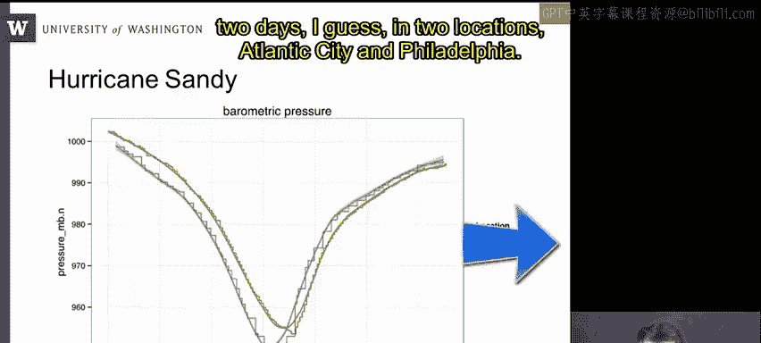
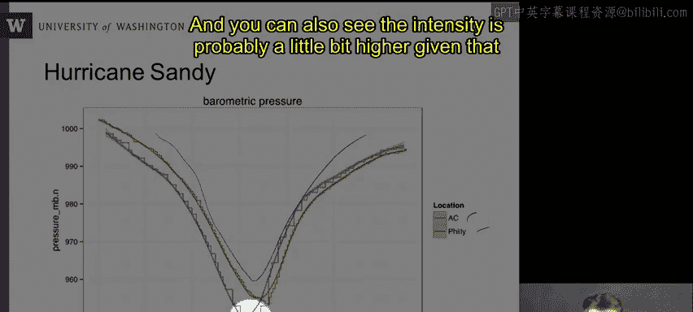
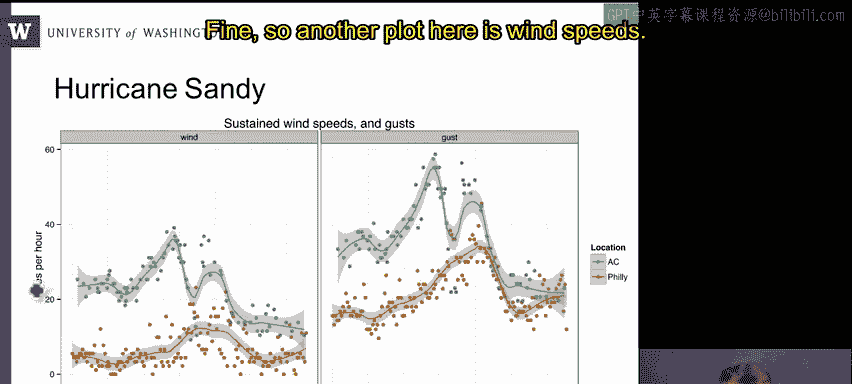
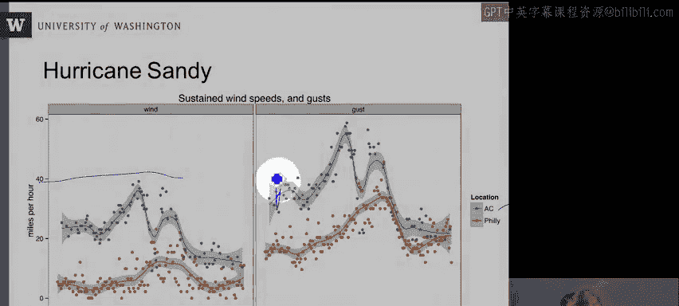

# 杜克大学《大规模数据科学（大数据操作，第1课／共3课有视频）｜Data Science at Scale》 - P2：1_激发胃口：极端天气.zh_en - GPT中英字幕课程资源 - BV12s421T7tJ

。

Around the same time， you know， when Hurricane Sandy made landfall。

 one of the things that struck me was the fact that。Visualizations of。

Available data were starting to emerge in real time in response to the storm。

And there's some very nice examples of people who used Twitter data to analyze a map or to produce a map of where the power was going out and in this even simpler case。

Joseph Ruwell。Got public data from local weather stations。

And just from two different weather stations and just simply plotted them。

 And so this is the barometric pressure over the course。Of。This。You know， a few day period。Two days。

 I guess。In two locations， Atlantic City and Philadelphia。

 and so you can see this enormous dip is the storm passing through and you can also see the time lag between Atlantic City and Philadelphia and you can also see the intensity is probably a little bit higher given that the per barmeter drop is more significant in Atlantic City okay。

So。A couple things here， one is pulling data down from the web and repurposing it sort of in real time。

 or at least in short time， maybe not real time。To produce。

Visualizations and then publishing those back out on the Web。

 I think this is very much the character of data science activities。 In this particular example。

 there's not necessarily a large data set involved。

But repurposing data that was collected for a different purpose is a theme that we'll come back to。

 and again we see the ad hoc nature of this as well。F。

 so another plot here's wind speeds and they sort of peak out at 40 in Atlantic City。

 which is still the green and you can see the Atlantic City is indeed more intense here and the gray here is error bars。

嗯。

So again， another variance on the same data。