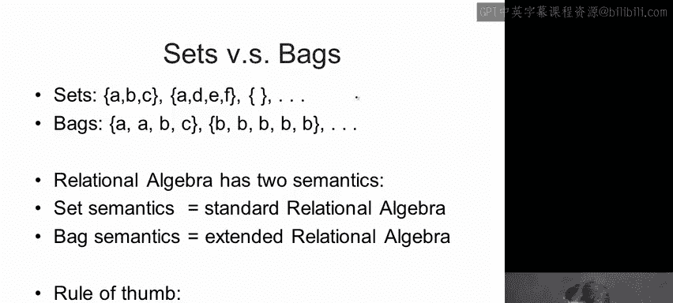
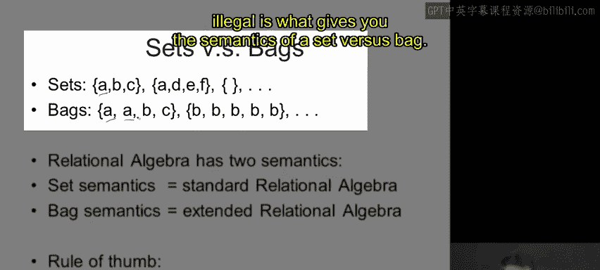
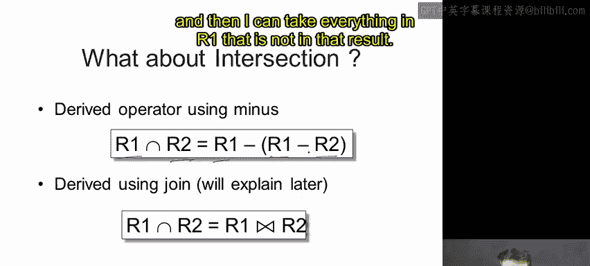
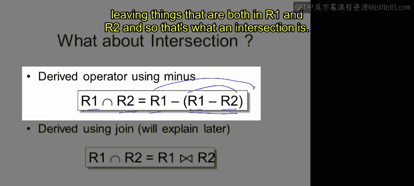
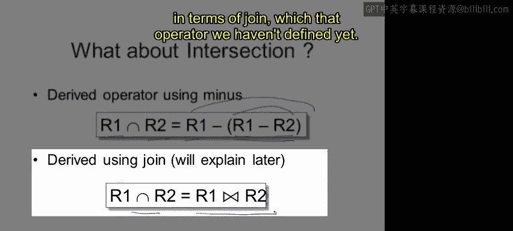
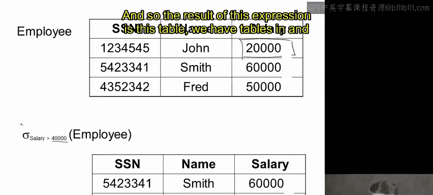
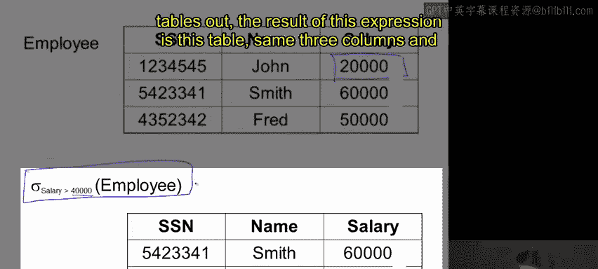

# 杜克大学《大规模数据科学（大数据操作，第1课／共3课有视频）｜Data Science at Scale》 - P30：29_关系代数运算符：并集、差集、选择.zh_en - GPT中英字幕课程资源 - BV12s421T7tJ

。

So this notion of sets versus bags is the duplicate question。Well， so first of all， what is a set。

 The set is a。Collection of objects where there are no duplicates and a bag is a collection of objects where there can be duplicates and so right up here。

You know， a is repeated， is not repeated at all in a set， but it may be repeated in a bag。

 And whether that's legal or illegal is what gives you the semantics of a set versus bag。

 So you can define the relational algebra in terms of these two different semantics。

 You can define in terms of set or you can define it in terms of。

Bag， and。This notion of an extended relational algebra comes from。

The need to sort of work with bags as well as other things like sorting as I mentioned。

 okay and so the rule of thumb here， this last time I'm really going to mention this。

 the rule of thumb here is that every paper you read if you end up reading some of the papers if we talked about in this course or beyond。

 you know unless it's said explicitly， we'll assume set semantics。

So be prepared for that while every implementation， every commercial database。

We'll assume bags mandates and we'll sort of see where that comes up in the language。

So I just wanted to put that out there up front that。

I may play fast and loose with the difference between sets versus bags。

 but it can be important in practice。So one lifted set operation you can define the union of two sets in the standard way。

 the union of two relations is natural given that a relation is a set of tus and in relational algebra notation I would write it like this and I can also write it in SQL with the union keyword and here's where setting bag will come up if I want to。

By unqualified union does indeed remove duplicates。

 in which case the answer is of the union of this relation with A1， B1 as a tuL and A2 B1 and A1。

 B1 and A 3B4 is，These three tus， the duplicate of A1 B1。Didn't get passed through。

To express this and bag semantics， to make sure we do include duplicates， you can say union all。

 and that would include all four twos okay。You can define the difference operation。The same way。

Or in the same way in the sense that you're lifting it from the set from the natural definition of oversets that。

Find every tuple in this set and remove any tus that also appear in this set and we see A1， B1。

 as we saw before， also appears in R1， and so you get rid of it and all you're left with is this tuple。

so why isn't this one in there？Well， we don't if it doesn't if A3 B4 doesn't appear in R1。

 we know it's not mis said， all we want is everything that's in R1。

Removing things that also appear in R2 So what about intersection that's another set operation that we could lift up。

You can indeed define。Intersection。But you don't necessarily need to have it as a fundamental operator because you can reexpress it in terms of difference right So if I want the intersection of R1 and R2。

I can take everything in R1 that is not in R2。And then I can take everything in R1 that is not in。

That result。So if you think about this for a second。This expression returns everything that ist。

That is only in R1。And then。This expression overall removes everything that is only in R1。

 leaving things that are both in R1 and R2， and so that's what the intersection is。

And we'll touch on this later， but you can also express intersection in terms of join。

Which that operator haven't defined yet。

The selection operator。Is。How we take twos that satisfy a certain condition and so we write it with sigma and we put C to express the condition this notation honestly we won't necessarily use too much throughout this course。

 but I think it's good to be familiar with it when it does come up i'm more interested in recognizing this sort of English。

Translation of these select， union， join and so on。 the Greek notation is perhaps less important。

Okay。If we want to find where the salary is greater than 4。

000 over an employee or where the name is equal to Smith。

That' that's an instance of a selection operator and the。Let's see。

 it says the condition C can involve equals， you know less than greater than equal to and so on。

 but it could be more than this， right， It can be any sort of boolean expression。 And in fact。

 as we'll see in maybe a segment or two， it can be sort of any arbitrary function that returns a boolean value。

 So it doesn't have to initially just be。A less than B or a equals B。

 it could be some complicated function。But let's say。

 in between some complicated function that's user defined。

And a simple condition like this where you just say salary equals 4000 or sorry。

 salary greater than 4000。You can have。Arbitary boolean expressions so you could have conjunctions。

 you could say where salary is greater than 4000。And。S name Eagle Smith。And of course。

 you can say or。And you can say not。All these are legal。Okay。So as an example。

 if we want to have a selection where salary is greater than 4，000 of an employee。

Which one passed this test， well， I've been saying 4，000 this whole time， and that's 40，000。

 excuse me。These numbers look high for a moment， so John has a salary less than 40。

000 and so he can be removed from the set and so the result of this expression。

Is this table right we have tables in and tables out， the result of this expression is this table。

 same three columns and only two tuples in it。

