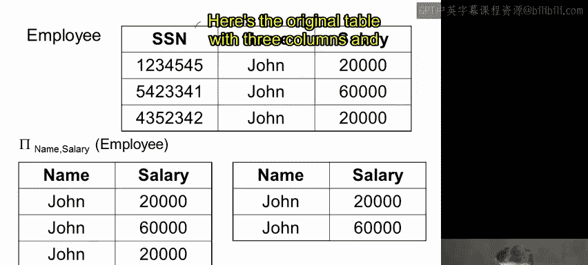
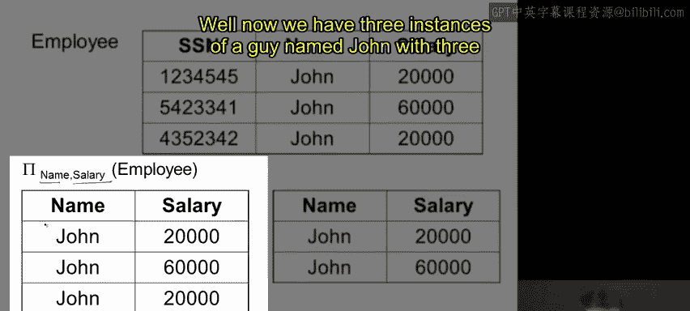
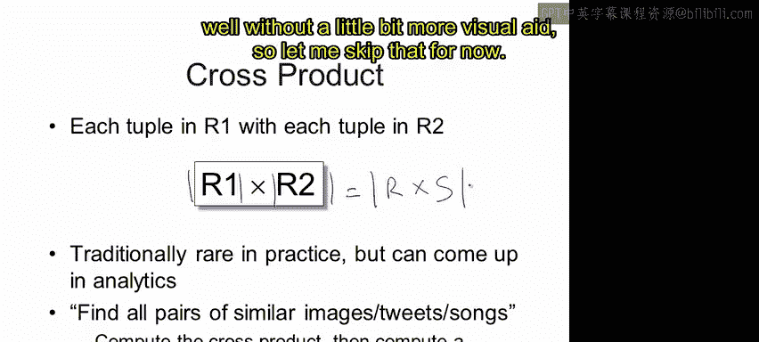

# 杜克大学《大规模数据科学（大数据操作，第1课／共3课有视频）｜Data Science at Scale》 - P31：30_关系代数运算符：投影、笛卡尔积.zh_en - GPT中英字幕课程资源 - BV12s421T7tJ

。

A project operator eliminates columns， and this is another one where you have to be sort of。

Careful about set versus bag。 So when you see a projection in the set semantics。

You're going to remove all columns that aren't explicitly listed。

But you're also going to remove all duplicates that might remain。So。

If I project away all columns except for the last name。Then you might think I get。You know。

 Bob Smith and John Smith。And I get rid of first name。

 I'm left with two tus or one tuple right well in set semantics。

 everything must be a set and so duplicates get removed automatically in bag semantics they'll both be there and if you write this query in SQL in any commercial database。

 what you'll get back is two tuupples， both Smiths you'll get duplicates and then you can explicitly ask them to be removed with a different keyword called Dis。

And we'll see you an example of this。So's an example here is project。

Social Security number and names。We only want two columns out of all the original columns that might appear in the employee table。

And so here's an example of the。Set semantics versus back semantics。

 here's the original table with three columns。

And we project onto name and salary。And so that means we get rid of SSN well now we have three instances of a guy named John with three different worth three salaries。

And the bag semantics would be okay with that， the set semantics would remove one instance of those duplicates。

And so question here is which one's more efficient？Well， removing duplicates is expensive。

So just leaving them in place is more efficient and in fact， that's。

that's really the motivation is to。Why。One of the key motivations why commercial databases assume bag semantics is that on every single query where you want to choose which columns you have。

Having an extra step to remove duplicates is sort of wasteful in typical applications you may not care。

Or you may sort of know by domain semantics that the remaining columns are unique anyway。

So you can tolerate duplicates and so forcibly removing them just to be pure with respect to the underlying semantics of the formalism。

Was not particularly necessary。Okay， so an operator that you won't hear much about。

 but I do want to mention for a couple of reasons one is that。

It' it's a useful as a reasoning tool when you're thinking about manipulating tables and then the other one is it actually is coming up more and more often in sort of analytics applications and data science applications it didn't come up very often in traditional relational database applications and that's this notion of cross product and so a cross product here is for every tuin R1。

For every combination of tuples in R1 and R2 produce a tuple in the output。

 and so the size of this thing is the size of R1。Multipliied by the size of R2。Mgus。Right。So fine。

 So an example where you might。See this and why you know sort of give you a flavor of why this is coming up more and more often is that you often want to find all pairs。

Of objects that have some similarity condition。And。

While while in any particular instance of this problem。

 there might be tricks to do this more efficiently。

 the brute force method of just generate all possible pairs and then apply some function。

To determine their similarity。Is。Often used in practice。So for example。

 if you want to compare two images for similarity。you have two faces and you're trying to see if they have the same face and you've got a piece of code that can do this。

啊。You now need to run and you have two big tables full of images or just collections of images。Well。

 generating all possible pairs and applying the function。It is always a reasonable way to do this。

So these kinds of operations are coming up more and more often。

 and I'm pausing because I was wondering whether is sort of。

Mentioned briefly some of the techniques you can do to get around this， but I don't。

I think it's going to come through very well without a little bit more visual aid。

 So let me skip that for now。

