# 杜克大学《大规模数据科学（大数据操作，第1课／共3课有视频）｜Data Science at Scale》 - P32：31_关系代数运算符：笛卡尔积（续）、连接.zh_en - GPT中英字幕课程资源 - BV12s421T7tJ

。

All right， so what does the cross product look like， well。

 imagine you had a table employee with these two columns。And a table depend。

Depenent with these two columns。And we do eight， whoops。

Like there we do a cross product of employee with dependent。

 that's all possible combinations of employees with all possible combinations of dependent。

 so we know there's going to be four tus in the output。

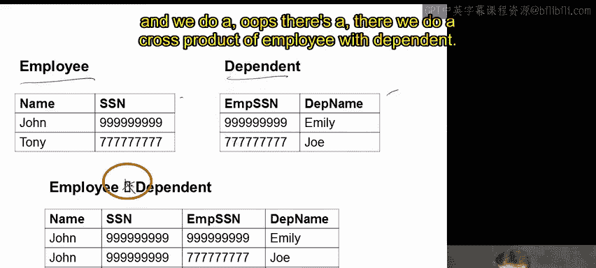

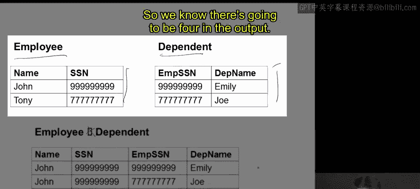

And you can check to see that John is here twice once for every instance in dependent and so on。

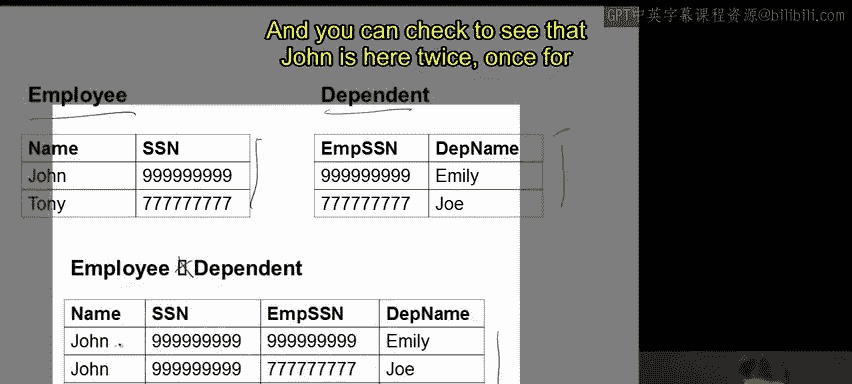

All right。So now let's talk about join and I probably maybe should have put a slide in here just about join in general first。

So really， we're talking about join， the most common instance of join that you're going to run into。

 and in fact， if we don't qualify it。This is what we mean is what I'll call Ejo and so equijoin is。

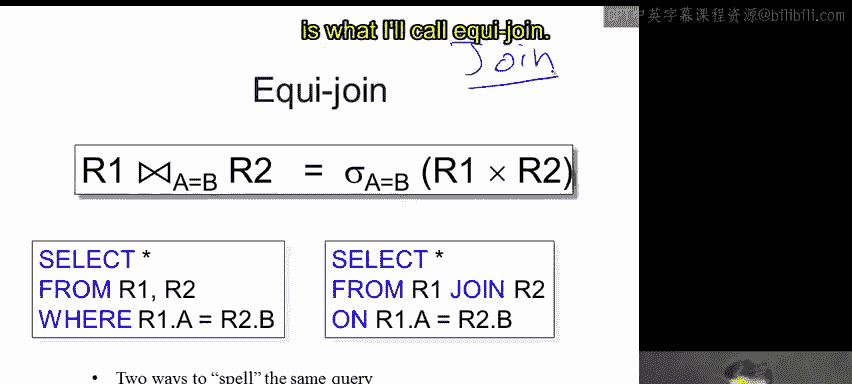

A。Join within a quality condition。Right here， Okay， so what does Jo do Jo says。

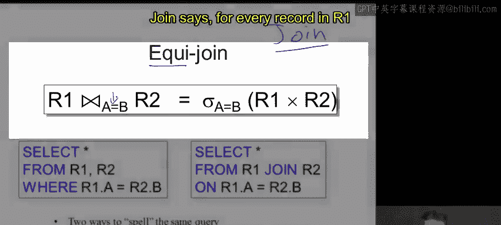

For every record in R1。Find me a corresponding record in R2 that satisfies some condition。

And in general， especially for those of you familiar with databases。

 you're going to be thinking about in terms of Ejoin， this would be you know。

For every course and find student IDs。That appear in particular courses。So join on。

Primary key and foreign key， if you don't mind the jargon， are instances of equi joins。

They they need not be。I is。One point I want to make， so we're not talking too much about schemas。

In this course， I'm more interested in teaching about the relational algebra and showing how it comes up rather than teaching about how to design a database in the first place and the reason for that is that you know you often don't have the luxury I made this point before we don't have the luxury of a engineered schema you're not you don't have time to build one you don't have。

there isn't one handed to you in the first place， there perhaps isn't even much need for one in that you're going to get your answer to a couple of questions and then you might sort of move on to something else。

So there's not really a way to amortize the cost of developing the scheme in the first place and so on。

You know。If you worked with databases， most of the joins you're doing are going to be along these predefined relationships that are called foreign keys。

 but those need not exist in order to apply a join。

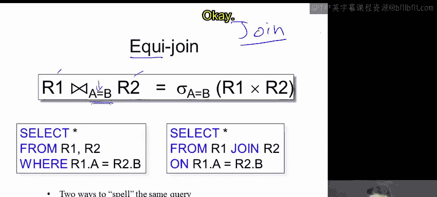

And then I'll point out that just a sort of syntactic node。

You can write this two different ways in SQL。 You'll sometimes see select star from R1。

Join R2 on some join condition。 And other times， you'll just say select star from R 1 comma R2 where this condition is met。

 Now， if I literally translated this into a。

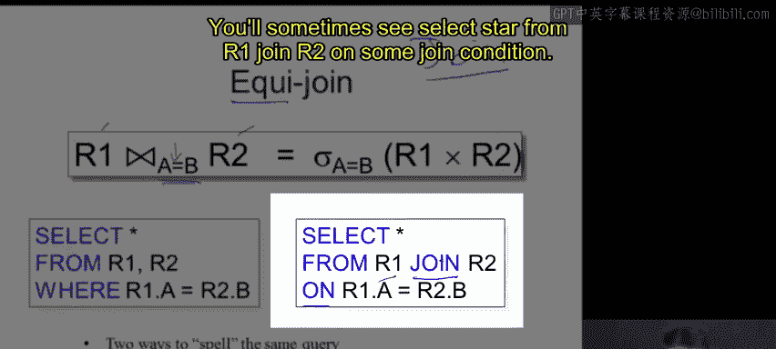

Brain dead relational algebra plan， and we'll talk about sort of how to do this a little bit more mechanically in a bit。

This is actually sort of saying， well， hey， look， first build the cross product of R1 and R2。

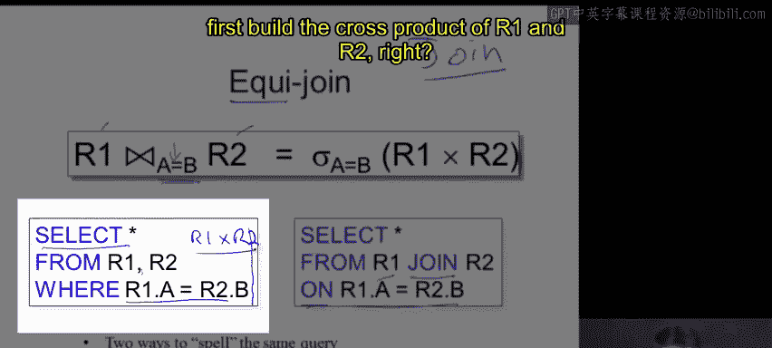

And then filter that cross product such that this condition is met。

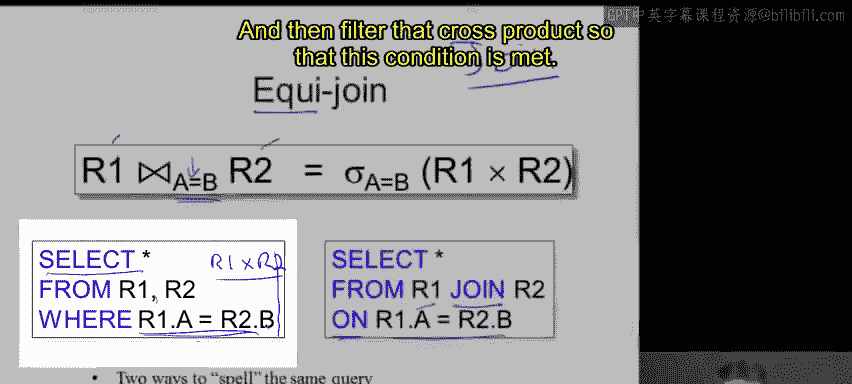

Okay。And this one is saying， no， no， no， don't do that， actually， use the join operator。

Rather than generating a cross product。

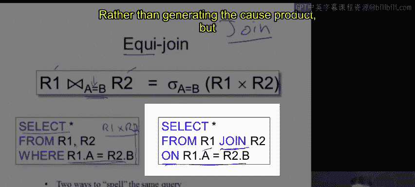

But。The optimizer， the databases are not that stupid right。

 they're smart enough to figure out that even in this case the right way to do this is to express a join and so in practice there's no difference between these two different ways of spelling the same query。

And in fact， know， to a first approximation， two equivalent queries。But different syntax。

 but same semantics in SQL， there's not going to be any difference between them。

 the optimizer doesn't care how you write。Your Sql， it's going to optimize the thing anyway。

 it's going to turn it into a relation algebra plan and manipulate that plan to find it to guess the best way to evaluate that query Okay。

 and so I say to a first approximation because there are such things as query hints and other ways you can sort of。

Tll the optimizer what you how you'd like the query to be evaluated。

 we're not going to talk about that because they're rarely important。And you know the other thing。

 it's not impossible to have two different queries that do the same thing that the optimizer can't figure out are actually equivalent。

 and so it's not impossible to get two different plans。

 but typically that won't be the case and in this example that doesn't matter at all。

Joining versus anware clause， I'll tend to write queries this way if and when they come up。Fine。

 so that's。The most common and the simplest instance of this joint operator。In fact。

 I think I did as a disservice here。By doing this on left and right。

 this is actually kind of a nice example。This is the sQL equivalent of writing join。

And this is the relation with sort of the sQL equivalent of writing。

Cross product followed by a selection， right they're the same。In fact。

 the only reason why in the algebra， you know， remember the algebra as a formalism， you know。

 maybe you don't care so much about deriving new operate as long as you can express the thing it doesn't matter。

There's so much work and there's so many good algorithms for implementing join that it sort of deserves its place as a specific operation。

 we don't want to have the right cross product followed by a select。

When we're actually sort of talking about efficient joint algorithms， okay？

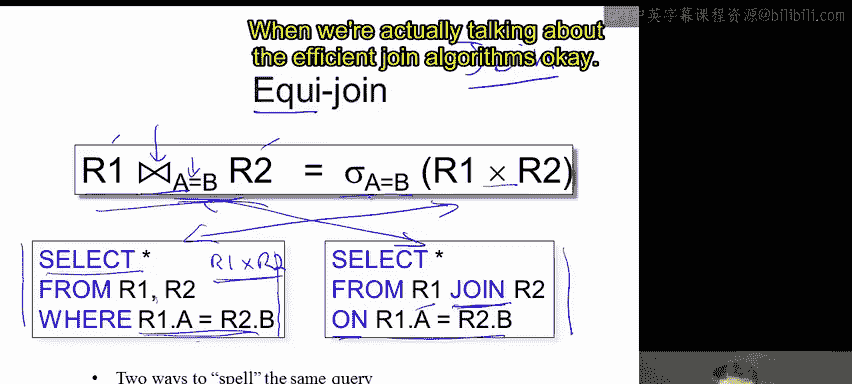