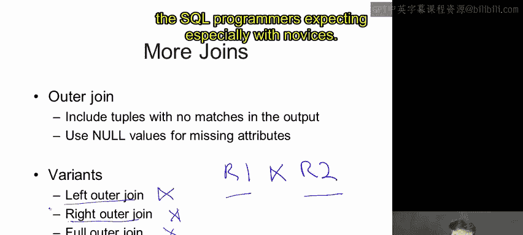
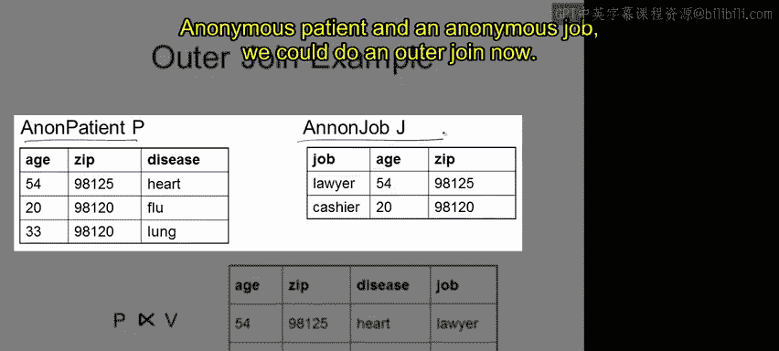
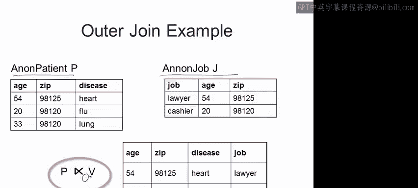
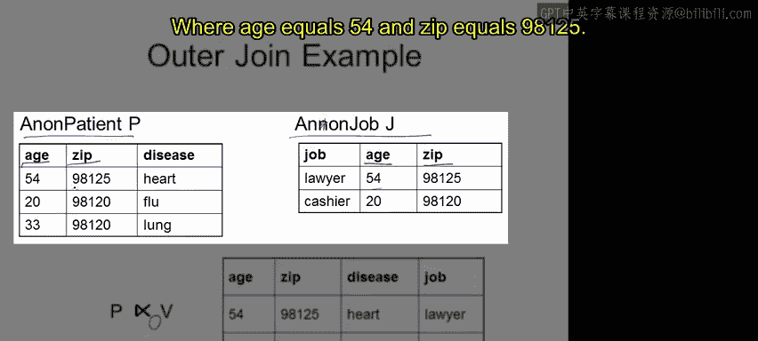
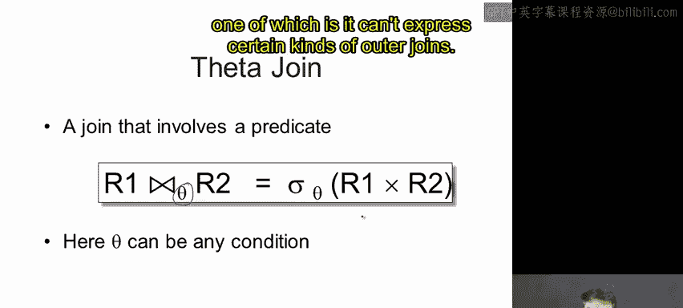
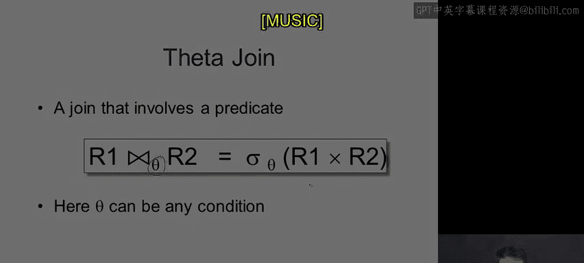

# 杜克大学《大规模数据科学（大数据操作，第1课／共3课有视频）｜Data Science at Scale》 - P33：32_关系代数运算符：外连接.zh_en - GPT中英字幕课程资源 - BV12s421T7tJ

。

There's others， another join to recognize that exists is this notion of an outer join and here。

What you're saying is you want。All the tules from the left。A1。

R2 right it like this with a sort of missing leg here。You want。All the tus from the left side。

 if you've written it this way。And。If the tuple on the right hand side matches great。

 you put it out and it's just like a regular join， but if there is no match。

 you still include the R1 tuple and you pad out the other columns with null。As needed。

So any value you don't have， make it a no。All right and so the variants here that aren't particularly important is left out or join。

 right out or join。Left out or join。Right outer join and sort of full outer join。

 which is a little bit hard to write。Because it looks like a cross product。

The right outer join you really sort of never need because you can always just reorder the operations school outer join means that you want everything from both tus patted out with null and these are sort of ugly to reason about formally but they come up pretty often in practice because especially for users when they're。

Well， actually， especially for users as opposed to applications， you know。

 if you're writing a query by hand， basically， many times people find it surprising that records in their table disappear because they join it with another table。

But that can happen because you've said that you only want pairs of tus where some condition matches and so you you might have no matches and things disappear and so out of jointin comes up as a useful。

Way to match more with the with the。SQL programmers expecting， especially with novices。

And so in an example of this， we have two tables here。Anonymous patience。And an anonymous job。

 we could do an outer join now。

What columns did we join on here？Well， it doesn't specify， we sort of omitted it here。

 although technically， we should write that。You know， right there in the sub of the joint operator。

 but we didn't， but of course you can probably figure it out。

Well， so you look at the columns that they have in common， right， This has an age column。

 and this has a zip column， and this has an age column， and this has a zip column。

So it's actually on both of those columns。Right。For every tu in P。

 find me a corresponding tu in an anonymous job J。hos。Extra in there。

Where age equals 54 and zip equals 98125。

So。If we had just done a join。Then this tuple would be removed from the output because it has no corresponding tuple on this side。

 there is no 33-98120， but because we did an outer join。啊。We do include the tu。

 and we pad it over them all here。Okay。And we write this in SQL。

Let me back up a couple of steps here and I'll show you so just like we have join here。

 you can actually write how to join explicitly。Howder， if you wanted to。

I'm not going to leave that in the slide because it'll be confusinguse， so is that a context。

And in fact， you can say left out or join， I guess to match our example。Put in the slides。

 the database that you'll be using in the assignment is SQL light。

Which has some nice properties for a single user。Case the entire database is stored as a single file and you can pass it around and so on。

 so it's a good tool to sort of having your toolbox which is one of the reasons why selected it for the assignments。

 but it actually has some limitations and one of which is it can't express certain kinds of outer joins。

In particular， full out of join。

