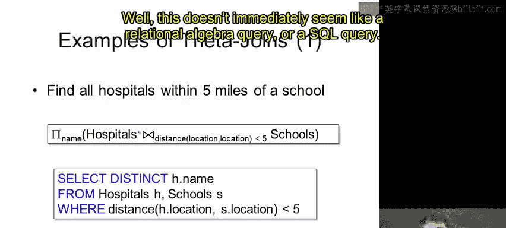
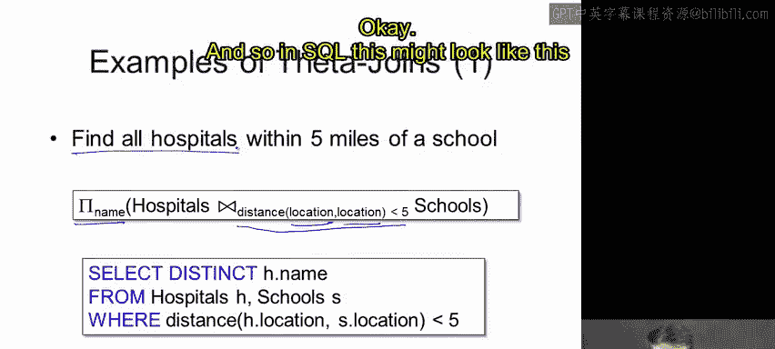
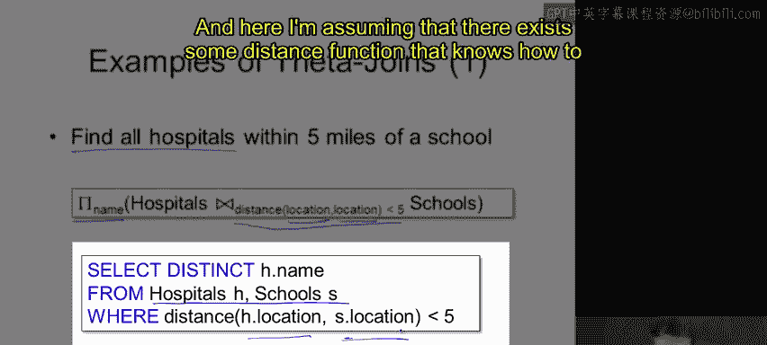
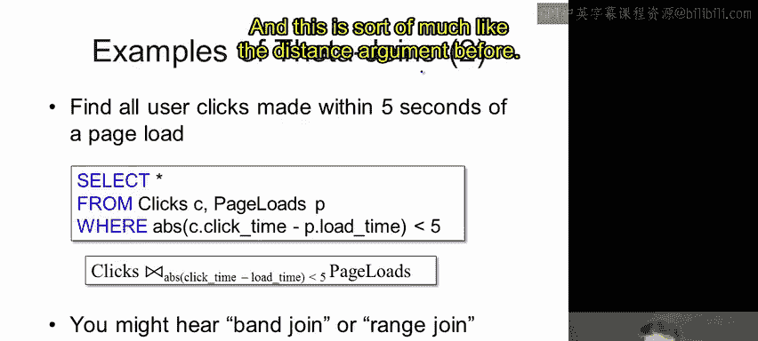
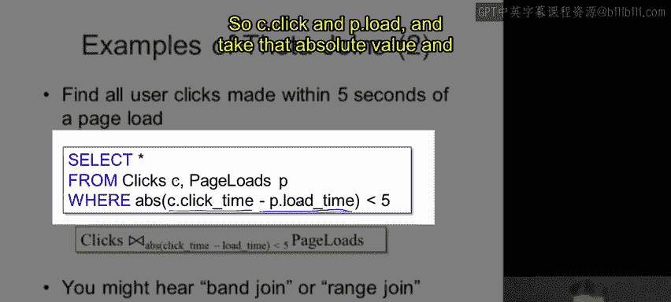
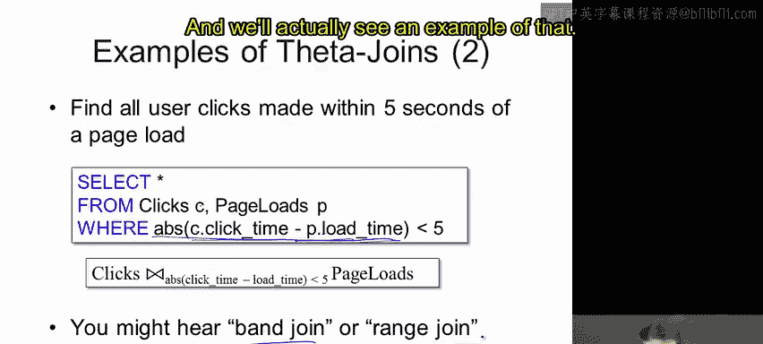

# 杜克大学《大规模数据科学（大数据操作，第1课／共3课有视频）｜Data Science at Scale》 - P34：33_关系代数运算符：θ连接.zh_en - GPT中英字幕课程资源 - BV12s421T7tJ

。

So more generally， you can have what we'll call a theta join， and this is essentially just a join。

 but the condition here can be anything you want。Rather than just an equality condition。

 this could be greater than or less than or arbitrary functions and so on。

And so this all paraimity test that I talked about before is an example of。

O' join and we'll see a more detailed example in a second。

And so just to point out that that E join itself is a special case of theta join where theta is just in the equality condition。

All right， so some examples of theta joins just to sort of demonstrate that these come up pretty often in practice more than you might be familiar with。

 and again， especially speaking to the people who who have experience with databases。You know。

 these are not going to be a long point key。Relationships quite as often， right？

So if you want to say find all hospitals within five miles of a school。Well， you know。

 this doesn't immediately seem like a relational algebra query or a SQL query。

 but it kind of is right， it's just a join where the join condition is this distance function over。

The location of the hospital and the location of the school。Okay。

 and then I did a projection here to sort of project out the name of the hospital because the English version of this seemed to suggest that we just want the name of the hospital and that's it。

Okay， and so in SQL， this might look like this where you say， look， give me all combinations。

Of hospitals and schools and then filter on the ones where the location of the hospital。

s less than five miles away from the location of。The school。

 And here I'm kind of assuming that there exists some distance function that knows how to compute this。

 And we'll talk at the beginning end about how new functions that are not part of。

The language or not part of relational algebra can be registered in the system and that's this notion of user defined functions。

 but trust me right now that these things can exist。And in fact。

 they don't even have to the be user defined there's many functions that already available in databases for manipulating。

 say for example strains， and in fact， even for geographic information there actually are distance functions available in those commercial databases so you'll see this structure。

The takeaway here is that I want you to still think join right just because you don't see a quality condition doesn't mean there's not a join going on it's just it' the same kind of join as everything else and then other the other takeaway is just to know the term theta join in case that comes up。

Usually when anybody's talking about the theta join， what they mean is difficult joins， right。

 arbitrary joins， the general case of joins。Another example that's。

Maybe you might sort of be able to think about coming up in practice in your own work is。

 well you know find all the user clicks made within five seconds of some page load and this is sort of much like the distance argument before。

 but now we can think about in terms of time， which is just a one dimensional。

The one dimensional distro metric is easier to define。

 so we say find the click time minus the load time of the page right so C dot click and P dot load。

And take that absolute value and see where that's less than。5。

 and so this might be when you're trying to find people who。

Find what they're looking for quickly right this is a metric that web analytics people might use frequently right if people sort of stare at a page for a long time。

Maybe if it's an article that might be good and means they're reading the article， if they' say。

Navigation page， it may be bad， it means they don't fly when they're looking more quickly。Okay。

 you might also hear about band joins or range joins， and this is things like find me。

There might be an interval of time， start time and end time in one table。

And you're trying to find tubs from another table that fall within that interval。

And we'll actually see an example of that。

