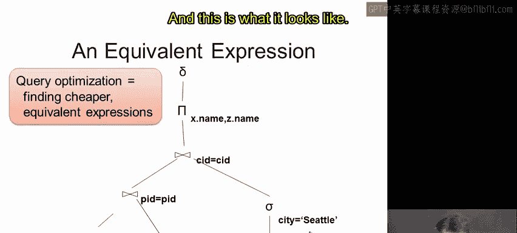

# 杜克大学《大规模数据科学（大数据操作，第1课／共3课有视频）｜Data Science at Scale》 - P35：34_从SQL到关系代数.zh_en - GPT中英字幕课程资源 - BV12s421T7tJ

。

So we talked about the relational algebra operators themselves。

Let's get a little bit of experience translating from SQL to relational algebra。

At least in our heads。So we'll see some examples of how to do this So assume this schema with three tables。

productduct purchase and customer we did not talk about that in this class。

 but the underlyingline here means that that's a primary key and so every unique value of PID defines a unique tu in product。

Every unique value of the combination of PID and CID defines a unique purchase。

 and every unique value of CID defines a unique customer。Fine。

 what's the relational algebra expression that corresponds to this query。

So the first thing you want to look for is or the first thing I like to look for is the。

From clauses I like to see what tables are involved Well。

 this has all three tables involved and whenever I see multiple tables on the from clause or involved in the query。

 I'm thinking joins okay so even if the condition is not immediately obvious or you haven't haven't sort of analyze the where clauses yet just think that they're going to be joins In fact。

 typically if you don't find a join condition linking say X and Y down below it usually means there's a bug in the query right that would correspond to a cross product and it's not too common that you want that So where are the join conditions well。

 here's the one that links x and y， they join on Pd equals P that's pretty common case to the link to sort of。

Keys and4 keys that way。And here's the condition that links， that's a bug too。It should be Z。

Here's an condition that links purchases with customers。Okay。

 and then there's mixture conditions here that are not joint conditions。

 So why aren't they joint conditions， Well， they only involve。Columns from。One table， not from both。

Okay， and so the price has to be greater than 100 and the city has to equal Seattle。

 So what does this sQL statement do in English， it says find me。

And the key we see that key we're distinct here too， so if find unique。

Pairers of products and customers。Products purchased by customers in the city of Seattle where the price was greater than 100。

All right， so the relational algebra。Expression of this。

 we saw that there were two joins or three tables join is a binary operator means has two inputs so we know there's going to be two joins right so first we join I say first in this particular plan。

 first we join product and purchase。On this condition， P I D equals P I D。

And then we join in customer where CID equals CID。And then we apply a selection condition。

 price greater than 100 and city equals Seattle， and that's perfectly legal。

And then we use the projection operator to get the tables we want。

 and then finally there's a funny operator here we didn't talk about which is the duplicate elimination operator。

And that explicitly removes duplicates， and that corresponds to that distinct keyword。

Okay so here's this tree based relational algebra view of the same。Query now。

We talked a little bit last time about optimizing。Querries algebraically。

 so think for a second about。Whether there's a faster way to do this， is this the fastest plan？

And I guess I'm sort of leading you that it probably isn't。

 but think about how you might make this one faster。So what does the cost depend on？

While the cost in general， the cost dependss on the size of the intermediate results。

 you want fewer tuples flowing through this plan。Okay， and here the selection operator。

 every time we see it， we know that it's going to reduce the number of tus or keep it the same。

 but it's going to it's。Applies a filter， right？So we want to do those。Almost always。

 we want to do those as early as possible。And so finding only those products where prices is greater than 100。

Down here would be a reasonable idea。And further， finding these purchases that are only in the city of Seattle。

Or sorry with these customers I。 Let me go back and check。Yeah， Z do Z dot city。

 So it it's an attribute on the customer relation。Excuse me， price equals on 100。City。Equals Seattle。

Would be better and then we could。Get rid of this。we talk about pushing selects and's。The most basic。

 the most common algebraic transformation you might do on a。Relational algebra plan。If。

 if this was a。If you were。Using databases in practice and you didn't care about sort of understanding the internals and you didn't this wasn't a data science course where you're going to move on beyond databases after that。

 this actually wouldn't be that important and the reason is because databases take care of this kind of thing automatically you just write the query。

 it's going to figure out that it can push the legs。

The reason I want to bring this up is for both those reasons。

 why I want you to understand what's going on inside a database。

 but also you're going to see as we get away from this decorative query language and algebraic optimization kind of framework that databases offer。

You have to worry about these things manually once again， okay。

And recognizing when there's an opportunity to sort of push these filters。

Upstream is important and the relation algebra gives you the kind of language and formalism to sort of reason about these problems。

 even when you're not talking about a database。And that's what this slide shows I sort of drew by hand in the。

With the pin， but what we did was we pushed the select down and this is what it looks like。

。