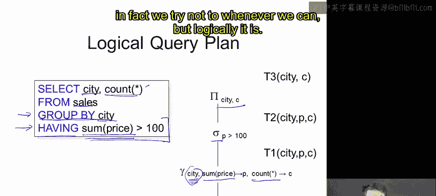

# 杜克大学《大规模数据科学（大数据操作，第1课／共3课有视频）｜Data Science at Scale》 - P36：35_关系代数思维：逻辑查询计划.zh_en - GPT中英字幕课程资源 - BV12s421T7tJ

。

So we talked about a duplicate olimination operation。Corresponding to the distinct keyword in SQL。啊。

We did not talk too much about a grouping operation， we'll see an example of that in a minute。

But I'm not going to talk about the relational algebra operator。Too much right now。

 it'll come up again later when we talk about implementations of some of these。

Okay and that corresponds to the group by clause in the SQL statement and we talked about sorting or we sorry we didn't talk about sorting but we mentioned sorting and that corresponds to this order by clause so basically just watch for these and try to understand what's going on that they imply that's extra operation that has to happen so here's an example that actually has a group by in it and we have another clause here called having。

Okay。So， this says。For every unique city。Count up all the sales transactions。

That occurred in that city， and so here we just have a single table， so there's no joins。

And we're going to this says explicitly to group by city。

Something is always about me a little bit about EscuL。Actually。

 obvious from context that we want to group by city because we said count and city doesn't have any kind of aggregation function applied to it。

Therefore， it must be grouped by and in fact， if you tried to write this without the group by explicitly。

 you'd get an error， but's there's not necessarily a reason why you have to get an error。

 it can actually figure that out， but let me not。Well， I that too much。So for every unique city。

 count the number of records then。There's this extra clause here called having。 And we say， look。

 here， I only want to have。I only want records to return that have the total price。

Of all the sales in that entire city to be greater than 100。Okay。

 so let's think about this in relation to algebra。 Well， soon we start with the sales table。

And then we apply this group by operation。And it has two sort of forms of arguments。

The set of grouping columns here， we just have one called City， and then we have。One or zero or more。

嗯。Aggregation expressions。And here there's actually two。

 one is count star and the other is sum of price。So count star appears in the select clause。

 and Summer Pri appears in this having clause， but we compute both with the same group by。

Just recognize that the grouping operation， how you would actually implement this in practice。

 there's an opportunity to compute as many aggregation expressions as you possibly can in one shot you don't necessarily want to do this twice because it takes multiple passes over the data okay so we see them both happening here。

Then how do we make sure we filter on？How do apply this filter Well it's a having clause。You know。

 that's something new immediate requires a new operator。 Well， no。

 it doesn't because it's just a selection， right？P， the sum of the prices。

 the total price is now just an attribute just like any other， right， so we can apply a selection。

 a select operator to it just like we could if it was stored in the underlying table。 Okay。

 And so this is another。Advantage of this notion of algebraic closure that I talked about a couple of segments ago。

Where we know that every operation returns tables since we know that we can apply。嗯嗯。

The same set of operators on any table。Okay， so for example。

 we don't need a special select operator called group select or something。

And we'll see later with in certain languages where this model is kind of broken。Okay。

 and then finally， we project out everything we don't want。

 and so we keep only the city and count star。F， and so the point here is these are。

 you can think of the result of every single operator， every single operator as a temporary table。

 it's not necessarily written out to disk as a temporary table and in fact we try not to whenever we can。

But it's logically， it is。

