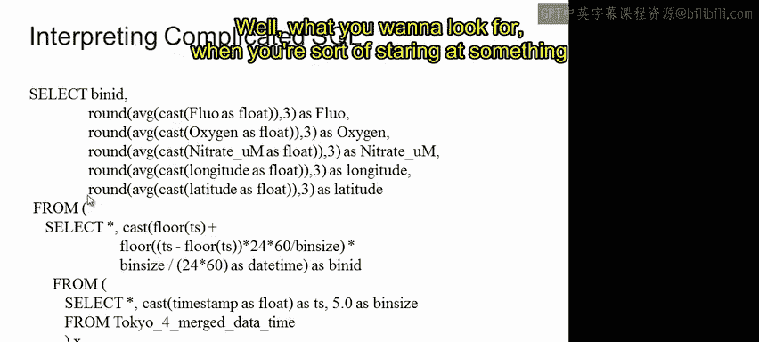
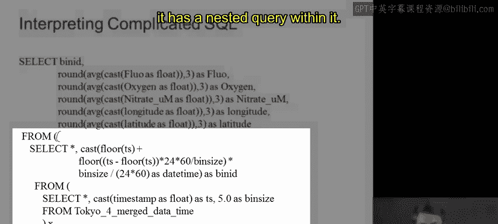
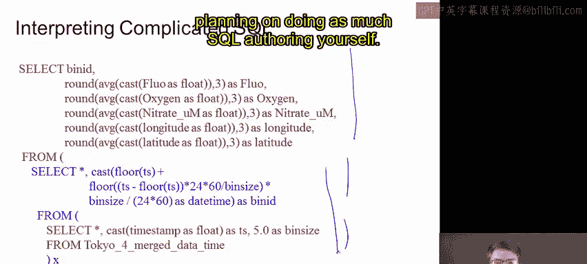

# 杜克大学《大规模数据科学（大数据操作，第1课／共3课有视频）｜Data Science at Scale》 - P37：36_实用SQL：时间序列分箱.zh_en - GPT中英字幕课程资源 - BV12s421T7tJ

。

So now I want to talk about。How to interpret or give some examples of how to interpret SQL statements sort of in terms of relational algebra we're not going to actually write out the plans。

 but I want to give you some experience staring at what may seem sort of complicated and kind of teasing out what's actually going on here and so for people that have spent a lot of time around databases and SQL。

 these may or may not seem particularly complicated but if you're just starting out they probably do So in this first example what do we see here Well。

 what you want to look for when you're sort of staring at something that may seem sort of hairy is you know look for the from clause here。

And so in this case， it's a little funny， right， because we see whoops。We see。

That the from claws does not have a table mentioned。 It has a nested query within it。

 And we remember that that's perfectly fine， because of。

Disclo property of the underlying algebra， we know that any relational algebra expression and therefore any SQL statement is going return a table。

And it operates on tables。 So if you can operate on table。

 if you operate on tables and you know you return a table。

 then you can sort of chain these operations together and you have this nice closure property。

 So we know that we're allowed to query derived results， just like we're allowed to query。

Base tables。Okay， and so in this case， we're doing a drive result。Now。

 well so let's go down to the other from clause well here we see another nestA query。

 another layer nest again， perfectly fine。And one more layer down， we see this table here。

 and so where this data came from was a sensor that was mounted underneath。诶。

Oceographic research vessel that was collecting。Measurements of a variety of different variables here。

 a few of them mentioned fluorescence， oxygen， nitrates。

And there's there's several more and then this is latitude longitude where where the ship actually was located at that point in time and they're also tagged with this timestamp so they're tagged with latitude longitude timestamp and a bunch of measured variables and so what this operation is actually doing is。

Aggregating， binning these measurements onto five minute windows。Okay， and so we can see how that's。

Done so in this inner query there's some work to or you call this function to cast the timest to a flow that's not particularly important。

 And here we see this trick where we just use a constant value right there in the slight clause。

And so what that does is。啊。Sort of a pinned a new column with with a。Value five for every record。ok。

And I'll say maybe why this was done in this particular case。In a moment。

 and then in the next layer up， we see this kind of hairy expression involving bin size twice。

And what it's doing is rounding down the timestamp to the nearest five minute window。You know。

 six minutes and 32 seconds becomes five minutes and 11 minutes and 29 seconds becomes 10 minutes and so on。

Okay。And then in both cases， by the way， we see this star here。

 meaning that all other columns are going to be passed through and then finally the outer query we have bin ID which we computed here notice that we've。

t this renaming operator where we can have this complicated expression and just give it a nice。

 convenient name。So we got that pass through， and then we compute the average。Of these other values。

 the average latitude and the average longtitude within that five minute window as well。ok。

So given that we're doing an average， we should expect to see a group buy， and in fact we do。

 we're grouping on the bin ID， which would make sense。

And then we happen to be sorting by binId just to make sure that the records come out in timestamp order because perhaps some application requires it that way Okay。

 so why is this why is this sort of overly complicated why not just collapse all this into one。

Expression， well， you could， but it's for the same reason that you might sort of abstract things or refactor things in an imperative language。

 there's a little bit of software engineering being applied here so that this complicated expression can be reused in multiple places in this case。

 it's only being used once so you could perhaps move it there。

But it sort of separates two different blocks of logic。So。In this slide。

 I've color coded the you know three different blocks of logic， red， blue and green。

 so you can see the layers of nesting。 But the main thing I I want you to take away is that one is that nesting。

Is perfectly fine and you may see it and not to worry when you see it bemus in practice。

And second district is going to convey that as you start to do more and more analysis in SQL。

 more complicated analysis。You， there are ways to kind of refactor the the complicated queries so they don't necessarily look so complicated。

 Another thing you can do here that we will talk about。In perhaps the next segment is。

Save this result as a view。Give it a name and then you could refer to it in the out just as a table。

I'll talk more about that。Next time， but these are some of the tricks you can play when you're sort of working with in SQL and in fact。

 you know some of the things you may see people do。

 even if you're not planning on doing as much SQL author in yourself。

