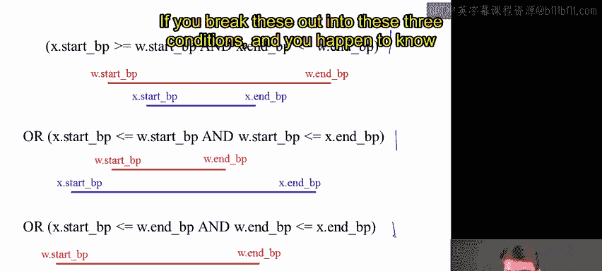
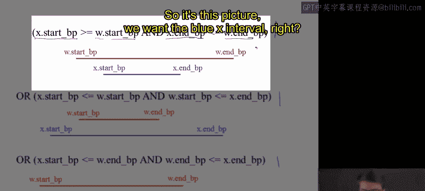
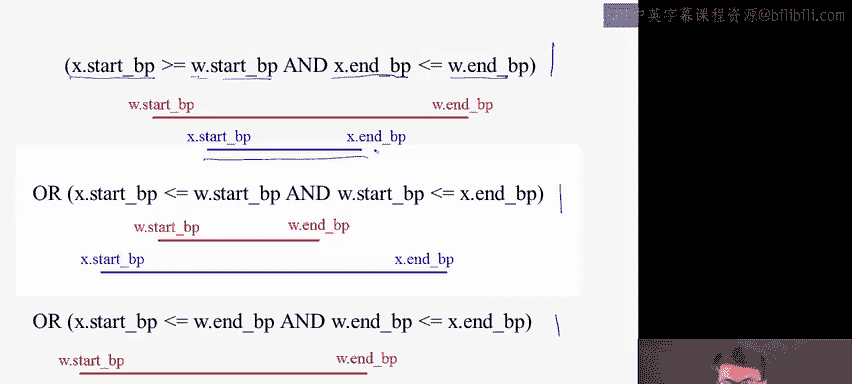
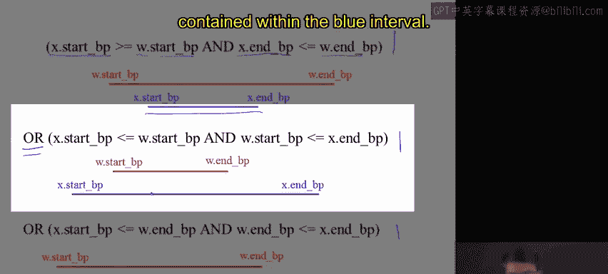
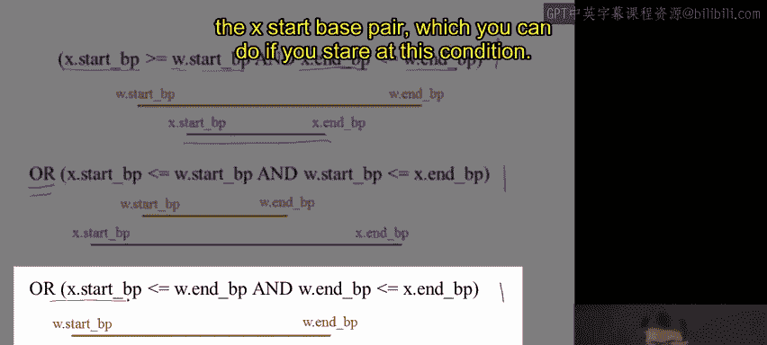
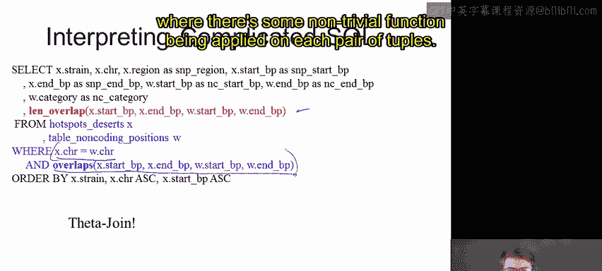

# 杜克大学《大规模数据科学（大数据操作，第1课／共3课有视频）｜Data Science at Scale》 - P38：37_实用SQL：基因组区间.zh_en - GPT中英字幕课程资源 - BV12s421T7tJ

。

So here's another example。Same thing， The first step is to look at the from claws and see what you see and here we see。

Two tables and there's this keyword inner joins now the join is explicit。

And the joint condition here。Is this where we have some sort of ID？And some sort of other ID。

By the way， one of the other things I want to kind of do here is to show that you can kind of analyze the structure of a SQL statement to understand what's going on。

 even if you really have no idea what the data is all about and in fact it's kind of helpful to do so。

 this is something you'll be presented with in a data science context as someone will say。

 look you know we need to know。We need to predict what the average sales for next month is going to be and you say。

 okay great， you give me the data and they'll say well I don't know。

 it's in some database over there and you'll go over there and talk to the DBA or maybe there won't even be a DBA and you'll have to sort of analyze what's going on inside that database on your own and so that means staring at the schema which we haven't done but it also means staring at certain people at queries。

Which you may not have written， okay， so having a little bit of a skill of analyzing these complicated queries can be important。

Okay， so fine， so this looks ostensibly like the joint condition， but if you look at the wear claws。

I want to make sort of a point here。That the table referred to as X， this hotpot deserts。

 and the table referred to as W。Are involved in additional conditions down here。Okay。

 and so these are actually join conditions as well， right。

 even though this one is explicitly listed as all you know an innerjoin on this particular condition。

Anything that involves。Anything that applies a condition to。Attributes that are in both tables。Right。

 any sort of condition evolving attributes from both tables is a joint condition。

 And so this this whole thing is actually one sort of complicated。Joint condition。All right。

So I went a little bit out of order into a little bit different than the order I wanted to go in。

 but let me backtrack and come back to that。Hold that thought popping back up to the top。

 there's other piece of complicated logic here。 Well， this is。

A particular syntax that's available in SQL called you know a case statement and it acts about the same way as a case statement in other languages。

 so that's not too bad。 but in particular， even if you just ignore all this logic， you can just。

Collapse all this down and say， well， look， there's some function。That's computing。

Lynn overlap and where did I get that name， Well， that's what they name。

Result of this complicated expression。The length of the overlap， and in fact。

I happen to know a little bit about where this query came from。

 whether they're working on is genetic sequences， and you may be able to do so if you could stare at this。

 there's SNP region， which stands for single nucleotide polymorphism。

And there's strain that may give you a hint and BPp is base pair and noncoding regions noncoding positions gives you a bit of a hint if you've done any work in bioinformatics but if you haven't。

 that's okay the point is length of overlap appears to be the name of this thing so it's almost like there exists a function linked overlap that involves these attributes and we don't even care what's inside it it's just a function so that helps us sort of see the underlying simplicity of this query in this case then。

Back to this。Other complicated expression。 let me show you a little bit about what's going on here just because I think it's kind of a。

Fun example。If you break these out into these three conditions。

And you happen to know something about where this data is coming from。

 You can see that what this is saying is， well， look， we want the。

Start base pair from the X table to be greater than the start base pair from the W table。

 and we want the end base pair from the x table to be less than。DN base pair from the W。

 so it's this picture right with the blue X interval。

It's a sequence， the x table is filled with ranges。All，'s starting in ranges， intervals。

And the blue interval needs to be completely contained within the red interval。

You know， or。The red interval needs to be completely contained within the blue interval or。

The red interval needs to。Straraddle the X start base pair。

 which you can do if you stare at this condition。

Okay， so they're doing kind of interval logic right there in SQL。

 And so the point of maybe looking at this in enough detail that I't understand what's going on is a couple things one is。

This point about the joint condition is that it's not， you know。

 even if you don't understand what's going on， you can sort of see the structural。

Details to understand that it's just a joint condition。

 but also that you can actually do certain kinds of analytics directly in SQL。

 This is a fairly non trivial operation to do that。Many people。

 especially among people who have either not had good experience with databases or have heard from their friends have not had good experience with databases。

 that this will be something that's considered sort of impossible。And it's not impossible。

 and nor is it really even a bad idea。 It's actually kind of a natural thing。

To do and so analytics in the database is should be a part of your bag of tricks you know。

 the first step should not be let's pull everything out of the database and then start using imperative code。

This example alone。I would hope doesn't convince you of that claim I just made of getting things out of the database is a good idea。

 but there's going to be a sequence of arguments that I make。

Probably throughout the quarter here and there。Meanwhile， I should put the caat of。

 This is not you know， I'm not going be。Pushing databases as the ultimate solution to data science。

 but by any stretch imagination。But I there is a role for it to play Now with these， you know。

 we collapsed this into one function， we can also collapse the joint condition into these two things。

 It must match on on this。CHR field， and then it must have this kind of overlaps condition be true that that we saw on the last slide and so this is just an example of a theta join where there's。

Some nontri function being applied on each pair of。

Tubs。