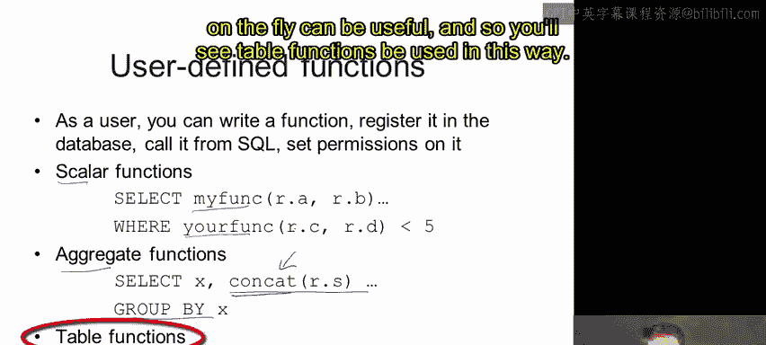

# 杜克大学《大规模数据科学（大数据操作，第1课／共3课有视频）｜Data Science at Scale》 - P39：38_用户自定义函数.zh_en - GPT中英字幕课程资源 - BV12s421T7tJ

Okay， let me add a short addendum about user defined functions。

So we've seen a couple of examples of them。 And In fact， I'll click back here briefly we。

Pretended that there existed a。User defined function called overlaps and a user defined function called the length of the overlap。

 And I wanted to point out， at least in this context， or especially in this context that。

You can indeed define these these kinds of application specific。Operations。

So they're called UDFs and you can as a user you can write one of these things。

 you can register it in the database and then you can call it from within your SQL statements and you can assign it。

 you can grant permissions for other people to use it as well so the database becomes kind of a repository of user definedfined functions that can be called from anywhere and so there's three types to be aware of one is scalar functions the other is aggregate and the third is table functions and you can tell what they are by how they're used within the SQL statements so a scalar function will appear。

Pretty much anywhere any expression can appear。 So if you can add two attributes together or you can subtract them or do any kind of arithmetic。

 you can apply a function。 So this can appear in the select clause or compare in the where clause or。

Appear in a joint condition， it can appear sort of anywhere an attribute can appear。

An aggregate function appears in the select clause only and is always associated with a group by and so here I've kind of indicated perhaps a common aggregate function that users define when it's not available built in and often this one isn't is concatenate。

If you have。A table of identifiers and words， and you want to concatenate all the words together to make one long string。

That's not always something。Available built in， but it's a very natural thing to want to do right so've got i've got a set of small strings and I want to create one long string well concatenation is something that's very easy to do in most programming languages and that's how you would express it in SQL you would do a group by right you say。

ああ。This example is a bit abstract to maybe go through live by waved my hands a lot。

 but you've got some grouping attribute， which defines a set of related strings。

Maybe I want to concatenate them all together， and so you might define a user defined function to do this concatenation built from a string primitive that's just a pin to pin to pin。

If you have a function that cancatenate two strings。

 you can build a user defined aggregate that cancatenate many strings，F。

 and then table functions appear in the from clause， and they're arguably the most complicated。

 So the most， the most common example you'll see here is。

Some kind of a table function that will allow you to define a sequence of。Excuse me。

 a sequence of integers。So sequence from。5 to 10。If you want to represent。

All the integers from  five to 10 as a table。You know one thing to do is actually physically create a table on disk and insert those integers into that table。

 but that's a little bit wasteful right because we sort of know what that sequence should be。

 we don't actually need to physically store it 5 to 10 maybe it's not so bad that if you're trying to store the integers from one to a million。

 it can get worse and so a function that knows how to generate these on the fly it can be useful and so you'll see table functions be used in this way。

