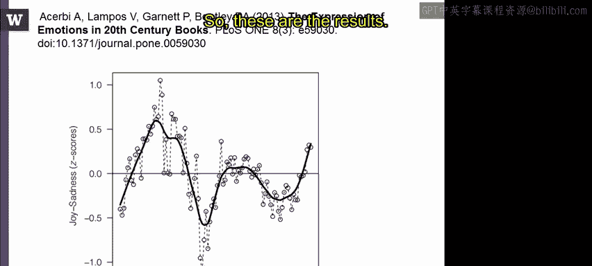
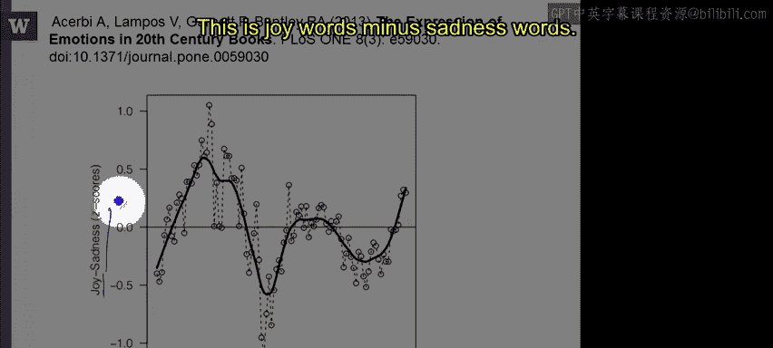
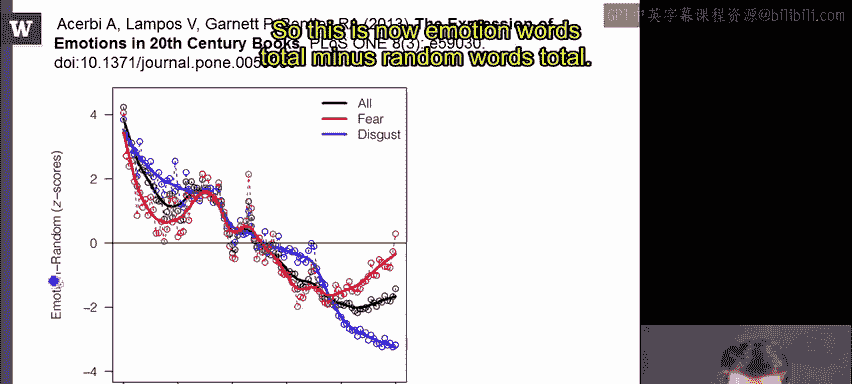
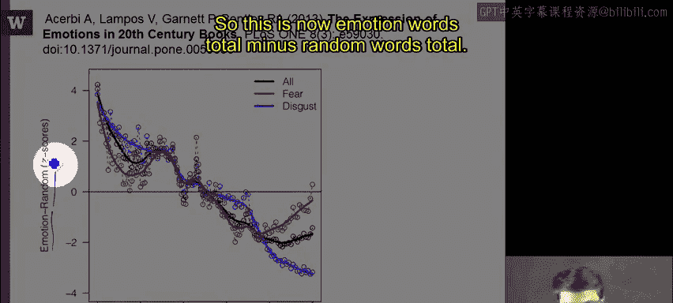
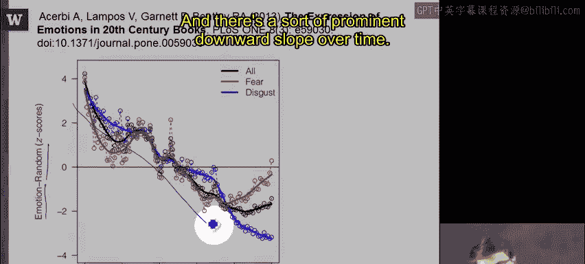
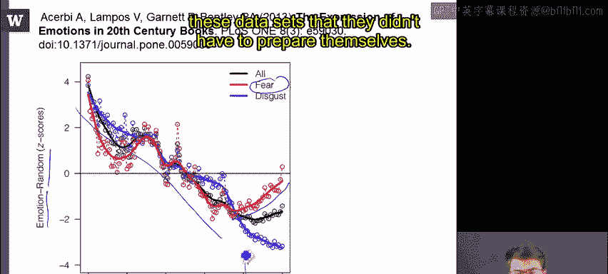

# 杜克大学《大规模数据科学（大数据操作，第1课／共3课有视频）｜Data Science at Scale》 - P3：2_激发胃口：数字人文.zh_en - GPT中英字幕课程资源 - BV12s421T7tJ

。

This was a study， the title here is called the expression of Es in 20th century。

Books and so what they were interested in is have the words that we choose to use in our collective literature changed over time and eventually does that tell us something about。

Sort of culture or civilization。I find the scientific inquiry。Sort of compelling。

 But what I think is most striking about this and why I wanted to conclude as an example is that the methodology that they use here is。

Pretty straightforward。 You could。 you could do this yourself with not a significant background in either technology or in statistics or even in you know linguistics or anything。

 And so this is what they did。 right， So the first step is kind of a doozy。

 This is take all the books written in the 20th century and digitize them。 Well。

 that would be a nonstarter。 None of us could do that。 But that's okay。

 Google's already done it for us。 And they've made the data available at this URL。

 And so you can go check that out。 What they've done is digitize the books。

 done the character recognition on it and produced these ingram data sets。 So these are tables of。

Of data。Where。Each row has an ingram and。Followed by the year and the counts of the number of times that ingramraham occurred。

 this has already been broken down and processed。Into a form that's digestible。 Okay。

 And so what's an in gra。 Well， it's pretty simple。 A one gram。Is just a single word like yesterday。

 a five gram， an example here is the phrase analysis is often described as。Okay。

 and so in this study， they just ignored。Everything but the1 grams。

And then they took some subset of those1 grams and assigned them a mood score。

 so how do they do this？You can imagine that certain words are charged with a particular mood or associated with joy or sadness or fear and so on。

 and you could also imagine that synonyms of those words，Might also be associated with that mood。

 And so this analysis。Sounds nontrivial and it is， but once again that's already been done for you。

 there's a resource on the web called WordNet where they've done this kind of affect analysis。

And so the authors of this paper were able to take the digitized books from Google。

Or already broken down in Dgrams and the Hax scores from WordNe。And then do this calculation。

 which you know may sort of look intimidating if you're not used to staring at these mathematical expressions。

 but it's actually pretty simple。 This is the count。Of a particular。Hao。Word in the set。

The set being the set of wordnet words， which is not as big as all the words。

 only only some words are able to be scored as mood。And then you normalize。

By the count of the number of occurrences of the word the。So why do they do that？Well。

 you need to normalize over something。A。In order to account for the fact that perhaps we just write more books in 2005 than we did in 1937 or we've been able to digitize more books so we need to normalize by that total but why not just normalize by the total number of words Well。

 the reason is that the the word does a better indicator of pros than the total number of words and this is because we've also apparently we've also started to produce more sort of captions and figures and more sort of technical language and more sort of formula and more expressions。

 more nonprose utterances in these。Books。And therefore， we can sort of skew the results。

 So they really want to capture that in our language when we actually write full complete sentences。

 how often are these words being used， Okay， and then you add those up and you divide by the。

Total number words in the set。And then there's one more transformation here that should look familiar to you if you sort of recall your high school statistics。

嗯。You subtract the mean and。Divide by。This standard deviation。So this is。

Normalizing with respect to a normal distribution。But that's about it。You know。

 there's a count and there's a division。And then there's two data sets that you can pull from the web and they're big。

 but they're not exceedingly big， they fit in memory on most of your laptops nowadays， so it it's a。

Significant computational tasks， but nothing that requires he do。 You could do this in a weekend。

 if you。Haved thought about it。Okay， so I find that pretty compelling。So。These are the results。

 this is joy， words， minus sadness words， this are the Z score。

For Jos sadnessnes。And you can see that there's sort of a big dip after World War。2。

And that's one of the points they make in in the paper。

 and then you can see this sort of thing start to。Increase in the late。90s。Some我。

Try to analyze this for the scientific value。 I'll just present the results。

What I think is maybe more interesting is。This one， so this is now emotion words。

 total minus random words。

Total， and there's a sort of prominent downward slope。

Over time， so is what's going on here？Apparently， you can make the argument that we're using fewer emotion words。

Over time。Okay。That said， there's a bit of an uptick in this red line。

 and so what does that represent Well that's。Fear words。

 and you can imagine some of the reasons why there might be an increase in fear words since the 1980s。

So this is pretty fun， though， this is a significant analysis that can be done just by taking these data sets that they didn't have to prepare themselves。

And then the other point I' want to make about this。

 this is just a copy and paste of a segment of some of the papers that this paper cites。

 and I just was struck by the titles here， you know。

 quantitative analysis of culture using millions of digitized books。

 quantifying the evolutionary dynamics of language。

Frequency of word use predicts rates of lexical evolution through Indo Europeanuropean history。嗯。

Song lyrics and linguistic markers， I mean what strikes me about this is that you know linguistics。

 anthropology， history， culture， these studies are becoming hard sciences by the virtue of data driven methods right so all science is becoming data science。

RightAnd therefore， data scientists。Have a lot of power in this regime。

 it's a great time to be a data geek。Okay。There's data of journalism as well。

 I mean one point I probably should have put a slide in here about this。

 but know when the WikiLeaks material came out。You know you're not going to pour yourself a pot of coffee and pour over those materials。

 you know print them all out and sort of go through them one by one。

 you're going to write algorithms that do this kind of an analysis， you know word use analysis。

 look for email chains and dialogues do sort of computational methods in order to analyze that material it's not a journalism itself is a computational enterprise a data science problem。

 not a or at least it's amenable to data science technique so。As a data scientist。

 the world is your oyster。All right。So let me pause there。

And we'll pick up with a couple more examples before moving on in the next segment。

