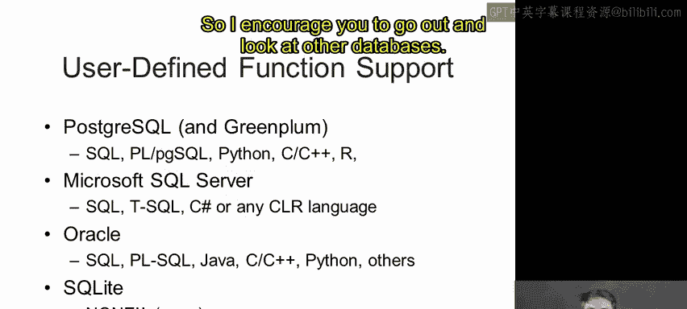
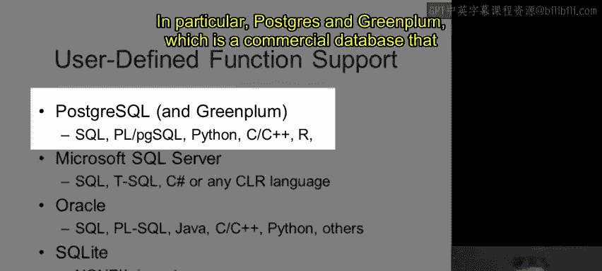

# 杜克大学《大规模数据科学（大数据操作，第1课／共3课有视频）｜Data Science at Scale》 - P40：39_用户自定义函数支持.zh_en - GPT中英字幕课程资源 - BV12s421T7tJ

。

So support for these are pretty comprehensive。 All databases have them with unfortunately a notable exception being SQL light itself。

 which is the one you're using for the assignments。 So I encourage you to go out and look at。

Other databases in particular， Postgres and greenplb， which is a commercial database that。

Is parallel and based on the Postgres code base has really。

 really excellent support for user defined functions。

SQL Ser and Oracle IBM all also have great support for it， but Postgress has a particularly clean。

Interface and was really designed way back when with extensibility in mind。

 So it was one of the first。Originally there was a research project and one of the main goals of the research project was to show that in extensible。

A database was a good idea， things you could add your own functions， add your own types。

Add your own features in various ways， okay， and so in particular。

 support for manipulating time data timestamps is quite nice there。Okay。

 so you can define these user defined functions in a variety of languages， including pure SQL。

 and you may have to sort of scratch your head to think about why that would be a good idea。

 but the short answer is that's。The same reason why defining functions is a good idea in any programming language。

 right is this notion of abstraction。Okay。And reuse。Okay， and then there's。Programming language。

Iative languages that are extensions of SQL， and Microsoft's got one called TSQL and Oracle's got one called PL SQL。

 and Postgres has one called PLPG SQL。That add things like willll run a query and save the result in a variable and then reuse that variable later。

 Or we can define variables of just primitive types like integers and reuse those。

 And there's usually also looping constructs and。あ。

Conditionals and every other kind of feature you might have in an imperative language。So。

These come up and they're useful and if you have， if youre a database administrator or you have friends or are database administrators。

 they're going to be very familiar with these languages。I'm not typically a big fan of。Using them。

 not because I don't think they're a good idea， but because I find them to be overused。

 I think there's things you can do。Without having to drop down into writing imperative program that are not always。

Recognized。The other reason。I don't like to use them is not for any kind of fundamental reason just because the。

Experience of writing code in these languages is actually kind of painful。

 they're difficult to debug because there's not great support for debugggers when things go wrong at runtime。

 they're sort of hard to figure out what's happening and so on。

While I complain a lot when I see SQL logic being pushed into the application layer。

 I complain less when。The alternative is to do it in one of these imperative。Extensions to SQL。

So don't put your joints in the application， but you can't put your loops。So fine。

 so in Microsoft SQL Ser， any kind of CLR language from dotnet can be used and they're typically needs to be sharp。

And so on Python， there's an our extension to Postgres that I haven't had much of a chance to play with yet。

 but that's kind of exciting because it gets the folks that are interested in。

Using databases with their statistics routines， a much more compelling argument of how to do so。

Okay。So that's what I wanted to say about that and we'll see examples of user design functions come up in a few different。

Places and most importantly， they'll all use the term。

 and so I want you to know that the term comes from databases and what I mean is things just any kind of code that is not provided by the system itself。

