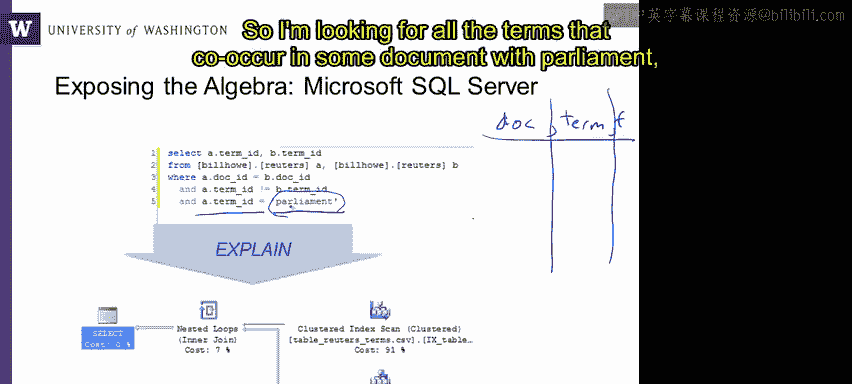
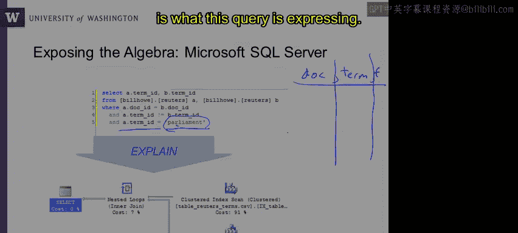

# 杜克大学《大规模数据科学（大数据操作，第1课／共3课有视频）｜Data Science at Scale》 - P41：40_优化：物理查询计划.zh_en - GPT中英字幕课程资源 - BV12s421T7tJ

。

So we talked about。Algebraic optimization， and then we talked about decorative languages on top of the algebra。

In order to simplify expression and in order to avoid specifying to the computer exactly how to do it。

 we want to leave that open and let the database figure that out。

But we stopped at what I'll call logical optimization。

 And when I want to talk a little bit about the physical level optimization。

 And what I mean by this is that even after you specified， we hinted at this last time。

 but even after you specified the order of operations。

 we haven't yet specified every detail needed in order to actually evaluate the query and let me give an example of that。

 So here's a simplified version of a query we looked at last time we say for every。Order。

 we want to find all the corresponding items。That were part of that order。

 and that's it last time we had an extra condition。So for every order， find the corresponding items。

That match and the last time we had another predicate down here and this time I've taken that out and so the algebraic plan that this translates into is very simple。

 it's just a join of the two tables and that's it。So you think we're done right we're going to join order an item and we're finished well we got to specify how we're going to do that join and so let me tell you about a couple of the options here so one。

In sort of very high level pseudocode looks like this， we could say for each record I and item。

And for each record， O and Oi。In order， check to see if those two records agree on the order fields。

 on the order attributes， and if so， return it and that's a joint result。You know， they match。

Another option。Is for each record I and item， insert that record into some sort of data structure and here I'm going to call it a hash table now I'm not too concerned about what exactly that is。

 and then second for each record O in order， go look up the corresponding records in that data structure that we found or that we built and return all the matching pairs。

Okay， and if it actually is a hash table that we're talking about， then this lookup。

Could be pretty efficient， right， It could be constant time， amortized constant time。

RightAnd so now this one says， well， for every record and item。Go scan every single record in order。

 and so we have kind of an in squared。Complexity going on here。And here we say， well。

 for every record an item， put it into a data structure。

 and then after that for every record in order， go look up those records in the hash table。

And if indeed this is constant time amortized， then this is a sort of linear time algorithm。

 So I argue that there's two different ways to implement this join that both of these are valid。

 Okay， so which one is faster， Well， I've sort of hinted that perhaps option two is faster。

 but in practice it may or may not be and so。I would pause here and ask the class to answer the question。

 but since it's over video， I can't do that。Give you a moment to think about that。

 but I want you to think about why this one in particular might be faster in some cases than this one。

 even though it seems like it shouldt never be。Okay。And let's see an example maybe in a second。

Leaving that question hanging open。I want to make the point that you have access to this underlying algebra。

 This isn't something that's all that's purely sort of theoretical。

 right this is something that you can use tomorrow if you work with databases that you're at your job。

 for example， in this particular product， Microsoft SQL server and in fact in all the products you're going to use the same sort of mechanism。

 but you can explain a query and that will give you access to some form of this algebra that I've been talking about。

 okay so if you take a query。And here I've changed the schema yet again， this table。

 this Reuters table is one you'll be working with in the homework。

I've written a query here and I've explained it and what shows what SQL management Studio did back to me is a little algebraic tree。

 kind of like the ones I've been drawing here just you know in PowerPoint okay， and so this one says。

A hash match is going to be used to implement this joint condition。

 This one's kind of a complicated join condition for a reason I'm not going to explain right now。

But it has two leaves and then they get joined with this thing called a hashmat inner join。Okay。

 and so this is very much like the hash table example I gave on the previous slide。

But I want you to take a look at something。 So here I've taken the exact same query， but I've added。

An extra condition。Where I'm only looking for words equal to Parliament。

 and I probably explain this schema a little bit。 so the Reuters data set gives you term frequencies。

 you have three columns。Doc I D， or let's just say doc。Tm。And frequency。

And the frequency is how often that term appears in that document。Okay， so this is the。

The table you'll be looking at。 And so here what I've said is。

I'm looking for pairs of terms that cooccur in a single document is the previous query I was looking at。

 and now I've said， well look， I don't want all pairs of document or all pairs of terms。

 I only want terms that co-oc with the term parliament。Right， so perhaps。

Lawyer coocs with parliament frequently， so I'm looking for the all the terms that cooc in some document with Parliament is what this query is expressing。

。